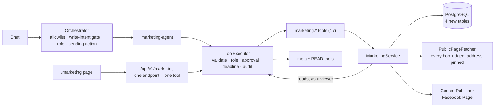

# Phase 15 — Marketing Operating System

**Date:** 2026-10-12 · **Branch:** `phase-15-marketing-os` · **Base:** `origin/main` at `625c3b8` (the merge of Phase 14, pull request #6)

**Verdict: PARTIAL.** Seven of the eleven things in scope are complete. Three are
partial, each for a stated reason. One — Google Ads — is blocked on access that
has not been granted. Nothing is simulated: where JARVIS cannot do something it
says so and leaves the capability absent.

How the workspace works, and the rules a change must not break, are in
[`../MARKETING.md`](../MARKETING.md). This file is the record of the phase:
what was asked, what was found, what was built, what was tested and how, and
what is still missing.

---

## 1. Where the scope came from

The brief named the "MDD Phase 15 scope" as the source. **That document was not
found**: not in this repository, not on the local disk, not in the connected
Drive. `docs/JARVIS-Project-Guide.doc`, the Master Development Document in the
repository, stops at Phase 10. The scope below is therefore the brief's own
list, taken as written. If the MDD says something different, this phase was
built against the brief, not against it.

| # | In scope |
|---|---|
| 1 | Social media content planning |
| 2 | Content calendar |
| 3 | Campaign workspace |
| 4 | SEO research |
| 5 | Competitor intelligence |
| 6 | Meta Ads analysis |
| 7 | Google Ads — only after its required access scope has been re-granted and verified |
| 8 | Campaign performance reporting |
| 9 | Client report generation |
| 10 | Approval-based publishing |
| 11 | Marketing recommendations |

Out of scope and not started: the Phase 16 workflow builder, the Phase 17
command-centre redesign, Phase 18 browser and computer control, Phase 19
self-repair.

---

## 2. Preflight

Checked before any file was changed.

| Check | Result |
|---|---|
| Phase 14 merged | Pull request #6, merged 2026-10-11. `origin/main` = `625c3b8` |
| CI on the pull request | Passed on its head, `f10256e` |
| CI after the merge | Passed on `625c3b8` (run 38145140636) — a separate run from the pull request's |
| Working tree | Clean |
| Branch | `phase-15-marketing-os`, created from `origin/main`, tracking nothing |
| Google Ads access | **Not granted.** The deployment database held no Google connection at all; no Google Ads developer token is configured; ledger R-6 is open |
| Meta access (read-only checks; nothing was written) | The configured token is valid and may list Pages, read their posts and create posts. One Page is reachable and allows content creation. No Page has an Instagram business account linked |

One thing found and left alone: a stray tracked file at the repository root
named `tatus --short`, from an earlier commit. It is unrelated to this phase and
was not touched.

---

## 3. The gap, before this phase

| In scope | What existed | What was missing |
|---|---|---|
| Content planning | A model could write posts in chat | Nowhere to keep them; no draft, no status |
| Content calendar | Nothing. "Calendar" meant Google Calendar | A store, dates, a screen |
| Campaign workspace | Meta campaigns (in the ad account). `MarketingAccount` rows for outcomes | A place to organise one campaign's content, research and reports |
| SEO research | An unregistered `web.research` tool. A browser agent that needs Chrome and is off in the deployment | A page reader that is safe to point at an address a user types; an audit |
| Competitor intelligence | Nothing | Everything |
| Meta Ads analysis | `meta.analyze` and `POST /api/v1/analysis`, the KPI and anomaly engines | **`meta.analyze` was offered to no model in chat** — finding F-1 |
| Google Ads | Read tools, registered only with full configuration | The Ads scope, a developer token, a connection |
| Performance reporting | Dashboard charts; ad-hoc answers written by a model | A saved, reproducible report with its sources stated |
| Client reports | An unregistered PDF tool | A report document and an export |
| Approval-based publishing | Approvals, the execution journal, pending actions, Meta **ads** writes | Any publisher of content; a publish state; verification |
| Recommendations | Ad-optimisation recommendations from the analysis pipeline | Recommendations about the marketing work itself |

---

## 4. What was built

One service, reached two ways.



| Piece | Where |
|---|---|
| Vocabulary, view types, schemas, limits | `packages/core/src/types/marketing.ts` |
| Content lifecycle and calendar; SEO audit and page comparison; report arithmetic and rendering; recommendation rules — all pure, no I/O | `packages/core/src/marketing-content.ts`, `seo-audit.ts`, `marketing-report.ts`, `marketing-recommendations.ts` |
| Four tables, additive migration, repository | `packages/db` — `20261012120000_phase15_marketing_os`, `marketing-repository.ts` |
| A page reader that validates every hop and pins the connection | `packages/browser/src/page-fetcher.ts` |
| Seventeen tools and the publisher port | `packages/tools/src/tools/marketing-tools.ts`, `marketing-publisher.ts` |
| A Facebook Page publisher | `packages/meta-graph/src/page-publisher.ts` |
| A tenth agent, its policy, its routing | `packages/agents/src/agents/marketing-agent.ts`, `agent-policy.ts`, `agent-router.ts` |
| The one implementation | `apps/api/src/services/marketing/marketing-service.ts` |
| Google Ads as a report source; the page's publish flow | `apps/api/src/services/marketing/google-ads-source.ts`, `publish-flow.ts` |
| The router | `apps/api/src/routes/marketing.ts` |
| The screen | `apps/web/src/app/marketing`, `apps/web/src/components/marketing` |

No new framework, database, queue or dependency was added. The lockfile is
unchanged.

### Two design decisions an auditor should weigh

**Why `MarketingService` and not the integration command service.** `AGENTS.md`
makes `IntegrationCommandService` the one place an *integration operation* is
implemented. Marketing is not an integration: it is a workspace in JARVIS's own
database that reads one integration and, for one action, writes to it. It
follows the shape that rule exists to guarantee — one implementation, both ways
in arriving at it through `ToolExecutor`, no provider logic in a tool, no
validation in a route, no provider call from the browser — the way memory and
the account analysis already do. Publishing was **not** added to the
integration catalogue as a Meta action: the catalogue's generic action runner
takes its parameters from the client, and a publish must take its text from the
saved item.

**Why the page has a publish flow of its own.** `MarketingPublishFlow` creates
the approval row for a publish and later runs the publish tool through
`ToolExecutor`, naming that approval. It executes nothing itself and decides
nothing: the decision is the Approvals API's, the permission check and the
parameter binding are the executor's, and the post is the tool's. It exists
because the executor's own "find or request an approval" branch has the
behaviour described in F-2, and because the page must show the exact text and
Page an approval is bound to.

---

## 5. Requirement by requirement

**Implemented** — the code is wired into the running system.
**Verified** — how, and against what.
**User-accessible** — whether a user can reach it today, and on what condition.

| # | Requirement | Status | Implemented | Verified | User-accessible |
|---|---|---|---|---|---|
| 1 | Social content planning | **Complete** | A model drafts in chat; `marketing.content.plan` saves ideas and drafts | Automated, on PostgreSQL, both ways in | Yes — chat and the Marketing page |
| 2 | Content calendar | **Complete** | Dates, a time-of-day label, statuses; thirty days at a time | Automated, on PostgreSQL | Yes. A date is a plan — nothing publishes on a date |
| 3 | Campaign workspace | **Complete** | A workspace with its content, research and reports; project-scoped | Automated, on PostgreSQL | Yes |
| 4 | SEO research | **Partial** | An audit of what one public page says about itself, by fixed rules | Automated, against a stand-in for the web; the reader itself against a local HTTP server | Only where `BROWSER_ENABLED=true` — **off in the Docker stack**. No keyword volume, ranking, traffic or backlink data: no provider of them is integrated |
| 5 | Competitor intelligence | **Partial** | One public page's facts, compared with the user's page and with the last saved reading | As 4 | As 4. Not their traffic, rankings, ads or spend |
| 6 | Meta Ads analysis | **Complete** | Existing `meta.analyze`, now actually offered in chat (F-1); the Meta read tools granted to the marketing agent; reports read the ad account | Automated: the real container for F-1; the real Meta read tools over a stand-in provider for reports | Yes, with Meta credentials. **No live read of the ad account was made by the new report path** |
| 7 | Google Ads | **Blocked** | The gate, and an honest status in every report. **No Google Ads data is read anywhere** | Automated, over the real capability service: every connection state gives a status and none gives "included" | No. Needs a developer token, a Google connection, and the Ads scope **granted** |
| 8 | Performance reporting | **Complete** | A saved report: totals, a comparison period, per-campaign rows, content, and the status of every source | Automated, on PostgreSQL: figures, partial failures, total failure, no ad account | Yes — Meta Ads and the workspace's content. Google Ads excluded |
| 9 | Client report generation | **Partial** | The same document under a client heading, exported as self-contained HTML or Markdown | Automated: headers, escaping, the file against the document | Yes, as a download. **No PDF, and nothing delivers it** |
| 10 | Approval-based publishing | **Partial** | A text post, with an optional link, to a Facebook Page — approval bound to the exact text and Page, read back before it is called published | Automated, on PostgreSQL, against a stand-in for the Page; the publisher itself against a stand-in for Meta's API. **No post was made to a live Page** | With Meta credentials and a Page the token may post to. No other channel, no images or video, no schedule |
| 11 | Marketing recommendations | **Complete** | Nineteen fixed rules over the calendar, the campaign, the latest report and saved audits; each with its evidence, each marked not carried out. No model | Automated | Yes |

---

## 6. Before and after

**Planning a week of posts.**

> **Before.** "Plan five posts for our Diwali sale" produced five posts in the
> chat. Closing the conversation lost them.
>
> **After.** The same request still produces a plan to read — and saves
> nothing, because a plan was asked for. "Save these posts to the content
> calendar" saves them as drafts, in the conversation's project, and says
> "Nothing was published." They are on the Marketing page a moment later.

**Publishing a post.**

> **Before.** Not possible. JARVIS could change an ad budget with approval and
> could not post anything.
>
> **After.** On an item marked Ready, **Publish** shows the exact text and the
> Page and posts nothing. **Approve and publish** posts it, reads it back from
> the Page, and only then shows "Published to … and read back from the Page."
> If the answer from Meta is lost, the screen says the outcome is not known,
> the item stays unpublished, and the next attempt looks for the post before it
> sends anything.

**"How did last month go?"**

> **Before.** An answer written by a model from whatever it had fetched in that
> turn. Not saved, not reproducible, and silent about what it had not read.
>
> **After.** A saved report. Its totals are arithmetic over rows that were
> read. It lists each data source and what happened to it — and says, in every
> report, that Google Ads was not read and why.

**A viewer asks to publish.**

> **Before** (and for every approval-gated tool). The viewer was shown "Reply
> 'yes' to …", and refused only on saying yes.
>
> **After.** Refused at once, with no approval created (F-3).

---

## 7. Findings

Three defects that predate this phase were found while building it.

### F-1 — `meta.analyze` was offered to no model (ledger R-34) — fixed

`apps/api/src/services/container.ts` registered the tool at the end of the
composition root, after the tool definitions every agent is handed had been
computed. It was in the registry, on three allowlists and listed as a
capability; the dashboard's button worked; "analyse my ad account" in chat
could not reach it. It is now registered before the definitions are computed,
with a late-bound reference to the service that still has to be built
afterwards. `apps/api/test/marketing-wiring-p15.test.ts` builds the real
container and reads what each agent was actually handed.

### F-2 — a rejected approval shadows a different request (ledger R-35) — not fixed

In `packages/tools/src/executor.ts`, when a caller names no approval, the
executor looks through the user's recent approvals for the tool and takes the
first rejected one **whatever its parameters**. Declining one proposal can
therefore make a later, different proposal for the same tool come back
"denied" instead of creating a new request. It fails closed — nothing runs — so
it is a usability defect, not a safety one. It was left alone because the fix
is a change to the one execution authority and deserves its own review. Phase
15 does not depend on it: both publish paths name the approval they execute,
which takes the executor's other branch. Tests in `marketing-publish-flow-p15`
and the end-to-end test show that declining one publish does not block another.

### F-3 — a role that could not run a tool was still asked to approve it (ledger R-36) — fixed

`packages/agents/src/orchestrator.ts` created a pending action, and its
approval row, before anything asked whether the caller's role could run the
tool. The executor refused at confirmation, so nothing ran; but a request
nobody could act on had been put in front of a person. The orchestrator now
asks the same question of the same role table one step earlier and audits the
refusal as `agent.tool_role_denied`. **This changes behaviour for every
approval-gated tool, not only publishing**: a viewer who asks to pause a Meta
campaign is now refused when they ask rather than when they confirm. It can
only refuse what the executor would have refused anyway.

### Two defects in this phase's own code, caught by its own tests

Recorded because they show what the tests against real parts were for.

- The report read campaign names with a call the real `meta.campaigns` tool
  rejects (it requires the account id) and looked for a field the tool does not
  return. Against a fake tool both went unnoticed; **against the real tool,
  campaign names would never have appeared**. The service is now given the
  configured ad account — as the account analysis is — and the end-to-end test
  runs the real Meta read tools over a stand-in provider.
- A report could ask for up to 366 days; the ad-account read refuses more than
  90. Every long report would have said the ad account "could not be read". The
  limit is now 90 days, and a test pins the two limits against each other.

---

## 8. Security and permission behaviour that was verified

Each line is asserted by a test that runs, not by reading the code.

| Behaviour | Where it is asserted |
|---|---|
| Chat and the page reach one store through one executor and one tool | `marketing-e2e-pg.integration` |
| The caller is the token: a user id, role, conversation or agent in a body or query is ignored | `marketing-routes-p15` |
| Only named fields of a body reach a tool; nothing can assert a publication by editing | `marketing-routes-p15`, `marketing-e2e-pg.integration` |
| A viewer can read and cannot save, edit or publish — on the page and in chat | `marketing-e2e-pg.integration`, `marketing-agent-p15`, `marketing-page` |
| One user never sees, changes, exports or publishes another's rows; another's row is "not found" | `marketing-e2e-pg.integration`, `marketing-p15-pg.integration` |
| Projects are kept apart; a model cannot name a different project from inside a conversation | `marketing-e2e-pg.integration` |
| Only the marketing agent is offered, or may call, a publish tool | `marketing-wiring-p15`, `marketing-agent-p15`, `marketing-e2e-pg.integration` |
| A publish nobody asked for creates no approval | `marketing-agent-p15`, `marketing-e2e-pg.integration` |
| Asking to publish posts nothing and creates one approval bound to the exact text and Page | `marketing-publish-flow-p15`, `marketing-e2e-pg.integration` |
| Nothing is posted on an approval that is pending, rejected, expired, another user's, for another item or for another tool | `marketing-publish-flow-p15`, `marketing-e2e-pg.integration` |
| One approval publishes at most once, including when executed twice at the same moment | `marketing-publish-flow-p15`, `marketing-e2e-pg.integration`, `marketing-p15-pg.integration` |
| Text edited after the approval is not posted; text a model wrote in place of the saved text is not posted | `marketing-e2e-pg.integration` |
| A Page renamed or lost after the approval is not posted to | `marketing-e2e-pg.integration` |
| An item is recorded as published only after the post was read back; a lost answer or a failed read-back leaves it unpublished and unconfirmed | `marketing-e2e-pg.integration`, `page-publisher-p15` |
| An unconfirmed publish is found on the Page and recorded, not posted again; while the Page cannot be checked, nothing is posted | `marketing-e2e-pg.integration` |
| The database refuses "published" without a record of how it is known | `marketing-p15-pg.integration` |
| A page read is refused for a private, loopback or link-local address, for a redirect to one, and for a name that resolves to one; the connection goes to the address that was judged | `page-fetcher-p15` |
| Page reads are limited per user, counted in the audit table | `marketing-e2e-pg.integration` |
| A page's text is marked as untrusted and carries no instruction anywhere | `marketing-tools-p15`, `marketing-e2e-pg.integration` |
| A provider's own error text and a full account id never enter a report, a response or a stored row | `marketing-e2e-pg.integration`, `page-publisher-p15` |
| The Page access token is never returned, thrown or logged | `page-publisher-p15`, `marketing-wiring-p15` |
| A report export is a download that can run nothing; a hostile title is escaped | `marketing-routes-p15`, `marketing-report-p15` |
| Google Ads is never reported as included, and no Google tool is run | `marketing-google-ads-source-p15`, `marketing-e2e-pg.integration` |
| The marketing service's own audit rows hold ids and outcomes, never the text of a post | `marketing-e2e-pg.integration` |

One thing to read precisely: the executor's generic `tool.execute` audit row
records each tool's parameters, as it does for every tool in JARVIS, after the
audit system's redaction. For a publish those parameters are the approved text
and Page; for a page read, the address as typed. That is existing behaviour and
was not changed.

---

## 9. What was verified and how

**Verified by automated tests on real parts:** the service, the repository, the
tools, `ToolExecutor`, the approval and audit and journal repositories, the
rate limiter, the orchestrator, the chat and pending-action and approvals
routes, the Meta **read** tools, the capability service, and PostgreSQL.

**Verified against stand-ins:** the three edges of the system.

| Edge | Stand-in | What that leaves unproven |
|---|---|---|
| Meta's Graph API for Pages | A fake HTTP client in `page-publisher-p15`; a fake publisher in the end-to-end test | That Meta's live API behaves as its documentation says for these calls |
| The ad account | A fake provider behind the **real** Meta read tools | A live read by the report path |
| The web | A local HTTP server for the reader; fixed HTML for the audits | Nothing about the reader's policy; real-world pages will vary |
| The model | A scripted model that proposes exactly the tool call a test queues | What a real model chooses to do. The gates are what is tested, not the model's manners |

**Read-only checks against the live Meta token**, made once before any code was
written: the token is valid, holds the Page permissions, and reaches one Page
that allows content creation. **Nothing was written to Meta at any point.**

**Driven in a real browser, against an isolated stack.** The Marketing page was
driven in headless Chrome against the built API and the web app in dev mode,
on spare ports, with a throwaway database and **no provider credentials** — so
nothing could be published. 32 checks, all passing on the final code:

- sign-in through the real form; the five views; the navigation entry;
- the document does not scroll, and there is no sideways scroll at phone width;
- a draft saved, marked ready, edited (back to a draft), and recorded as posted
  by the user — shown as "published · reported by you", never as verified, and
  with no controls afterwards;
- no Publish button on a server with no publisher, and the sentence saying why;
- a campaign workspace created and opened;
- **a real SEO audit of a live public page (`example.com`) through the real
  page reader** — HTTP 200, thirteen checks, the list of what was not measured;
- a loopback address refused, in the reader's own words, with nothing of the
  address's content shown;
- a report whose two data sources are both listed as not set up, saying it
  holds no advertising data; its HTML download; recommendations marked as
  advice with no button.

It found two things the other tests could not. Across origins a browser hides
the `Content-Disposition` header from a page, so the download was named
`report.html`: the file is now named on the client by the same function the
server uses. And a refused page address was answered with a 5xx: it is now a
`400`, because the caller's input was refused and no provider failed.

**One mistake made during that check, recorded because it matters.** The first
isolated API was started from the repository root with a cleaned environment.
`@jarvis/config` loads `./.env` from the working directory when it is imported
— by design, so that the API reads the one root file however it is launched —
so that process had the real Meta token and registered the real publisher. Its start-up line showed it, and
it was stopped at once. Only health checks had been made against it: no
marketing request, and nothing was sent to Meta. It was restarted from an empty
directory, and its start-up line — no publisher, no token, no model key — was
read before anything else was done.

**Not verified:**

- **No post was made to a live Facebook Page.**
- The publish confirmation was not driven in a real browser: the isolated
  stack had no publisher, deliberately. That path is covered in jsdom and, end
  to end against PostgreSQL, through the API.
- The stack was not built into an image, started or deployed.
- Nothing ran on GitHub. Every count below is local: Windows, Node 24.

---

## 10. Test evidence

All run on 2026-10-12, on the final code.

| Command | Result |
|---|---|
| `pnpm install --frozen-lockfile` | Clean; lockfile unchanged |
| `pnpm typecheck` | 35 of 35 tasks |
| `pnpm lint` | 19 of 19 tasks |
| `pnpm typecheck:tests` | Passed (the API's test files; the web app's are covered by `typecheck`) |
| `pnpm build` | 19 of 19 tasks, including the Next.js production build of `/marketing`. After the last edits the three workspaces they touched — `@jarvis/core`, `@jarvis/api`, `@jarvis/web` — were each rebuilt and passed; the repo-wide build was not repeated |
| `pnpm test` — every workspace, no database | **8,959 passed · 480 skipped · 0 failed** |
| `prisma migrate deploy` on a new, empty pgvector database | 30 migrations applied |
| `@jarvis/db`, all tests, on that database | 327 of 327 (25 files) |
| `@jarvis/memory`, `pg.integration` | 93 of 93 (9 files) |
| `@jarvis/api`, `pg.integration` and `sprint-1.1d-memory-e2e` | 155 of 155 (7 files) |
| Memory quality evaluation | 13 of 13 |
| CI's skip check on those four reports | 0 tests not run |
| The previous release's `migrate deploy` against that database | `No pending migrations to apply.` |
| The new CI step's selection — marketing contracts | 203 + 74 + 106 + 58 + 46 = 487 passed |
| The Marketing page in real Chrome, isolated stack | 32 of 32 checks |
| `git diff --check` | Clean |

**The 480 skipped tests** are the database-backed ones: 242 in `@jarvis/db`, 96
in `@jarvis/memory`, 142 in `@jarvis/api`. They skip when no separate test
database is configured, by design, and every one of them then ran and passed
against the fresh database in the rows below that line.

### The tests this phase added — 967

| Workspace | File | Tests |
|---|---|---|
| core | `marketing-content-p15` | 72 |
| core | `seo-audit-p15` | 52 |
| core | `marketing-recommendations-p15` | 41 |
| core | `marketing-report-p15` | 38 |
| db | `marketing-p15-pg.integration` | 51 |
| browser | `page-fetcher-p15` | 58 |
| tools | `marketing-tools-p15` | 74 |
| meta-graph | `page-publisher-p15` | 46 |
| agents | `marketing-agent-p15` | 106 |
| api | `marketing-routes-p15` | 139 |
| api | `marketing-e2e-pg.integration` | 100 |
| api | `marketing-publish-flow-p15` | 51 |
| api | `marketing-wiring-p15` | 34 |
| api | `marketing-google-ads-source-p15` | 12 |
| web | `marketing-page` | 68 |
| web | `marketing-api-client` | 25 |

### Existing tests that were changed, and why

None was weakened. Each pins a list this phase legitimately extended.

| File | Change |
|---|---|
| `core/test/skill-membership-s2` | A ninth skill, `marketing`, appended; the first eight asserted unchanged; a new test that it takes no tool from an earlier skill |
| `agents/test/mcp-policy-s8` | The general assistant's and the new agent's allowlist sizes |
| `agents/test/sprint6-agent-architecture`, `test/helpers/sprint6-harness` | Ten agents; the marketing tools in the production-like tool set |
| `agents/test/skill-catalog-authorization` | The file that declares the marketing tool ids added to the sources it reads |
| `api/test/sprint6-agent-wiring` | The mirror of the container's registration list |
| `web/test/dashboard` | "Marketing" in the pinned navigation list |
| `web/test/meta-panel` | `executeMarketingPublish` added, by name, to an explicit allowlist of client functions permitted to carry "execute" in their name. The test's own comment asks for exactly that deliberate edit; the function sends an approval id and nothing else, and changes no campaign, ad or budget |

### One change to CI

A step was **added** that runs the marketing contract tests in `@jarvis/core`,
`tools`, `agents`, `browser` and `meta-graph` by file name — 487 tests that CI
would otherwise never run, because those workspaces are not gated as a whole.
It mirrors the Phase 14 memory-contract step. No existing step was changed. It
has not run on GitHub.

---

## 11. Changed files

**New — source**

```
apps/api/src/routes/marketing.ts
apps/api/src/services/marketing/marketing-service.ts
apps/api/src/services/marketing/google-ads-source.ts
apps/api/src/services/marketing/publish-flow.ts
apps/web/src/app/marketing/layout.tsx
apps/web/src/app/marketing/page.tsx
apps/web/src/components/marketing/calendar-tab.tsx
apps/web/src/components/marketing/campaigns-tab.tsx
apps/web/src/components/marketing/research-tab.tsx
apps/web/src/components/marketing/reports-tab.tsx
apps/web/src/components/marketing/recommendations-tab.tsx
apps/web/src/components/marketing/publish-panel.tsx
apps/web/src/components/marketing/format.ts
packages/agents/src/agents/marketing-agent.ts
packages/browser/src/page-fetcher.ts
packages/core/src/marketing.ts
packages/core/src/marketing-content.ts
packages/core/src/marketing-recommendations.ts
packages/core/src/marketing-report.ts
packages/core/src/seo-audit.ts
packages/core/src/types/marketing.ts
packages/db/prisma/migrations/20261012120000_phase15_marketing_os/migration.sql
packages/db/src/repositories/marketing-repository.ts
packages/meta-graph/src/page-publisher.ts
packages/tools/src/tools/marketing-publisher.ts
packages/tools/src/tools/marketing-tools.ts
```

**New — tests:** the sixteen files in section 10.

**New — documentation:** `docs/MARKETING.md`, `docs/phases/phase-15.md`,
`docs/diagrams/marketing-workspace.mmd`,
`docs/diagrams/marketing-publish-flow.mmd`.

**Modified — source**

| File | Why |
|---|---|
| `apps/api/src/index.ts` | Mounts `/api/v1/marketing` |
| `apps/api/src/services/container.ts` | Builds and registers the marketing service, tools, agent and publish flow; registers `meta.analyze` early (F-1); exposes the role table |
| `apps/api/src/services/approval-summary.ts` | The words an approval shows for a publish |
| `apps/api/src/services/rate-limiter.ts` | The `marketing` namespace |
| `apps/web/src/lib/api.ts` | The marketing client |
| `apps/web/src/components/dashboard/nav.ts` | The navigation entry |
| `packages/agents/src/agent-policy.ts` | The marketing agent's policy and the four tool groups |
| `packages/agents/src/agent-router.ts` | Routing for marketing requests |
| `packages/agents/src/orchestrator.ts` | The role check before a pending action (F-3) |
| `packages/agents/src/pending-action-service.ts` | What a publish waiting for confirmation shows; a publish cannot be modified while it waits |
| `packages/agents/src/write-intent-gate.ts` | `save`, `schedule`, `reschedule`, `move`, `mark` count as asking for a write. Deliberately not `post` |
| `packages/agents/src/work-request-detector.ts` | A content-calendar request is a conversation, not a scheduled task |
| `packages/agents/src/index.ts`, `packages/tools/src/index.ts`, `packages/core/src/index.ts`, `packages/db/src/index.ts`, `packages/meta-graph/src/index.ts`, `packages/browser/src/index.ts` | Exports |
| `packages/browser/src/config.ts` | `isPageResearchEnabled`, `pageResearchPolicy` |
| `packages/core/package.json` | The browser-safe `./marketing` entry point. No dependency change |
| `packages/core/src/capability-catalog.ts`, `capability-presentation.ts`, `objective-extraction.ts`, `types/agent.ts` | The marketing capabilities, the ninth skill, the `marketing` agent domain |
| `packages/db/prisma/schema.prisma` | Four models and their relations |
| `.github/workflows/ci.yml` | One added step |
| `.env.example` | Two comments. No new variable |

**Modified — documentation:** `AGENTS.md`, `docs/API.md`,
`docs/ARCHITECTURE.md`, `docs/SKILLS.md`, `docs/JARVIS_CAPABILITY_MATRIX.md`,
`docs/JARVIS_USER_MANUAL.md`, `docs/DEVELOPMENT.md`, `docs/DEPLOYMENT.md`,
`docs/DOCUMENTATION_PROTOCOL.md`,
`docs/JARVIS_MASTER_AUDIT_AND_DEVELOPMENT_LEDGER.md`.

**Modified — tests:** the eight files in "Existing tests that were changed".

**Deleted:** none.

---

## 12. What is still missing, outside this repository

| For | Needed |
|---|---|
| Google Ads in reports | A Google Ads developer token (`GOOGLE_ADS_DEVELOPER_TOKEN`); a Google connection; the Ads scope **granted** by Google on that connection; then one verified live read. Until all four, the capability stays absent |
| A first real publish | Nothing more to configure — the token already holds the Page permissions. It needs a person to do it once, watching the Page |
| Page research in the Docker stack | `BROWSER_ENABLED` set to `"true"` in `docker-compose.yml`, deliberately; optionally `BROWSER_DOMAIN_ALLOWLIST` |
| Instagram publishing | Not implemented. It would also need an Instagram business account linked to a Page; the token's Pages have none |
| LinkedIn, X or any other channel | Not implemented. No provider package exists for them |
| Keyword volumes, rankings, backlinks, traffic | Not implemented. A provider of that data, and an account with it |
| PDF client reports | Not implemented. The existing PDF tool is unregistered and was left that way |

---

## 13. Limitations

- **Publishing is proven against stand-ins, not against Meta.** The publisher
  follows Meta's documented Page API and is tested against a fake of it. The
  first live post should be watched.
- Publishing is a text post with an optional link, to a Facebook Page. No
  images, video, carousels, stories or reels; no other channel; no schedule.
- A post whose text contains a word the output sanitiser removes before a model
  sees it — "password", "token", "secret" — or that is very long, cannot be
  published from chat. JARVIS says so and points to the Marketing page, where
  it works.
- When a model in chat proposes a publish with words of its own, the person is
  shown and approves those words, and the publish is then refused because they
  are not the saved text. Nothing is posted, but an approval is spent on a
  request that could not succeed. Asking through the publish check, as the
  agent is instructed to, avoids it.
- SEO and competitor research read what a page says about itself. They are not
  keyword research and not competitive intelligence in the commercial sense.
- A viewer may run a page audit and generate a report: both are reads. They
  save a research result or a report in the viewer's own workspace.
- Reports cover Meta Ads and the workspace's content. At most 90 days. No
  website or conversion analytics. Reach is not summed across campaigns.
- The Meta read tools' own row limit is 500. A report scoped to linked
  campaigns says so if more rows existed than were read.
- Content items and campaigns can be archived, not deleted. Reports and
  research results cannot be deleted at all.
- The Marketing page's publish confirmation was tested in jsdom and through the
  API, not in a real browser; the rest of the page was driven in real Chrome.
- F-2 is open.

---

## 14. Rolling back

The migration is additive: four new tables, no change to an existing one.

1. Roll the application back as [`../DEPLOYMENT.md`](../DEPLOYMENT.md)
   describes. **Do not undo the migration.**
2. A release from before Phase 15 starts against the newer database: its
   migration step reported `No pending migrations to apply.` when this was
   tried. It has no route, tool or page for the marketing tables and never
   reads or writes them.
3. The marketing rows stay where they are and are there again when the newer
   release returns.

What a rollback cannot do: **take down a post.** Anything published to a Page
stays published.

The one behaviour change outside marketing — F-3, the role check before a
pending action — goes back with the code. So does the F-1 fix.

To remove the feature without rolling back, unset nothing: it has no switch of
its own. Page research is off unless `BROWSER_ENABLED=true`, and publishing
exists only with Meta credentials; the workspace itself is always present.
