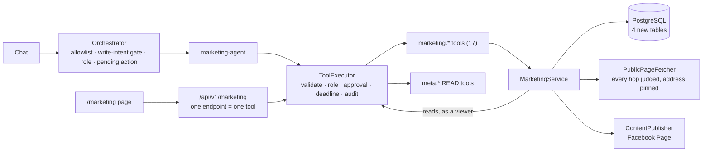

# Phase 15 — Marketing Operating System

**Date:** 2026-10-12 · **Branch:** `phase-15-marketing-os` · **Base:** `origin/main` at `625c3b8` (the merge of Phase 14, pull request #6)

**Verdict: PARTIAL.** Seven of the eleven things in scope are complete. Three are
partial, each for a stated reason. One — Google Ads — is blocked on access that
has not been granted. Nothing is simulated: where JARVIS cannot do something it
says so and leaves the capability absent.

How the workspace works, and the rules a change must not break, are in
[`../MARKETING.md`](../MARKETING.md). This file is the record of the phase:
what was asked, what was found, what was built, what was tested and how, and
what is still missing.

**Audited 2026-10-12; five findings fixed 2026-10-13.** The audit of `c9cebc7`
found no blocker, one high finding and four medium ones. What each was, what
was changed and what now proves it is in [§15](#15-audit-fixes-2026-10-13).
Sections 1 to 14 are the record as it stood at `c9cebc7`, corrected only where
a fix made a sentence untrue; the test counts in §10 are that commit's, and the
counts after the fixes are in §15.

---

## 1. Where the scope came from

The brief named the "MDD Phase 15 scope" as the source. **That document was not
found**: not in this repository, not on the local disk, not in the connected
Drive. `docs/JARVIS-Project-Guide.doc`, the Master Development Document in the
repository, stops at Phase 10. The scope below is therefore the brief's own
list, taken as written. If the MDD says something different, this phase was
built against the brief, not against it.

| # | In scope |
|---|---|
| 1 | Social media content planning |
| 2 | Content calendar |
| 3 | Campaign workspace |
| 4 | SEO research |
| 5 | Competitor intelligence |
| 6 | Meta Ads analysis |
| 7 | Google Ads — only after its required access scope has been re-granted and verified |
| 8 | Campaign performance reporting |
| 9 | Client report generation |
| 10 | Approval-based publishing |
| 11 | Marketing recommendations |

Out of scope and not started: the Phase 16 workflow builder, the Phase 17
command-centre redesign, Phase 18 browser and computer control, Phase 19
self-repair.

---

## 2. Preflight

Checked before any file was changed.

| Check | Result |
|---|---|
| Phase 14 merged | Pull request #6, merged 2026-10-11. `origin/main` = `625c3b8` |
| CI on the pull request | Passed on its head, `f10256e` |
| CI after the merge | Passed on `625c3b8` (run 38145140636) — a separate run from the pull request's |
| Working tree | Clean |
| Branch | `phase-15-marketing-os`, created from `origin/main`, tracking nothing |
| Google Ads access | **Not granted.** The deployment database held no Google connection at all; no Google Ads developer token is configured; ledger R-6 is open |
| Meta access (read-only checks; nothing was written) | The configured token is valid and may list Pages, read their posts and create posts. One Page is reachable and allows content creation. No Page has an Instagram business account linked |

One thing found and left alone: a stray tracked file at the repository root
named `tatus --short`, from an earlier commit. It is unrelated to this phase and
was not touched.

---

## 3. The gap, before this phase

| In scope | What existed | What was missing |
|---|---|---|
| Content planning | A model could write posts in chat | Nowhere to keep them; no draft, no status |
| Content calendar | Nothing. "Calendar" meant Google Calendar | A store, dates, a screen |
| Campaign workspace | Meta campaigns (in the ad account). `MarketingAccount` rows for outcomes | A place to organise one campaign's content, research and reports |
| SEO research | An unregistered `web.research` tool. A browser agent that needs Chrome and is off in the deployment | A page reader that is safe to point at an address a user types; an audit |
| Competitor intelligence | Nothing | Everything |
| Meta Ads analysis | `meta.analyze` and `POST /api/v1/analysis`, the KPI and anomaly engines | **`meta.analyze` was offered to no model in chat** — finding F-1 |
| Google Ads | Read tools, registered only with full configuration | The Ads scope, a developer token, a connection |
| Performance reporting | Dashboard charts; ad-hoc answers written by a model | A saved, reproducible report with its sources stated |
| Client reports | An unregistered PDF tool | A report document and an export |
| Approval-based publishing | Approvals, the execution journal, pending actions, Meta **ads** writes | Any publisher of content; a publish state; verification |
| Recommendations | Ad-optimisation recommendations from the analysis pipeline | Recommendations about the marketing work itself |

---

## 4. What was built

One service, reached two ways.



| Piece | Where |
|---|---|
| Vocabulary, view types, schemas, limits | `packages/core/src/types/marketing.ts` |
| Content lifecycle and calendar; SEO audit and page comparison; report arithmetic and rendering; recommendation rules — all pure, no I/O | `packages/core/src/marketing-content.ts`, `seo-audit.ts`, `marketing-report.ts`, `marketing-recommendations.ts` |
| Four tables, additive migration, repository | `packages/db` — `20261012120000_phase15_marketing_os`, `marketing-repository.ts` |
| A page reader that validates every hop and pins the connection | `packages/browser/src/page-fetcher.ts` |
| Seventeen tools and the publisher port | `packages/tools/src/tools/marketing-tools.ts`, `marketing-publisher.ts` |
| A Facebook Page publisher | `packages/meta-graph/src/page-publisher.ts` |
| A tenth agent, its policy, its routing | `packages/agents/src/agents/marketing-agent.ts`, `agent-policy.ts`, `agent-router.ts` |
| The one implementation | `apps/api/src/services/marketing/marketing-service.ts` |
| Google Ads as a report source; the page's publish flow | `apps/api/src/services/marketing/google-ads-source.ts`, `publish-flow.ts` |
| The router | `apps/api/src/routes/marketing.ts` |
| The screen | `apps/web/src/app/marketing`, `apps/web/src/components/marketing` |

No new framework, database, queue or dependency was added. The lockfile is
unchanged.

### Two design decisions an auditor should weigh

**Why `MarketingService` and not the integration command service.** `AGENTS.md`
makes `IntegrationCommandService` the one place an *integration operation* is
implemented. Marketing is not an integration: it is a workspace in JARVIS's own
database that reads one integration and, for one action, writes to it. It
follows the shape that rule exists to guarantee — one implementation, both ways
in arriving at it through `ToolExecutor`, no provider logic in a tool, no
validation in a route, no provider call from the browser — the way memory and
the account analysis already do. Publishing was **not** added to the
integration catalogue as a Meta action: the catalogue's generic action runner
takes its parameters from the client, and a publish must take its text from the
saved item.

**Why the page has a publish flow of its own.** `MarketingPublishFlow` creates
the approval row for a publish and later runs the publish tool through
`ToolExecutor`, naming that approval. It executes nothing itself and decides
nothing: the decision is the Approvals API's, the permission check and the
parameter binding are the executor's, and the post is the tool's. It exists
because the executor's own "find or request an approval" branch has the
behaviour described in F-2, and because the page must show the exact text and
Page an approval is bound to.

---

## 5. Requirement by requirement

**Implemented** — the code is wired into the running system.
**Verified** — how, and against what.
**User-accessible** — whether a user can reach it today, and on what condition.

| # | Requirement | Status | Implemented | Verified | User-accessible |
|---|---|---|---|---|---|
| 1 | Social content planning | **Complete** | A model drafts in chat; `marketing.content.plan` saves ideas and drafts | Automated, on PostgreSQL, both ways in | Yes — chat and the Marketing page |
| 2 | Content calendar | **Complete** | Dates, a time-of-day label, statuses; thirty days at a time | Automated, on PostgreSQL | Yes. A date is a plan — nothing publishes on a date |
| 3 | Campaign workspace | **Complete** | A workspace with its content, research and reports; project-scoped | Automated, on PostgreSQL | Yes |
| 4 | SEO research | **Partial** | An audit of what one public page says about itself, by fixed rules | Automated, against a stand-in for the web; the reader itself against a local HTTP server | Only where `BROWSER_ENABLED=true` — **off in the Docker stack**. No keyword volume, ranking, traffic or backlink data: no provider of them is integrated |
| 5 | Competitor intelligence | **Partial** | One public page's facts, compared with the user's page and with the last saved reading | As 4 | As 4. Not their traffic, rankings, ads or spend |
| 6 | Meta Ads analysis | **Complete** | Existing `meta.analyze`, now actually offered in chat (F-1); the Meta read tools granted to the marketing agent; reports read the ad account | Automated: the real container for F-1; the real Meta read tools over a stand-in provider for reports | Yes, with Meta credentials. **No live read of the ad account was made by the new report path** |
| 7 | Google Ads | **Blocked** | The gate, and an honest status in every report. **No Google Ads data is read anywhere** | Automated, over the real capability service: every connection state gives a status and none gives "included" | No. Needs a developer token, a Google connection, and the Ads scope **granted** |
| 8 | Performance reporting | **Complete** | A saved report: totals, a comparison period, per-campaign rows, content, and the status of every source | Automated, on PostgreSQL: figures, partial failures, total failure, no ad account | Yes — Meta Ads and the workspace's content. Google Ads excluded |
| 9 | Client report generation | **Partial** | The same document under a client heading, exported as self-contained HTML or Markdown | Automated: headers, escaping, the file against the document | Yes, as a download. **No PDF, and nothing delivers it** |
| 10 | Approval-based publishing | **Partial** | A text post, with an optional link, to a Facebook Page — approval bound to the exact text and Page, read back **with its text** before it is called published. Off unless `MARKETING_PUBLISH_ENABLED=true` (§15) | Automated, on PostgreSQL, against a stand-in for the Page; the publisher itself against a stand-in for Meta's API. **No post was made to a live Page** | With the switch on, Meta credentials and a Page the token may post to. No other channel, no images or video, no schedule |
| 11 | Marketing recommendations | **Complete** | Nineteen fixed rules over the calendar, the campaign, the latest report and saved audits; each with its evidence, each marked not carried out. No model | Automated | Yes |

---

## 6. Before and after

**Planning a week of posts.**

> **Before.** "Plan five posts for our Diwali sale" produced five posts in the
> chat. Closing the conversation lost them.
>
> **After.** The same request still produces a plan to read — and saves
> nothing, because a plan was asked for. "Save these posts to the content
> calendar" saves them as drafts, in the conversation's project, and says
> "Nothing was published." They are on the Marketing page a moment later.

**Publishing a post.**

> **Before.** Not possible. JARVIS could change an ad budget with approval and
> could not post anything.
>
> **After.** On an item marked Ready, **Publish** shows the exact text and the
> Page and posts nothing. **Approve and publish** posts it, reads it back from
> the Page, and only then shows "Published to … and read back from the Page."
> If the answer from Meta is lost, the screen says the outcome is not known,
> the item stays unpublished, and the next attempt looks for the post before it
> sends anything.

**"How did last month go?"**

> **Before.** An answer written by a model from whatever it had fetched in that
> turn. Not saved, not reproducible, and silent about what it had not read.
>
> **After.** A saved report. Its totals are arithmetic over rows that were
> read. It lists each data source and what happened to it — and says, in every
> report, that Google Ads was not read and why.

**A viewer asks to publish.**

> **Before** (and for every approval-gated tool). The viewer was shown "Reply
> 'yes' to …", and refused only on saying yes.
>
> **After.** Refused at once, with no approval created (F-3).

---

## 7. Findings

Three defects that predate this phase were found while building it.

### F-1 — `meta.analyze` was offered to no model (ledger R-34) — fixed

`apps/api/src/services/container.ts` registered the tool at the end of the
composition root, after the tool definitions every agent is handed had been
computed. It was in the registry, on three allowlists and listed as a
capability; the dashboard's button worked; "analyse my ad account" in chat
could not reach it. It is now registered before the definitions are computed,
with a late-bound reference to the service that still has to be built
afterwards. `apps/api/test/marketing-wiring-p15.test.ts` builds the real
container and reads what each agent was actually handed.

### F-2 — a rejected approval shadows a different request (ledger R-35) — not fixed

In `packages/tools/src/executor.ts`, when a caller names no approval, the
executor looks through the user's recent approvals for the tool and takes the
first rejected one **whatever its parameters**. Declining one proposal can
therefore make a later, different proposal for the same tool come back
"denied" instead of creating a new request. It fails closed — nothing runs — so
it is a usability defect, not a safety one. It was left alone because the fix
is a change to the one execution authority and deserves its own review. Phase
15 does not depend on it: both publish paths name the approval they execute,
which takes the executor's other branch. Tests in `marketing-publish-flow-p15`
and the end-to-end test show that declining one publish does not block another.

### F-3 — a role that could not run a tool was still asked to approve it (ledger R-36) — fixed

`packages/agents/src/orchestrator.ts` created a pending action, and its
approval row, before anything asked whether the caller's role could run the
tool. The executor refused at confirmation, so nothing ran; but a request
nobody could act on had been put in front of a person. The orchestrator now
asks the same question of the same role table one step earlier and audits the
refusal as `agent.tool_role_denied`. **This changes behaviour for every
approval-gated tool, not only publishing**: a viewer who asks to pause a Meta
campaign is now refused when they ask rather than when they confirm. It can
only refuse what the executor would have refused anyway.

### Two defects in this phase's own code, caught by its own tests

Recorded because they show what the tests against real parts were for.

- The report read campaign names with a call the real `meta.campaigns` tool
  rejects (it requires the account id) and looked for a field the tool does not
  return. Against a fake tool both went unnoticed; **against the real tool,
  campaign names would never have appeared**. The service is now given the
  configured ad account — as the account analysis is — and the end-to-end test
  runs the real Meta read tools over a stand-in provider.
- A report could ask for up to 366 days; the ad-account read refuses more than
  90. Every long report would have said the ad account "could not be read". The
  limit is now 90 days, and a test pins the two limits against each other.

---

## 8. Security and permission behaviour that was verified

Each line is asserted by a test that runs, not by reading the code.

| Behaviour | Where it is asserted |
|---|---|
| Chat and the page reach one store through one executor and one tool | `marketing-e2e-pg.integration` |
| The caller is the token: a user id, role, conversation or agent in a body or query is ignored | `marketing-routes-p15` |
| Only named fields of a body reach a tool; nothing can assert a publication by editing | `marketing-routes-p15`, `marketing-e2e-pg.integration` |
| A viewer can read and cannot save, edit or publish — on the page and in chat | `marketing-e2e-pg.integration`, `marketing-agent-p15`, `marketing-page` |
| One user never sees, changes, exports or publishes another's rows; another's row is "not found" | `marketing-e2e-pg.integration`, `marketing-p15-pg.integration` |
| Projects are kept apart; a model cannot name a different project from inside a conversation | `marketing-e2e-pg.integration` |
| Only the marketing agent is offered, or may call, a publish tool | `marketing-wiring-p15`, `marketing-agent-p15`, `marketing-e2e-pg.integration` |
| A publish nobody asked for creates no approval | `marketing-agent-p15`, `marketing-e2e-pg.integration` |
| Asking to publish posts nothing and creates one approval bound to the exact text and Page | `marketing-publish-flow-p15`, `marketing-e2e-pg.integration` |
| Nothing is posted on an approval that is pending, rejected, expired, another user's, for another item or for another tool | `marketing-publish-flow-p15`, `marketing-e2e-pg.integration` |
| One approval publishes at most once, including when executed twice at the same moment | `marketing-publish-flow-p15`, `marketing-e2e-pg.integration`, `marketing-p15-pg.integration` |
| Text edited after the approval is not posted; text a model wrote in place of the saved text is not posted | `marketing-e2e-pg.integration` |
| A Page renamed or lost after the approval is not posted to | `marketing-e2e-pg.integration` |
| An item is recorded as published only after the post was read back **and its text is the item's text** — on the first attempt and on a retry; a lost answer, a failed read-back, other text or no text leaves it unpublished and unconfirmed | `marketing-e2e-pg.integration`, `page-publisher-p15` |
| An unconfirmed publish is found on the Page it was sent to and recorded, not posted again; **when it is not found, or the Page cannot be checked, nothing is posted** | `marketing-e2e-pg.integration` |
| An unconfirmed item cannot be edited, and a retry cannot name another Page or carry other words — from the page or from chat | `marketing-e2e-pg.integration`, `marketing-p15-pg.integration` |
| Only a person settles an unconfirmed publish: no agent is offered the tool, a call from chat is refused, and the decision is audited with ids only | `marketing-e2e-pg.integration`, `marketing-wiring-p15`, `marketing-agent-p15`, `marketing-tools-p15` |
| With `MARKETING_PUBLISH_ENABLED` not exactly `true`, no publish tool is registered and no approval for a publish is created, from the page or from chat | `marketing-wiring-p15`, `page-publisher-p15`, `marketing-e2e-pg.integration` |
| The database refuses "published" without a record of how it is known | `marketing-p15-pg.integration` |
| A page read is refused for a private, loopback or link-local address, for a redirect to one, and for a name that resolves to one; the connection goes to the address that was judged | `page-fetcher-p15` |
| Page reads, reports and publish checks are limited per user, and the limit holds for requests that arrive together: a slot is reserved in the audit table, atomically, before the provider is called | `marketing-e2e-pg.integration`, `marketing-p15-pg.integration`, `marketing-limits-p15` |
| A page's text is marked as untrusted and carries no instruction anywhere | `marketing-tools-p15`, `marketing-e2e-pg.integration` |
| A provider's own error text and a full account id never enter a report, a response or a stored row | `marketing-e2e-pg.integration`, `page-publisher-p15` |
| The Page access token is never returned, thrown or logged | `page-publisher-p15`, `marketing-wiring-p15` |
| A report export is a download that can run nothing; a hostile title is escaped | `marketing-routes-p15`, `marketing-report-p15` |
| Google Ads is never reported as included, and no Google tool is run | `marketing-google-ads-source-p15`, `marketing-e2e-pg.integration` |
| The marketing service's own audit rows hold ids and outcomes, never the text of a post | `marketing-e2e-pg.integration` |

One thing to read precisely: the executor's generic `tool.execute` audit row
records each tool's parameters, as it does for every tool in JARVIS, after the
audit system's redaction. For a publish those parameters are the approved text
and Page; for a page read, the address as typed. That is existing behaviour and
was not changed.

---

## 9. What was verified and how

**Verified by automated tests on real parts:** the service, the repository, the
tools, `ToolExecutor`, the approval and audit and journal repositories, the
rate limiter, the orchestrator, the chat and pending-action and approvals
routes, the Meta **read** tools, the capability service, and PostgreSQL.

**Verified against stand-ins:** the three edges of the system.

| Edge | Stand-in | What that leaves unproven |
|---|---|---|
| Meta's Graph API for Pages | A fake HTTP client in `page-publisher-p15`; a fake publisher in the end-to-end test | That Meta's live API behaves as its documentation says for these calls |
| The ad account | A fake provider behind the **real** Meta read tools | A live read by the report path |
| The web | A local HTTP server for the reader; fixed HTML for the audits | Nothing about the reader's policy; real-world pages will vary |
| The model | A scripted model that proposes exactly the tool call a test queues | What a real model chooses to do. The gates are what is tested, not the model's manners |

**Read-only checks against the live Meta token**, made once before any code was
written: the token is valid, holds the Page permissions, and reaches one Page
that allows content creation. **Nothing was written to Meta at any point.**

**Driven in a real browser, against an isolated stack.** The Marketing page was
driven in headless Chrome against the built API and the web app in dev mode,
on spare ports, with a throwaway database and **no provider credentials** — so
nothing could be published. 32 checks, all passing on the final code:

- sign-in through the real form; the five views; the navigation entry;
- the document does not scroll, and there is no sideways scroll at phone width;
- a draft saved, marked ready, edited (back to a draft), and recorded as posted
  by the user — shown as "published · reported by you", never as verified, and
  with no controls afterwards;
- no Publish button on a server with no publisher, and the sentence saying why;
- a campaign workspace created and opened;
- **a real SEO audit of a live public page (`example.com`) through the real
  page reader** — HTTP 200, thirteen checks, the list of what was not measured;
- a loopback address refused, in the reader's own words, with nothing of the
  address's content shown;
- a report whose two data sources are both listed as not set up, saying it
  holds no advertising data; its HTML download; recommendations marked as
  advice with no button.

It found two things the other tests could not. Across origins a browser hides
the `Content-Disposition` header from a page, so the download was named
`report.html`: the file is now named on the client by the same function the
server uses. And a refused page address was answered with a 5xx: it is now a
`400`, because the caller's input was refused and no provider failed.

**One mistake made during that check, recorded because it matters.** The first
isolated API was started from the repository root with a cleaned environment.
`@jarvis/config` loads `./.env` from the working directory when it is imported
— by design, so that the API reads the one root file however it is launched —
so that process had the real Meta token and registered the real publisher. Its start-up line showed it, and
it was stopped at once. Only health checks had been made against it: no
marketing request, and nothing was sent to Meta. It was restarted from an empty
directory, and its start-up line — no publisher, no token, no model key — was
read before anything else was done.

**Not verified:**

- **No post was made to a live Facebook Page.**
- The publish confirmation was not driven in a real browser: the isolated
  stack had no publisher, deliberately. That path is covered in jsdom and, end
  to end against PostgreSQL, through the API.
- The stack was not built into an image, started or deployed.
- Nothing ran on GitHub. Every count below is local: Windows, Node 24.

---

## 10. Test evidence

All run on 2026-10-12, on the final code.

| Command | Result |
|---|---|
| `pnpm install --frozen-lockfile` | Clean; lockfile unchanged |
| `pnpm typecheck` | 35 of 35 tasks |
| `pnpm lint` | 19 of 19 tasks |
| `pnpm typecheck:tests` | Passed (the API's test files; the web app's are covered by `typecheck`) |
| `pnpm build` | 19 of 19 tasks, including the Next.js production build of `/marketing`. After the last edits the three workspaces they touched — `@jarvis/core`, `@jarvis/api`, `@jarvis/web` — were each rebuilt and passed; the repo-wide build was not repeated |
| `pnpm test` — every workspace, no database | **8,959 passed · 480 skipped · 0 failed** |
| `prisma migrate deploy` on a new, empty pgvector database | 30 migrations applied |
| `@jarvis/db`, all tests, on that database | 327 of 327 (25 files) |
| `@jarvis/memory`, `pg.integration` | 93 of 93 (9 files) |
| `@jarvis/api`, `pg.integration` and `sprint-1.1d-memory-e2e` | 155 of 155 (7 files) |
| Memory quality evaluation | 13 of 13 |
| CI's skip check on those four reports | 0 tests not run |
| The previous release's `migrate deploy` against that database | `No pending migrations to apply.` |
| The new CI step's selection — marketing contracts | 203 + 74 + 106 + 58 + 46 = 487 passed |
| The Marketing page in real Chrome, isolated stack | 32 of 32 checks |
| `git diff --check` | Clean |

**The 480 skipped tests** are the database-backed ones: 242 in `@jarvis/db`, 96
in `@jarvis/memory`, 142 in `@jarvis/api`. They skip when no separate test
database is configured, by design, and every one of them then ran and passed
against the fresh database in the rows below that line.

### The tests this phase added — 967

| Workspace | File | Tests |
|---|---|---|
| core | `marketing-content-p15` | 72 |
| core | `seo-audit-p15` | 52 |
| core | `marketing-recommendations-p15` | 41 |
| core | `marketing-report-p15` | 38 |
| db | `marketing-p15-pg.integration` | 51 |
| browser | `page-fetcher-p15` | 58 |
| tools | `marketing-tools-p15` | 74 |
| meta-graph | `page-publisher-p15` | 46 |
| agents | `marketing-agent-p15` | 106 |
| api | `marketing-routes-p15` | 139 |
| api | `marketing-e2e-pg.integration` | 100 |
| api | `marketing-publish-flow-p15` | 51 |
| api | `marketing-wiring-p15` | 34 |
| api | `marketing-google-ads-source-p15` | 12 |
| web | `marketing-page` | 68 |
| web | `marketing-api-client` | 25 |

### Existing tests that were changed, and why

None was weakened. Each pins a list this phase legitimately extended.

| File | Change |
|---|---|
| `core/test/skill-membership-s2` | A ninth skill, `marketing`, appended; the first eight asserted unchanged; a new test that it takes no tool from an earlier skill |
| `agents/test/mcp-policy-s8` | The general assistant's and the new agent's allowlist sizes |
| `agents/test/sprint6-agent-architecture`, `test/helpers/sprint6-harness` | Ten agents; the marketing tools in the production-like tool set |
| `agents/test/skill-catalog-authorization` | The file that declares the marketing tool ids added to the sources it reads |
| `api/test/sprint6-agent-wiring` | The mirror of the container's registration list |
| `web/test/dashboard` | "Marketing" in the pinned navigation list |
| `web/test/meta-panel` | `executeMarketingPublish` added, by name, to an explicit allowlist of client functions permitted to carry "execute" in their name. The test's own comment asks for exactly that deliberate edit; the function sends an approval id and nothing else, and changes no campaign, ad or budget |

### One change to CI

A step was **added** that runs the marketing contract tests in `@jarvis/core`,
`tools`, `agents`, `browser` and `meta-graph` by file name — 487 tests that CI
would otherwise never run, because those workspaces are not gated as a whole.
It mirrors the Phase 14 memory-contract step. No existing step was changed. It
has not run on GitHub.

---

## 11. Changed files

**New — source**

```
apps/api/src/routes/marketing.ts
apps/api/src/services/marketing/marketing-service.ts
apps/api/src/services/marketing/google-ads-source.ts
apps/api/src/services/marketing/publish-flow.ts
apps/web/src/app/marketing/layout.tsx
apps/web/src/app/marketing/page.tsx
apps/web/src/components/marketing/calendar-tab.tsx
apps/web/src/components/marketing/campaigns-tab.tsx
apps/web/src/components/marketing/research-tab.tsx
apps/web/src/components/marketing/reports-tab.tsx
apps/web/src/components/marketing/recommendations-tab.tsx
apps/web/src/components/marketing/publish-panel.tsx
apps/web/src/components/marketing/format.ts
packages/agents/src/agents/marketing-agent.ts
packages/browser/src/page-fetcher.ts
packages/core/src/marketing.ts
packages/core/src/marketing-content.ts
packages/core/src/marketing-recommendations.ts
packages/core/src/marketing-report.ts
packages/core/src/seo-audit.ts
packages/core/src/types/marketing.ts
packages/db/prisma/migrations/20261012120000_phase15_marketing_os/migration.sql
packages/db/src/repositories/marketing-repository.ts
packages/meta-graph/src/page-publisher.ts
packages/tools/src/tools/marketing-publisher.ts
packages/tools/src/tools/marketing-tools.ts
```

**New — tests:** the sixteen files in section 10.

**New — documentation:** `docs/MARKETING.md`, `docs/phases/phase-15.md`,
`docs/diagrams/marketing-workspace.mmd`,
`docs/diagrams/marketing-publish-flow.mmd`.

**Modified — source**

| File | Why |
|---|---|
| `apps/api/src/index.ts` | Mounts `/api/v1/marketing` |
| `apps/api/src/services/container.ts` | Builds and registers the marketing service, tools, agent and publish flow; registers `meta.analyze` early (F-1); exposes the role table |
| `apps/api/src/services/approval-summary.ts` | The words an approval shows for a publish |
| `apps/api/src/services/rate-limiter.ts` | The `marketing` namespace |
| `apps/web/src/lib/api.ts` | The marketing client |
| `apps/web/src/components/dashboard/nav.ts` | The navigation entry |
| `packages/agents/src/agent-policy.ts` | The marketing agent's policy and the four tool groups |
| `packages/agents/src/agent-router.ts` | Routing for marketing requests |
| `packages/agents/src/orchestrator.ts` | The role check before a pending action (F-3) |
| `packages/agents/src/pending-action-service.ts` | What a publish waiting for confirmation shows; a publish cannot be modified while it waits |
| `packages/agents/src/write-intent-gate.ts` | `save`, `schedule`, `reschedule`, `move`, `mark` count as asking for a write. Deliberately not `post` |
| `packages/agents/src/work-request-detector.ts` | A content-calendar request is a conversation, not a scheduled task |
| `packages/agents/src/index.ts`, `packages/tools/src/index.ts`, `packages/core/src/index.ts`, `packages/db/src/index.ts`, `packages/meta-graph/src/index.ts`, `packages/browser/src/index.ts` | Exports |
| `packages/browser/src/config.ts` | `isPageResearchEnabled`, `pageResearchPolicy` |
| `packages/core/package.json` | The browser-safe `./marketing` entry point. No dependency change |
| `packages/core/src/capability-catalog.ts`, `capability-presentation.ts`, `objective-extraction.ts`, `types/agent.ts` | The marketing capabilities, the ninth skill, the `marketing` agent domain |
| `packages/db/prisma/schema.prisma` | Four models and their relations |
| `.github/workflows/ci.yml` | One added step |
| `.env.example` | Two comments. No new variable |

**Modified — documentation:** `AGENTS.md`, `docs/API.md`,
`docs/ARCHITECTURE.md`, `docs/SKILLS.md`, `docs/JARVIS_CAPABILITY_MATRIX.md`,
`docs/JARVIS_USER_MANUAL.md`, `docs/DEVELOPMENT.md`, `docs/DEPLOYMENT.md`,
`docs/DOCUMENTATION_PROTOCOL.md`,
`docs/JARVIS_MASTER_AUDIT_AND_DEVELOPMENT_LEDGER.md`.

**Modified — tests:** the eight files in "Existing tests that were changed".

**Deleted:** none.

---

## 12. What is still missing, outside this repository

| For | Needed |
|---|---|
| Google Ads in reports | A Google Ads developer token (`GOOGLE_ADS_DEVELOPER_TOKEN`); a Google connection; the Ads scope **granted** by Google on that connection; then one verified live read. Until all four, the capability stays absent |
| A first real publish | Nothing more to configure — the token already holds the Page permissions. It needs a person to do it once, watching the Page |
| Page research in the Docker stack | `BROWSER_ENABLED` set to `"true"` in `docker-compose.yml`, deliberately; optionally `BROWSER_DOMAIN_ALLOWLIST` |
| Instagram publishing | Not implemented. It would also need an Instagram business account linked to a Page; the token's Pages have none |
| LinkedIn, X or any other channel | Not implemented. No provider package exists for them |
| Keyword volumes, rankings, backlinks, traffic | Not implemented. A provider of that data, and an account with it |
| PDF client reports | Not implemented. The existing PDF tool is unregistered and was left that way |

---

## 13. Limitations

- **Publishing is proven against stand-ins, not against Meta.** The publisher
  follows Meta's documented Page API and is tested against a fake of it. The
  first live post should be watched.
- Publishing is a text post with an optional link, to a Facebook Page. No
  images, video, carousels, stories or reels; no other channel; no schedule.
- A post whose text contains a word the output sanitiser removes before a model
  sees it — "password", "token", "secret" — or that is very long, cannot be
  published from chat. JARVIS says so and points to the Marketing page, where
  it works.
- When a model in chat proposes a publish with words of its own, the person is
  shown and approves those words, and the publish is then refused because they
  are not the saved text. Nothing is posted, but an approval is spent on a
  request that could not succeed. Asking through the publish check, as the
  agent is instructed to, avoids it.
- SEO and competitor research read what a page says about itself. They are not
  keyword research and not competitive intelligence in the commercial sense.
- A viewer may run a page audit and generate a report: both are reads. They
  save a research result or a report in the viewer's own workspace.
- Reports cover Meta Ads and the workspace's content. At most 90 days. No
  website or conversion analytics. Reach is not summed across campaigns.
- The Meta read tools' own row limit is 500. A report scoped to linked
  campaigns says so if more rows existed than were read.
- Content items and campaigns can be archived, not deleted. Reports and
  research results cannot be deleted at all.
- The Marketing page's publish confirmation was tested in jsdom and through the
  API, not in a real browser; the rest of the page was driven in real Chrome.
  The controls added by the audit fixes — settling an unconfirmed publish — were
  tested in jsdom and through the API only.
- **A duplicate post is not impossible, only never the system's own doing.**
  After an unknown outcome JARVIS sends nothing until a person says the first
  post did not happen and JARVIS, looking, does not find it. If the first post
  is in fact live and is not returned when JARVIS looks — it reads the post by
  its id when it has one, and otherwise the Page's 25 most recent posts for the
  exact text — and the person says it was not published, publishing again posts
  it again.
- **Publishing is off by default** since the audit fixes. A deployment that
  wants it sets `MARKETING_PUBLISH_ENABLED=true`.
- An unconfirmed item cannot be edited or archived until it is settled. If the
  Page cannot be read — the token was revoked, say — the only way out is "I
  posted this myself", or restoring the connection.
- The audit's low findings were left as they are (§15).
- F-2 is open.

---

## 14. Rolling back

The migration is additive: four new tables, no change to an existing one.

1. Roll the application back as [`../DEPLOYMENT.md`](../DEPLOYMENT.md)
   describes. **Do not undo the migration.**
2. A release from before Phase 15 starts against the newer database: its
   migration step reported `No pending migrations to apply.` when this was
   tried. It has no route, tool or page for the marketing tables and never
   reads or writes them.
3. The marketing rows stay where they are and are there again when the newer
   release returns.

What a rollback cannot do: **take down a post.** Anything published to a Page
stays published.

The one behaviour change outside marketing — F-3, the role check before a
pending action — goes back with the code. So does the F-1 fix.

To remove the feature without rolling back, unset nothing: it has no switch of
its own. Page research is off unless `BROWSER_ENABLED=true`, and publishing
exists only with Meta credentials; the workspace itself is always present.

---

## 15. Audit fixes (2026-10-13)

The audit of `c9cebc7` returned **READY AFTER FIXES**: no blocker, one high
finding, four medium, ten low. The five below are fixed. The low findings were
deliberately left as they are, with one exception that a fix required (see
"What was not changed").

**State:** the fixes are in the working tree of `phase-15-marketing-os`, on top
of `c9cebc7`. They are **not committed, not pushed, and no pull request
exists**. Nothing was posted to a Page and no call was made to Meta.

### The five findings, and what was done

**1 — HIGH (R-37). A retry could record "published · verified" without
verifying the text or the Page.**
The reconcile branch finalised any post found by the kept id, with no text
comparison; recorded the newly approved Page's name; and the item could be
edited while unconfirmed.

- A post is recorded only when **the text read back is the item's text** — on
  the first attempt and on a retry. A post with other text, or with no text at
  all, is not confirmed (`VERIFY_MISMATCH`, `VERIFY_NO_TEXT`,
  `RECONCILE_MISMATCH`).
- `claimForPublish` now says what it took — an item with no publish outstanding
  (`FRESH`), or one whose publish is unconfirmed — and, with a fresh claim,
  writes **where the attempt is going and a hash of what it sends** in the same
  statement. That record is the original attempt and is kept as it is across
  retries, including for an attempt whose process died before it could report.
- A retry is **held to that record**: another Page (`TARGET_CHANGED`) or other
  words (`TEXT_CHANGED`) is refused — by the publish check, so no approval is
  created from the page, and again under the claim, so an approval made in chat
  sends nothing.
- **An unconfirmed item cannot be edited** — one conditional `UPDATE` that
  applies only while the publish state is `NONE`.

**2 — MEDIUM (R-38). After a lost answer, a retry that did not find the post
posted again.**

- **Nothing is sent for an unconfirmed item.** Only a claim taken from an item
  with no publish outstanding may send; a retry of an unconfirmed publish only
  looks. Not found → still unconfirmed, `NOT_FOUND_ON_PAGE`, nothing sent.
- Leaving that state takes the post being found, "I posted this myself", or a
  new tool, **`marketing.publish.resolve`**: a person says "it was not
  published", JARVIS looks once more, and the attempt is cleared only if the
  post is not there (found → recorded as published instead; a post with other
  text, or a Page that cannot be read → nothing changes). It runs through
  `ToolExecutor`, needs `write`, is on **no agent's allowlist**, refuses a call
  that carries an agent or a conversation, and audits the decision
  (`marketing.publish.resolve`: item, decision, what was found — ids only).
  `POST /api/v1/marketing/content/:id/publish/resolve` is its one endpoint.
- The user manual, `MARKETING.md`, the API reference and the service's own
  sentences no longer say a post cannot appear twice. They say what is
  guaranteed and what is not (§13).

**3 — MEDIUM (R-39). The page-read limit did not hold for simultaneous
requests.**

- `PrismaAuditRepository.reserveSlot`: one transaction that takes an advisory
  lock keyed on the user and the action, counts the window, and writes the
  reservation row — or writes nothing. `AtomicRateLimiter` wraps it and **fails
  closed**. The slot is taken before the page is fetched, one per page.

**4 — MEDIUM (R-40). Reports and publish checks called Meta with no limit; a
report's cap was checked after the reads.**

- Reports: 10 per user per 10 minutes, and the 500-report cap, are both
  answered **before any read of the ad account**. Publish checks (and the look
  made when a person settles an unconfirmed publish): 60 per user per 10
  minutes, taken before the provider is asked which Pages it may post to. A
  refused request runs no `meta.*` tool, asks the publisher nothing and creates
  no approval.

**5 — MEDIUM (R-41). Publishing switched on from the Meta Ads credentials
alone.**

- `MARKETING_PUBLISH_ENABLED` must be exactly `true` (`isPagePublishingEnabled`,
  `packages/meta-graph/src/config.ts`). Off — the default — no publisher is
  built and no publish tool is registered: the publish endpoints answer `503`
  with the reason, the page draws no Publish button and says publishing is
  switched off, no agent is offered a publish tool, and **no approval for a
  publish can be created**. `.env.example` and the runbook say how to switch it
  on, and `docker-compose.yml` needed no change.

### What proves each one

| Finding | Asserted in |
|---|---|
| 1 — read-back text differs, then asked again: not published, stays unconfirmed, cannot be cleared while that post is on the Page | `marketing-e2e-pg.integration` §9 |
| 1 — no text read back: not published, first attempt and retry | `marketing-e2e-pg.integration` §9 |
| 1 — edited after the attempt: every edit refused (words, title, link, status, date, notes); recorded only once the post's text is the item's text | `marketing-e2e-pg.integration` §9, `marketing-p15-pg.integration` |
| 1 — words changed underneath, straight in the row: refused before an approval exists and after one made in chat | `marketing-e2e-pg.integration` §9 |
| 1 — retry aimed at another Page: not offered, no approval from the page, an approval made in chat sends nothing; found on the original Page, it is recorded under that Page's name | `marketing-e2e-pg.integration` §9 |
| 1 — a publish that died mid-flight: its Page is remembered, it cannot be edited, nothing is sent | `marketing-e2e-pg.integration` §9, `marketing-p15-pg.integration` |
| 1, 2 — the claim says what it took; a fresh claim writes the attempt; an unconfirmed claim leaves the original record alone; racing claims never yield a second fresh one | `marketing-p15-pg.integration` |
| 2 — lost answer, post not found: three approved retries send nothing; one post on the Page | `marketing-e2e-pg.integration` §9 |
| 2 — a person's decision clears it after JARVIS looks again, is audited with ids only, and only then can the item be edited and published — once | `marketing-e2e-pg.integration` §9 |
| 2 — the decision clears nothing when the post is found, when the Page cannot be checked, when there is nothing to settle; refused to another user, to a viewer, to any other decision | `marketing-e2e-pg.integration` §9, `marketing-routes-p15` |
| 2 — no model can make the decision: on no allowlist, offered to no agent, refused from chat, refused with an agent or conversation in the call | `marketing-agent-p15`, `marketing-wiring-p15`, `marketing-tools-p15`, `marketing-e2e-pg.integration` §9 |
| 2 — a retry that only looked is recorded as having sent nothing; one that sent stays unknown | `marketing-tools-p15`, `marketing-publish-flow-p15`, `marketing-content-p15` |
| 3 — sixty page reads at once: exactly twenty fetched; sixty reservations at once, across six repository instances: exactly the limit | `marketing-e2e-pg.integration` §10, `marketing-p15-pg.integration` |
| 3, 4 — the slot is taken before the provider is called; refused or unavailable, nothing outside JARVIS is reached | `marketing-limits-p15` (no database) |
| 4 — reports: repeated to the limit then refused with no `meta.*` tool run; thirty at once → exactly ten read the ad account; at the cap → refused before any read and before a slot | `marketing-e2e-pg.integration` §10 |
| 4 — publish checks: repeated to the limit then refused with the provider not asked and no approval created; a hundred at once → exactly sixty | `marketing-e2e-pg.integration` §10 |
| 5 — with credentials and no switch: no publish tool, no agent offered one, the flow answers UNAVAILABLE with the reason; only the exact word `true` switches it on; the switch alone builds nothing | `marketing-wiring-p15`, `page-publisher-p15` |
| 5 — switched off, end to end: the page's four publish endpoints refuse, a model's publish call creates no pending action, no approval and no execution | `marketing-e2e-pg.integration` §11 |
| The screen: an unconfirmed item offers only the ways to settle it; the confirmation says approving only looks; the settle form sends one decision and shows the server's sentence | `marketing-page`, `marketing-api-client` |

### Verification

**On Linux (Node 24, Docker), from a clean copy of the working tree** — tracked
and new files, nothing ignored, so no `.env` and no local build output — with a
brand-new pgvector database. This is the CI workflow's own sequence, step for
step.

| Step | Result |
|---|---|
| `pnpm install --frozen-lockfile` | Clean; lockfile unchanged |
| `pnpm lint` | 19 of 19 tasks |
| `pnpm typecheck` | 35 of 35 tasks |
| `pnpm typecheck:tests` | 17 of 17 tasks |
| `pnpm build` | 19 of 19 tasks, including `/marketing` |
| `@jarvis/api` | 2,332 passed · 168 skipped (database-backed) |
| `@jarvis/memory` | 660 passed · 96 skipped |
| `@jarvis/n8n` | 65 passed |
| `@jarvis/web` | 797 passed |
| Memory contracts (unchanged step) | 632 + 75 + 162 |
| **Marketing contracts — the CI step** | 205 + 83 + 107 + 58 + 61 = **514 passed** (was 487) |
| `prisma migrate deploy` on the empty database | 30 migrations applied — no new migration |
| `@jarvis/db`, all tests | 341 of 341 (25 files) |
| `@jarvis/memory`, `pg.integration` | 93 of 93 |
| `@jarvis/api`, `pg.integration` and `sprint-1.1d-memory-e2e` | 181 of 181 (7 files) |
| Memory quality evaluation | 13 of 13 |
| CI's skip check | 0 tests not run, in all four reports |
| Every workspace's tests (more than CI gates) | 9,048 passed · 520 skipped · **1 failed** — see below |

**On Windows (Node 24), the same working tree:** `pnpm typecheck` 35/35,
`pnpm lint` 19/19, `pnpm typecheck:tests` 17/17, `pnpm build` 19/19; the
marketing suites, each alone — core 205, tools 83, agents 107, browser 58,
meta-graph 61, the API's marketing files 288 without a database, the web's 104;
on a throwaway database, `@jarvis/memory` 93/93 and `@jarvis/api` 181/181, and
`@jarvis/db` 338 passed with 3 skipped. The three are tests 4, 5 and 7 of
`phase117a-outcome-pg.integration`, which skip when the record test 1 of the
same file creates is not found. Why it was not found in that run was not
established. *(Corrected 2026-10-14: this used to say the database "had been
used by earlier runs". It does not follow — every id in that file is new on
each run — and it did not recur: 341 of 341 on fresh and reused databases on
2026-10-13, and 365 of 365 twice in a row on a reused one on 2026-10-14.)* On
the fresh database, above, all 341 ran.

**Tests that failed, and why they are not these fixes.** Stated rather than
re-run until green:

| Test | Where it failed | What it depends on |
|---|---|---|
| `@jarvis/core` `historical-outcome-engine`, "processes 10,000 outcomes in under 100ms" | Linux, in the all-workspace run (206 ms) | A performance budget, while every workspace's tests ran at once |
| `@jarvis/core` `evidence-builder`, "identical evidenceHash … regardless of builtAt" | Windows, intermittently — 5 of 8 runs of that file | Two timestamps taken one after the other being different; they fall in the same millisecond |
| `@jarvis/mcp` `verify-s8`, and `@jarvis/api` `mcp-integration-s8`, `mcp-pilot-failures-s8` — a child server that stops answering | Windows, in full-suite runs. They passed on Linux | Each gives a child server 500 ms — two as its connection timeout, one as the executor's deadline for the call. Why they failed was not established. *(Corrected 2026-10-14: this row used to blame a Node start-up of about 550 ms, with a pass at about 250 ms. That does not hold: they passed with a measured start-up of 642 ms on 2026-10-13, and 3 of 3 with about 340 ms on 2026-10-14.)* |

None is in a file these fixes changed, none is a marketing test, and CI runs
neither of the two core tests. They were not modified.

**The tests these fixes added — 130.** core 2, tools 9, agents 1, meta-graph
15, web 11, `@jarvis/api` without a database 52 (16 of them the new
`marketing-limits-p15`), `@jarvis/api` on PostgreSQL 26, `@jarvis/db` 14.
Existing tests that were changed, and why: the two that pin the list of
marketing tool ids (seventeen became eighteen); those that pin the shape of
`/status` (`caller.canResolve`) and of an `UNCONFIRMED` answer (`reason`,
`sentNothing`); the repository's claim tests, for a claim that now takes the
attempt and says what it took; the wiring tests that built a publisher from
credentials alone; and the page tests for an unconfirmed item, whose button
"Check and publish" became "Look for the post". No assertion was removed
without the behaviour it described having changed, and no test was weakened.

### Changed files

*Contracts and the repository*
`packages/core/src/types/marketing.ts` · `packages/core/src/capability-catalog.ts` ·
`packages/db/src/repositories/marketing-repository.ts` ·
`packages/db/src/repositories/audit-repository.ts`

*The service, its limiter, the tools and the wiring*
`apps/api/src/services/marketing/marketing-service.ts` ·
`apps/api/src/services/marketing/publish-flow.ts` ·
`apps/api/src/services/rate-limiter.ts` · `apps/api/src/services/container.ts` ·
`apps/api/src/routes/marketing.ts` · `apps/api/src/index.ts` ·
`packages/tools/src/tools/marketing-tools.ts` · `packages/tools/src/index.ts` ·
`packages/meta-graph/src/config.ts` · `packages/meta-graph/src/index.ts`

*The screen*
`apps/web/src/lib/api.ts` · `apps/web/src/components/marketing/calendar-tab.tsx` ·
`apps/web/src/components/marketing/publish-panel.tsx` ·
`apps/web/src/components/marketing/format.ts`

*Tests*
`apps/api/test/marketing-limits-p15.test.ts` (new) ·
`apps/api/test/marketing-e2e-pg.integration.test.ts` ·
`apps/api/test/marketing-publish-flow-p15.test.ts` ·
`apps/api/test/marketing-routes-p15.test.ts` ·
`apps/api/test/marketing-wiring-p15.test.ts` ·
`apps/web/test/marketing-page.test.tsx` ·
`apps/web/test/marketing-api-client.test.ts` ·
`packages/agents/test/marketing-agent-p15.test.ts` ·
`packages/core/test/marketing-content-p15.test.ts` ·
`packages/db/test/marketing-p15-pg.integration.test.ts` ·
`packages/meta-graph/test/page-publisher-p15.test.ts` ·
`packages/tools/test/marketing-tools-p15.test.ts`

*Documents*
`.env.example` · `AGENTS.md` · `docs/API.md` · `docs/ARCHITECTURE.md` ·
`docs/DEPLOYMENT.md` · `docs/DEVELOPMENT.md` ·
`docs/JARVIS_CAPABILITY_MATRIX.md` ·
`docs/JARVIS_MASTER_AUDIT_AND_DEVELOPMENT_LEDGER.md` ·
`docs/JARVIS_USER_MANUAL.md` · `docs/MARKETING.md` · `docs/SKILLS.md` ·
`docs/diagrams/marketing-publish-flow.mmd` · `docs/phases/phase-15.md`

No migration was added: the attempt record's two new fields live in the
existing `publish_attempt` JSON column, and the reservations are rows in the
existing `AuditLog` table. `docker-compose.yml` and `.github/workflows/ci.yml`
are unchanged.

### What was not changed

- **The audit's low findings.** L2 (the claim has no owner token), L3 (a
  publish whose record could not be written holds its claim for five minutes),
  L4 (address ranges missing from the deny table), L5 (the DNS lookup is not
  bounded by the page read's deadline), L6 (the HTML reader's cost on a hostile
  page), L7 (the Markdown export does not escape HTML), L8 (the executor's
  `tool.execute` audit rows hold tool parameters), L9 (the sentences about voice
  and about what a viewer may save — the sentence about the page-read limit,
  which it also named, is now true) and L10 (CI gates the agents workspace by
  file name) are as the audit found them. So is the record of the accidental
  start-up in §9, which the audit found incomplete.
- **L1 was closed, because finding 2 required it.** "Was an earlier publish
  outstanding?" used to be read before the claim; it is now answered by the
  claim itself. Without that, an execution could have read "nothing
  outstanding", claimed an item that had just become unconfirmed, and sent.
- **The orchestrator.** A model that calls a publish tool on a server where
  publishing is off gets "Tool not found" for each call, and a turn in which
  every tool call failed is reported as a failed turn (HTTP 500) — the
  orchestrator's existing behaviour, asserted as it is. Nothing is created that
  could publish. In practice a model is not offered a tool that is not
  registered. *(This was true of these fixes and is no longer true of the
  working tree: §16 changes it.)*

### Limitations that remain

- **No post has been made to a live Page**, before or after these fixes. The
  publisher and the reconciliation are proven against stand-ins.
- **A duplicate is not impossible** (§13): it now takes a person's recorded
  decision that the first post did not happen, and JARVIS not finding it.
- **The limits are per user, not per deployment.** Many users together can
  still read the shared ad account more often than one user may.
- **An unconfirmed item whose Page can no longer be read** can only be settled
  with "I posted this myself" until the connection is restored.
- Records written before these fixes carry no hash of what was sent. There are
  none in any deployment — Phase 15 has not been released — and such a record
  is still held to its Page and to the text check. *(Since §16 such a record
  also cannot be cleared by a settle.)*
- Nothing ran on GitHub. The Linux replay is the workflow's sequence, not the
  workflow.

---

## 16. Final safety pass (2026-10-13)

A second, independent audit of the working tree — §15's fixes included —
returned **READY FOR PR**: no blocker, no high finding, one medium and eight
low. Five of those nine are fixed here: **M1, L1, L2, L3 and L6**. The other
four are as that audit found them (see "What was not changed").

**State:** in the working tree of `phase-15-marketing-os`, on top of `c9cebc7`,
together with §15's fixes. **Not committed, not pushed, and no pull request
exists.** Nothing was posted to a Page and no call was made to Meta.

### The five findings, and what was done

**M1 — in chat, with publishing switched off, a model that named a publish
tool got HTTP 500.**
The marketing agent's prompt told it to "call the publish-check tool" on every
server, including one where neither publish tool is registered. A model that
did so reached the executor, which answered "Tool not found"; a turn whose only
tool call failed is reported as a failed turn, so the user saw
`TOOL_EXECUTION_FAILED`, "Data retrieval failed." — an error, for a setting.

- The agent's prompt is now **computed from the tools it was handed**
  (`marketingPrompt`, `publishingOffered`). With both publish tools it is told
  how to publish. Without them it is told that publishing is not available on
  this server, the server's own reason — which names
  `MARKETING_PUBLISH_ENABLED=true` and a restart, or says that no connection is
  configured — to say that nothing was published, and not to call a publish
  tool. A reason cannot switch the instructions off where the tools are there.
- The orchestrator is given the tools a server **named as switched off**, with
  that reason (`OrchestratorConfig.switchedOffTools`). A call to one that is
  not in the registry is answered before the executor is asked: status
  `unavailable` (new), the reason as the tool's result, an
  `agent.tool_unavailable` audit row. The turn is an ordinary reply. **No
  execution, approval or pending action is created.**
- It is deliberately narrow. A tool that is registered is never looked up
  there, and a tool that is missing and was *not* named is handled exactly as
  before — which the existing MCP test still pins.
- The settle-flow sentence the audit called outdated ("the Page should be
  checked before trying again") is replaced by what is true now: a retry only
  looks, a look that finds nothing is not permission to post again, and only
  the user settles it, on the Marketing page.

**L1 — an approval obtained for a look could send.**
While a publish is unconfirmed, the person is told that asking again "only
LOOKS". But the approval was bound only to the item, the Page and the text. If
the attempt was settled as not published in another tab before that approval
ran, the item had no publish outstanding, the claim came back `FRESH`, and a
post went out that nobody had approved as a post.

- `publishParams` now carries **`earlierAttempt`** while a publish is
  unconfirmed: the identity of that one attempt — when it was recorded, where
  it went, a hash of what it sent; never the text. It is part of what the
  approval's hash is taken over.
- **`claimForPublish` takes the item only from the state the approval was made
  for.** An approval to look issues only the statement that takes an
  unconfirmed item, so it *cannot* take the claim that may send; an approval to
  send issues only the one that takes an item with nothing outstanding. The
  attempt outstanding must also be the attempt that was named.
- The other direction is refused too: an approval to send, run after the item
  became unconfirmed, is not quietly run as a look. Either way nothing is sent
  and the person is asked again (`STALE` — `STATE_CHANGED`, `ATTEMPT_CHANGED`).
- What the person is shown before approving now says which it is — on the
  Approvals API and in a chat confirmation: "Look on … Nothing new will be
  posted", not "Publish this post publicly".

**L2 — two items with the same words: the second could be recorded with the
first one's post.**
A look for an earlier post searches the Page for the item's exact text. With
two calendar items holding identical text, the second item's look found the
first item's post and recorded the second as published · verified with it.

- **One post is one item's post.** `finalizePublished` — the only writer of
  `VERIFIED` — refuses a post id another item already holds, whichever user's
  item it is (every user of a deployment publishes through the same
  connection). The check and the write are one transaction under a lock on
  that post's id, so two items that found the same post at the same moment
  cannot both record it.
- A look **passes such a post over and keeps looking**: the publisher's text
  search takes the ids to pass over (`excludeIds`), so this item's own post, a
  different post further down, can still be found. More than five such posts is
  "could not tell", which changes nothing.
- A *first* attempt whose answer names a post another item holds is not called
  published either (`UNCONFIRMED` — `POST_RECORDED_ELSEWHERE`).

**L3 — settling did not check that the item still held what was sent.**
"It was not published" looks for the attempt's post by the item's words and
clears the attempt if it is not there. A retry was held to the attempt's hash;
a settle was not. With the row changed underneath, JARVIS looked for the *new*
words, found nothing, and cleared the attempt.

- Before a settle looks at all, the item must still hold **exactly the words
  the attempt sent** (the hash that was kept — an attempt that kept none cannot
  be cleared), and **the Page the attempt went to must still be one the
  connection can read** (the provider's own list; if the list cannot be read,
  that is "could not check"). Otherwise nothing is looked for and nothing is
  cleared: the item stays unconfirmed, its record untouched.
- The hash check is made twice — before a slot is taken, and again under the
  claim, where nothing else can be changing the row.

**L6 — the audit row of a settle was written after the change, and a failure
to write it was swallowed.**
The attempt was cleared, and then the row saying who decided it was written
through a helper that never throws. With the audit log unavailable, an item
became sendable again with no record of the decision.

- Clearing an attempt, and recording a post the settle found, are each **one
  transaction with the audit row of the decision** (`clearUnconfirmed`, and
  `finalizePublished` given a record). If the row cannot be written the
  decision is **not carried out**: the item is given back unconfirmed, with the
  original attempt, and the person is told (`503`).
- Refusals, which change nothing, are still audited after the fact.

### What proves each one

| Fix | Where it is proven |
|---|---|
| M1 — the prompt follows the tools: with them, how to publish; without them, that it is off, why, how it is switched on; never an instruction for a tool it lacks | `marketing-agent-p15`; in the real container, `marketing-wiring-p15` |
| M1 — a switched-off publish tool named by a model: the turn succeeds, the model is given the reason, and no execution, approval or pending action exists | `marketing-agent-p15` (orchestrator); `marketing-chat-publishing-off-p15` (new — the real container, a scripted model upstream); `marketing-e2e-pg.integration` §11 (HTTP 200, PostgreSQL) |
| M1 — only for tools the server named; a registered tool is never treated as switched off; another missing tool behaves as before | `marketing-agent-p15`; the unchanged `mcp-pilot-e2e-s8` |
| L1 — two tabs: a look is approved, the attempt is cleared, the look is run — refused, nothing sent, nothing looked for; from the page and from chat | `marketing-e2e-pg.integration` §9 |
| L1 — the claim itself: a claim to look never takes an item with nothing outstanding, a claim to send never takes an unconfirmed one, also when they race | `marketing-p15-pg.integration` (`@jarvis/db`) |
| L1 — an approval to send or to look fits only itself; a look for one attempt does not run against a later one; what is shown before approving says which | `marketing-tools-p15`, `marketing-agent-p15`, `marketing-e2e-pg.integration` §9 |
| L2 — two items with identical text: the second cannot claim the first one's post — by a retry, by a settle, across users, or on a first attempt; and its own post, when there is one, is still found | `marketing-e2e-pg.integration` §9 |
| L2 — one post, one item, in the database: refused for another item, for another user's item, and when two items record the same post at once | `marketing-p15-pg.integration` |
| L2 — the Page publisher passes over the ids it is given | `page-publisher-p15` |
| L3 — a row changed underneath (text, or link) cannot be settled; nor an attempt with no hash; nor one whose Page the connection can no longer read. Nothing is looked for, no slot is taken, the attempt is untouched | `marketing-e2e-pg.integration` §9 |
| L6 — the audit log refuses the row: the attempt is not cleared, a found post is not recorded, and once the log takes the row the same decision goes through with exactly one row | `marketing-e2e-pg.integration` §9, `marketing-p15-pg.integration` |

The audit-write failure is a real one: a trigger on the audit table, scoped to
one test user and one action, raises inside the transaction that is writing
the row. The tests remove it afterwards, and the replay checks that none is
left.

**Do the tests guard the fixes?** In the Linux copy — never the repository —
28 single changes that each undo one piece of a fix were applied in turn, and
the tests that should notice were run. **26 were caught.** The 2 that were not
were predicted before the run, and each is one of two layers where the other
still refuses: the early check that an item is in the state an approval was
made for (the claim, which is what decides, still refuses), and the hash check
a settle makes *under* its claim (reached only if the row changes between the
early read and the claim — no test drives that race). *(Since §17 a test drives
that race, and removing that check is caught. The first is still a survivor by
design: the claim, which is what decides, refuses — and §17 has a test that
shows it doing so.)*

**And are §15's fixes still guarded?** The second audit's 21 reversions of the
first five fixes were applied to this tree in the same way: 19 caught, and the
same 2 that audit predicted would survive. This pass took nothing away from
them.

### Verification

**On Linux (Node 24, Docker), from a clean copy of the working tree** — tracked
and new files, nothing ignored, so no `.env` and no local build output — with a
brand-new pgvector database. The CI workflow's own sequence, step for step.

| Step | Result |
|---|---|
| `pnpm install --frozen-lockfile` | Clean; lockfile unchanged |
| `pnpm lint` | 19 of 19 tasks |
| `pnpm typecheck` | 35 of 35 tasks |
| `pnpm typecheck:tests` | 17 of 17 tasks |
| `pnpm build` | 19 of 19 tasks, including `/marketing` |
| `@jarvis/api` | 2,343 passed · 190 skipped (database-backed) |
| `@jarvis/memory` | 660 passed · 96 skipped |
| `@jarvis/n8n` | 65 passed |
| `@jarvis/web` | 797 passed |
| Memory contracts (unchanged step) | 632 + 75 + 162 |
| **Marketing contracts — the CI step** | 205 + 101 + 134 + 58 + 67 = **565 passed** (was 514) |
| `prisma migrate deploy` on the empty database | 30 migrations applied — no new migration |
| `@jarvis/db`, all tests | 365 of 365 (25 files) |
| `@jarvis/memory`, `pg.integration` | 93 of 93 |
| `@jarvis/api`, `pg.integration` and `sprint-1.1d-memory-e2e` | 203 of 203 (7 files) |
| Memory quality evaluation | 13 of 13 |
| CI's skip check | 0 tests not run, in all four reports |
| The marketing PostgreSQL tests a second time, on the database the first run left | 89 of 89 and 148 of 148 |
| Test triggers and functions left in the database | 0 |

**On Windows (Node 24), the same working tree:** `pnpm typecheck` 35/35,
`pnpm lint` 19/19, `pnpm typecheck:tests` 17/17, `pnpm build` 19/19; the five
marketing contract commands 205, 101, 134, 58, 67; the whole of `@jarvis/api`
without a database 2,343 passed · 190 skipped; the whole of `@jarvis/agents`
1,040, `@jarvis/tools` 994, `@jarvis/core` 2,149, `@jarvis/meta-graph` 170,
`@jarvis/security` 74, `@jarvis/web` 797, `@jarvis/memory` 660 · 96 skipped,
`@jarvis/browser` 259, `@jarvis/n8n` 65; and on a throwaway pgvector database
`@jarvis/db` 365/365, `@jarvis/memory` 93/93, `@jarvis/api` 203/203 and the
evaluation 13/13. `typecheck:tests` covers only `@jarvis/api`; the four package
test files this pass changed were type-checked directly as well, and pass.

**Two tests failed, in a run CI does not make.** Every workspace's tests
started at once (`turbo run test`, 19 workspaces, no database) was run twice on
Linux. Stated rather than re-run until green:

| Test | When it failed | Alone |
|---|---|---|
| `@jarvis/web` `auth-session`, "/approvals loads its data with the restored session" — a one-second wait for a dynamically imported page | Both all-at-once runs | 5 of 5 passed; passed in CI's own web step (797 of 797) and on Windows |
| `@jarvis/core` `historical-outcome-engine`, "processes 10,000 outcomes in under 100ms" (129 ms) | The first all-at-once run; passed in the second | 5 of 5 passed |

Neither is in a file this pass changed — the web test was last changed long
before Phase 15 — neither is a marketing test, and neither was modified. In
those two runs every other test passed: 9,109 and then 9,110 of the 9,111
that run without a database (566 more are skipped for want of one).

**The tests this pass added — 108.** tools 18, agents 27, meta-graph 6,
`@jarvis/db` 24, `@jarvis/api` without a database 11 (8 of them the new
`marketing-chat-publishing-off-p15`), `@jarvis/api` on PostgreSQL 22.

**Existing tests that were changed, and why.** No assertion was removed without
the behaviour it described having changed, and none was weakened.

- *The chat test with publishing off* asserted the old answer — HTTP 500,
  failed `tool.execute` rows. It now asserts the new one: HTTP 200, both calls
  `unavailable` with the server's reason, the executor never asked, and — as
  before — no approval, no execution, nothing posted.
- *Two tests that forge an approval for an unconfirmed item* in chat (other
  words; another Page) forged a send. A send for an unconfirmed item is now
  refused one check earlier, so each test makes both forgeries: marked as the
  look it would have to be — still refused for the reason the test was written
  for — and unmarked, refused as a send.
- *Every call to `claimForPublish`* in the storage tests names the state it
  claims from. Two of them gained assertions: a claim to send cannot take an
  unconfirmed or an abandoned item, and writes nothing while failing to.
- *The test that pins the publish tool's parameter names:* five became six,
  and it now also pins which four are required.
- *The stand-in Page of the end-to-end tests* numbered its posts from the same
  start in every test world, so different worlds reused post ids — which a
  provider never does, and which the one-post-one-item rule notices. It now
  draws from one counter, and honours `excludeIds`. The test world also hands
  the marketing agent its tool definitions and the orchestrator the
  switched-off tools, as the container does.

### Changed files

*Contracts*
`packages/core/src/types/marketing.ts` (`PublishParams.earlierAttempt`) ·
`packages/core/src/types/execution.ts` (status `unavailable`) ·
`packages/core/src/types/orchestrator.ts` (`switchedOffTools`)

*Storage*
`packages/db/src/repositories/marketing-repository.ts` · `packages/db/src/index.ts`

*The service, the tools and the wiring*
`apps/api/src/services/marketing/marketing-service.ts` ·
`apps/api/src/services/marketing/publish-flow.ts` ·
`apps/api/src/services/approval-summary.ts` ·
`apps/api/src/services/container.ts` ·
`packages/tools/src/tools/marketing-tools.ts` ·
`packages/tools/src/tools/marketing-publisher.ts` ·
`packages/meta-graph/src/page-publisher.ts`

*The agent side*
`packages/agents/src/agents/marketing-agent.ts` ·
`packages/agents/src/orchestrator.ts` · `packages/agents/src/domain-agent.ts` ·
`packages/agents/src/pending-action-service.ts` · `packages/agents/src/index.ts`

*Tests*
`apps/api/test/marketing-chat-publishing-off-p15.test.ts` (new) ·
`apps/api/test/marketing-e2e-pg.integration.test.ts` ·
`apps/api/test/marketing-wiring-p15.test.ts` ·
`packages/agents/test/marketing-agent-p15.test.ts` ·
`packages/db/test/marketing-p15-pg.integration.test.ts` ·
`packages/meta-graph/test/page-publisher-p15.test.ts` ·
`packages/tools/test/marketing-tools-p15.test.ts`

*Documents*
`AGENTS.md` · `docs/API.md` · `docs/ARCHITECTURE.md` · `docs/DEPLOYMENT.md` ·
`docs/JARVIS_CAPABILITY_MATRIX.md` ·
`docs/JARVIS_MASTER_AUDIT_AND_DEVELOPMENT_LEDGER.md` ·
`docs/JARVIS_USER_MANUAL.md` · `docs/MARKETING.md` ·
`docs/diagrams/marketing-publish-flow.mmd` · `docs/phases/phase-15.md`

No migration was added, and no screen changed: `earlierAttempt` travels in the
approval's existing `params` JSON, and the one-post-one-item rule is a check
made under a lock, not a new constraint. `docker-compose.yml`,
`.github/workflows/ci.yml`, `.env.example` and `pnpm-lock.yaml` are unchanged.

### What an existing caller will notice

- **A send approved for an item that has since become unconfirmed is refused**
  (`409`, reason `STALE`). It used to be run as a look. Asking again produces
  the look.
- **A settle can now answer `409`** when the item no longer holds the words the
  attempt sent or the attempt's Page is no longer connected, **and `503`** when
  its audit row cannot be written. In each case nothing changed.
- **In code:** `claimForPublish` takes the state to claim from as its last
  argument; `ContentPublisher.findByMessage` accepts `excludeIds`; a tool
  execution status can be `unavailable`; `MarketingAgent` takes
  `publishingUnavailableReason`.

### What was not changed

- **The second audit's other low findings.** L4 (the re-check a retry makes
  under its claim has no test of its own — and the settle's equivalent, added
  here, has none either: both are reached only by a race), L5 (the limits are
  per user, not sized to the provider's quotas), L7 (two explanations in §15
  that the audit found unsupported: that three storage tests were skipped
  because the database "had been used by earlier runs", and that three MCP
  tests failed because starting a process "took about 550 ms") and L8 (an
  exact text match has not been tried against a live Page) are as that audit
  found them. The sentences L7 names are still in §15, uncorrected. *(Changed
  since: §17 adds tests that drive both races and corrects those sentences.)*
- **Other tools that are switched off.** Only the publish tools are named to
  the orchestrator. Page research, where `BROWSER_ENABLED` is not `true`, is
  also unregistered while still on the agent's allowlist; a model that named
  one of those tools would still be answered as before. No test here covers
  that case and nothing about it was changed. *(No longer true: §17 found that
  it was answered with HTTP 500, and names the two page reads as well.)*
- **The audit rows of a publish itself.** `marketing.publish` rows are still
  written after the fact, best-effort. A publish has its approval, its
  execution journal record and the executor's `tool.execute` row; a settle had
  only the one row, which is why that one is now part of the transaction.

### Limitations that remain

- **No post has been made to a live Page**, before or after this pass.
- **A duplicate is still not impossible** (§13, §15). The two-tab route to one
  is closed. What remains takes a person's recorded decision that the first
  post did not happen, and JARVIS not finding it.
- **An attempt that kept no hash of what it sent cannot be cleared** by a
  settle — only recorded with "I posted this myself". No such record exists in
  any deployment; Phase 15 has not been released.
- **One post, one item is enforced by a check under a lock, not by the
  database on its own.** Any future writer of a verified publication has to go
  through `finalizePublished`.
- **The attempt's identity is compared, not signed.** It keeps an approval for
  one attempt from running against another; it is not a secret, and it does not
  need to be — a forged one is refused or, at most, turns a send into nothing.
- Nothing ran on GitHub. The Linux replay is the workflow's sequence, not the
  workflow.

---

## 17. Final review before commit (2026-10-14)

A focused review of four things the second audit left open — the retry race
(its L4), the new settle flow under concurrency, page research where it is
switched off, and the record's claims L7 and L8. The fixes of §15 and §16 were
kept unless a concrete defect was shown. Three were shown, and are fixed here.

**State:** the working tree of `phase-15-marketing-os`, on `c9cebc7`. Not
committed, not pushed, no pull request. Nothing was posted to a Page and no
call was made to Meta: every marketing test file of the API, and the Page
publisher's, was run with a network tripwire in every Node process, and every
request it saw went to `127.0.0.1`.

### How a race is tested now

The end-to-end tests can run a complete second operation — through the same
API a second tab would use — at the exact moment before the first
operation's claim, or its record, is written (`justBefore`, on the real
repository). Each interleaving below is forced, not hoped for — except the
two that say "at the same moment", which are run concurrently for real and
must hold whichever way the timing falls.

### 1. The retry race (the second audit's L4)

| What happens in the gap | What the retry does |
|---|---|
| Another retry of the same attempt, at the same moment | One records the post that was there; the other is refused. Nothing is sent |
| Another retry finishes first, recording the post | Takes nothing, and says "This item is already published. Nothing new was posted." |
| The attempt is settled as not published | The claim takes nothing (`STATE_CHANGED`). Nothing sent, nothing looked for |
| Settled, and the item sent again — unconfirmed, same Page | The claim is taken, and the re-check under it refuses: it is not the attempt the approval named (`ATTEMPT_CHANGED`). The new attempt is left exactly as it was |
| The same, with the new attempt on another Page | Refused under the claim (`TARGET_CHANGED`). Nothing is recorded under the wrong Page's name |
| A send goes out, unconfirmed, inside another send's gap | The second sends nothing (`STATE_CHANGED`). One post |

**No safeguard was bypassed.** The re-check under the claim that L4 said had
no test is now driven by two of these cases; removing it is caught. **One
defect was found:** in the second case the losing retry said "Nothing was sent
and nothing was published. Ask again to publish the item." — while the item
had just been recorded as published. When its claim takes nothing, a retry
now reads the item again and, if it is published, says so.

### 2. The settle race

| What happens in the gap | What the settle does |
|---|---|
| A retry finds the post and records it | Clears nothing: `409`, "no longer waiting to be settled" |
| The attempt is settled and the item sent again, unconfirmed | **Before: cleared the NEW attempt (`200`)**, on a decision checked against the old one. Now: `409`, nothing cleared, the new attempt untouched, audited as `ATTEMPT_CHANGED` |
| The row's words are changed underneath | The check made under the claim refuses. Nothing looked for, nothing cleared |
| Another item records the very post this settle has just found | Not recorded twice: `409`, and this item stays unconfirmed |
| A settle and a retry at the same moment, three times | Nothing sent, nothing recorded, the attempt cleared only by the settle |

**The defect:** a settle reads the item, then takes its claim; the attempt
under the claim could be a different one. The settle now requires the attempt
under its claim to have the identity of the attempt it read first.

### 3. Page research switched off

With `BROWSER_ENABLED=false` — or anything but exactly `true` — the real
container, with a scripted model upstream, was asked for an SEO audit and the
model named `marketing.seo.audit`.

**Before:** `success: false`, `TOOL_EXECUTION_FAILED`, "Data retrieval failed."
— HTTP 500 at the route. The executor was asked and answered "Tool not
found", and the model was shown `STATUS: FAILED`. No page was read: the tool
is not registered, so nothing ran.

**Now:** the container names the two page reads as switched off, with the
sentence the service already gives (`PAGE_RESEARCH_OFF`, which names
`BROWSER_ENABLED=true` and a restart). The call is answered `unavailable`
before the executor is asked; the turn is an ordinary reply; the refusal is
audited (`agent.tool_unavailable`). The same holds for the competitor
comparison and for the general assistant, which holds both tools too. The
page reader is watched in these tests and is never used. The marketing
agent's prompt still explains how to present research — saved research can
still be listed — and never tells it to call a page read.

### 4. The record's claims (L7, L8)

- **"`@jarvis/db` 338 passed with 3 skipped — that database had been used by
  earlier runs"** (§15). Not supported. The three are tests 4, 5 and 7 of
  `phase117a-outcome-pg.integration`; they skip when the record test 1 of the
  same file creates is not found, and every id in that file is new on each
  run. On a database used by earlier runs the whole suite was run twice in a
  row: 365 of 365, 0 skipped, that file 7 of 7 both times. Corrected in §15 to
  say what the code says, and that the cause was not established.
- **"The MCP tests failed while starting a Node process took about 550 ms, and
  passed once it took about 250 ms"** (§15 and `docs/DEVELOPMENT.md`). Not
  supported. The 500 ms is real — two of the tests give a child server 500 ms
  to connect, the third gives the call a 500 ms deadline — but the tests passed
  with a measured start-up of 642 ms on 2026-10-13, and passed 3 of 3 today
  with a start-up of about 340 ms (median of ten, twice). Corrected in both
  places; the cause is stated as not established.
- **L8 — the exact text match against a live Page.** No document says a live
  Page returns a post's text unchanged; they say publishing was exercised only
  against stand-ins (§13, §16, the user manual, the runbook). What the code
  does if a live Page returns other text is known from the code and its tests:
  the first attempt ends `UNCONFIRMED` (`VERIFY_MISMATCH`); a retry's look and
  a settle do not accept that post (`RECONCILE_MISMATCH`, `409`); the item can
  then only be recorded as reported by its owner. Nothing was changed for L8.
  It stays the first thing to watch on a live post.

### What proves it

| What | Where |
|---|---|
| The six retry interleavings | `marketing-e2e-pg.integration` §9 ("L4 — …") |
| The five settle interleavings | `marketing-e2e-pg.integration` §9 ("settle race — …") |
| Page research switched off, in chat, through the real container | `marketing-chat-research-off-p15` (new, 15 tests) |
| The same, through the chat route on PostgreSQL: HTTP 200, nothing fetched | `marketing-e2e-pg.integration` §4 |

**Do the tests guard it?** In a Linux copy — never the repository — seven
single changes that each undo one piece of this review's fixes, or one
safeguard the races rely on, were applied in turn: **all seven were caught**.
Among them are the two mutations earlier checks could not catch — the
re-check under a retry's claim, and the hash check under a settle's claim. A
mutation in `@jarvis/db` was rebuilt before its run.

### Verification

| Check | Result |
|---|---|
| `pnpm typecheck` · `pnpm lint` · `pnpm typecheck:tests` · `pnpm build` | 35/35 · 19/19 · 17/17 · 19/19 (Windows) |
| `@jarvis/api`, no database | 2,358 passed · 202 skipped (database-backed) |
| `@jarvis/api`, `pg.integration` and `sprint-1.1d-memory-e2e` | 215 of 215; the skip check: 0 not run |
| `marketing-e2e-pg.integration` alone | 160 of 160, four runs in a row on one database; 160 of 160 on Linux |
| `@jarvis/db`, all tests, twice on a used database | 365 of 365 both times; the skip check: 0 not run |
| Marketing contracts — the CI step | 205 + 101 + 134 + 58 + 67 = 565 (unchanged) |
| The three MCP tests L7 names, alone | 3 of 3: `verify-s8` 8/8, the API's two files 52/52 |
| Network tripwire over the API's marketing files and the Page publisher's | 474 + 67 passed; every request to `127.0.0.1` |

Every workspace's tests were **not** run together this time; the review
changed only `@jarvis/api`, and §16 records what running them at once does to
two timing-sensitive tests.

**The tests this review added — 27:** 12 in `marketing-e2e-pg.integration`
(six retry races, five settle races, one page-research chat) and the 15 of
`marketing-chat-research-off-p15`. No existing assertion was removed or
weakened. The end-to-end test world gained the `justBefore` hook and, like the
container, names the page reads as switched off where page reads are off; the
closing check that no audit row holds a post's text now also covers the three
users the race tests add.

### Changed files

`apps/api/src/services/marketing/marketing-service.ts` (`PAGE_RESEARCH_OFF`;
a retry that lost a race reads the item again; a settle checks the attempt
under its claim) · `apps/api/src/services/container.ts` (the page reads named
as switched off) · `apps/api/test/marketing-chat-research-off-p15.test.ts`
(new) · `apps/api/test/marketing-e2e-pg.integration.test.ts` · `AGENTS.md` ·
`docs/API.md` · `docs/DEPLOYMENT.md` · `docs/DEVELOPMENT.md` ·
`docs/JARVIS_MASTER_AUDIT_AND_DEVELOPMENT_LEDGER.md` ·
`docs/JARVIS_USER_MANUAL.md` · `docs/MARKETING.md` · `docs/phases/phase-15.md`

No migration, no package other than `@jarvis/api`, no screen.

### Limitations that remain

- **A settle sent from a screen that shows an older attempt** — say, a tab
  left open while the item was settled and published again in another —
  settles the attempt outstanding when it arrives, after looking for its post.
  The decision carries nothing from the screen that names an attempt. Closing
  that needs the client to send the attempt it showed; nothing here does.
- **The claim still has no owner.** A claim held past its five-minute life is
  taken as abandoned. A live execution cannot hold one that long — every
  provider call it makes has a 30-second timeout and the executor's deadline —
  so this needs a process frozen mid-publish for minutes. It was not tested.
- **No post has been made to a live Page.**
