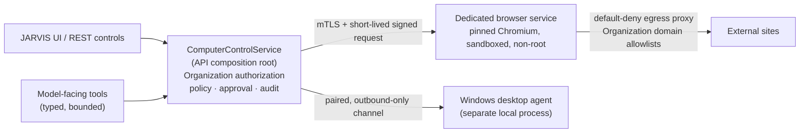

# Phase 19 — Computer & Browser Control

**Stage 19.0 — Architecture Decision Record**

| | |
|---|---|
| Status | Owner-approved architecture; **no runtime implemented** |
| Date | 2026-10-23 |
| Branch inspected | `feat/automation-engine-phase-18` @ `435c39f8` |
| Phase 18 merge state | **Not merged.** `main` is at `1fd1bb0e` (Phase 17 merge) |
| Scope of this stage | Documentation and validation only |
| Runtime changes | None |

This record defines the architecture, security boundaries and release gates for
Phase 19 — Computer & Browser Control. Every statement is labelled as one of:
**owner-approved** (a decision the owner has made), **verified** (observed in
the source named), **proposed** (target behavior that does not exist yet), or
**unresolved** (an operational choice this stage deliberately does not make).

Nothing in this document authorises Stage 19.1. No new component described here
runs today, and no control described here should be read as already
implemented.

---

## 1. Purpose and scope

Phase 19 adds two related capabilities behind one control path:

1. **Browser control** — JARVIS and a person can drive a real browser through a
   dedicated, sandboxed service, with typed and bounded commands.
2. **Computer control** — a person can grant a separately paired local agent
   narrowly scoped control of a Windows desktop.

Both are treated as external-action surfaces. They must pass through the same
server-side authorization, approval and audit path as every other integration,
and they must fail closed.

**In scope for Stage 19.0:** the decisions below, the trust boundaries they
create, the security acceptance criteria, the stage sequence, and the
unresolved operational choices.

**Out of scope for Stage 19.0:** application code, database schema or
migrations, package changes, Docker or service startup, browser or desktop
automation, external network activity, and any Stage 19.1 work.

---

## 2. Inspection record

### 2.1 Repository state

Observed before any documentation change:

| Item | Result |
|---|---|
| Branch | `feat/automation-engine-phase-18` |
| HEAD | `435c39f8f54fcf84af076aa3e8a28d9b3ff214ac` — `feat(automation): add trusted n8n node schema validation` |
| Upstream | `origin/feat/automation-engine-phase-18`, ahead/behind `0 0` |
| `main` | `1fd1bb0e343725441419875541701051b344af4c` — merge of Phase 17 |
| Working tree | Two pre-existing untracked files, preserved untouched |
| Phase 18 | Committed on the phase branch; **not merged into `main`** |

The two untracked files are user work. They were identified and left exactly as
found. No branch, merge, rebase, reset, stash or switch was performed.

### 2.2 Documents and code read

- `AGENTS.md` — the binding integration, shared-connection, approval, voice,
  memory, marketing, observability and deployment rules.
- `docs/DOCUMENTATION_PROTOCOL.md` — phase documents live under
  `docs/phases/`, must distinguish implemented / verified / user-accessible,
  and must not claim future work as present.
- `docs/phases/phase-17.md`, especially §7 (tenant foundation) and §8
  (multi-business hardening): the Organization ownership model and the
  `authorizeSharedConnection` / `SharedConnectionAccess` policy table.
- `docs/phases/phase-18.md` — stages 18.1 through 18.5, including the
  server-enforced voice-confirmation refusal (18.3A).
- `docs/DEPLOYMENT.md` — Organizations and shared connections; the
  operator-only assignment command.
- `docs/DEVELOPMENT.md` — quality gates and the CI slices that select tests by
  file name.
- `docs/JARVIS_MASTER_AUDIT_AND_DEVELOPMENT_LEDGER.md` — roadmap, risk register
  and documentation rules.
- Current browser, tool, approval, authorization and composition code, cited
  inline below.

### 2.3 Existing Phase 19 document

**No Phase 19 architecture document or ADR existed in the repository before
this file.** A search across `docs/` for `Phase 19`, `phase-19`, `19.0`,
computer control, browser control and desktop agent found no architecture
record: only historical forward-references in `docs/phases/phase-15.md` and
`docs/phases/phase-16.md`, and one ledger note that the old capability matrix
omitted browser control (`docs/JARVIS_MASTER_AUDIT_AND_DEVELOPMENT_LEDGER.md`,
§10.4). This file is therefore new, not a duplicate.

### 2.4 Historical numbering note

Two older planning documents refer to computer control as **Phase 18**:

- `docs/phases/phase-15.md` (out-of-scope list) — “Phase 18 browser and
  computer control, Phase 19 self-repair”.
- `docs/phases/phase-16.md` §10 — “Self-repair (the brief's Phase 19) and
  computer control (Phase 18)”.

The owner has designated this work **New Phase 19 — Computer & Browser
Control**. That designation governs this record. The historical documents are
left unchanged, because `docs/DOCUMENTATION_PROTOCOL.md` forbids rewriting
history. This is a naming difference, not a change to any hard project rule.

---

## 3. Status vocabulary used in this record

| Label | Meaning |
|---|---|
| **Owner-approved** | The owner has approved the decision in this stage. |
| **Verified** | Observed in the named source file on the inspected commit. |
| **Proposed** | Target behavior. It does **not** exist yet and is not claimed as implemented. |
| **Unresolved** | A deployment or product choice left open on purpose. |

---

## 4. Context: what exists today (verified)

These findings motivate the decisions. They are observations of the inspected
commit, not proposals.

| # | Finding | Source |
|---|---|---|
| F1 | Browser tools are **not** shared-connection tools. `SHARED_CONNECTION_TOOLS` lists Meta Ads tools and one n8n allow-list tool only, so browser actions bypass `authorizeSharedConnection` and `SharedConnectionAccess`. | `packages/core/src/types/tenant.ts` (`SHARED_CONNECTION_TOOLS`); `packages/security/src/shared-connection-authz.ts` |
| F2 | When `ToolExecutor` creates an approval it does not pass a `tenantId`. A browser approval therefore has no Organization binding and can be approved by its requester. | `packages/tools/src/executor.ts` (`requestApproval({...})`) |
| F3 | Audit rows and approval parameters receive `request.params` directly. Redaction is key/shape based. `browser.type` and `browser.submit` carry free-text field values, so a typed password can reach durable records if its key is not recognised as secret. | `packages/tools/src/executor.ts` (`audit`); `packages/tools/src/tools/browser-tools.ts` |
| F4 | `buildApprovalSummary` has no browser cases, so a browser write is confirmed without a purpose-built, reviewable summary. | `apps/api/src/services/approval-summary.ts` |
| F5 | The browser runtime launches one shared Chromium inside the API process with `--no-sandbox`. A browser compromise is an API-process compromise. | `packages/browser/src/runtime.ts`; `apps/api/src/services/container.ts` |
| F6 | The reference deployment sets `BROWSER_ENABLED=false`, and the application image does not contain Chromium. Browser control is effectively off in that deployment. | `docker-compose.yml`; `Dockerfile` |
| F7 | `DownloadStore` writes bytes under the download root but keeps its `downloadId → record` map in process memory. A restart loses ids, and several API instances cannot share artifacts. | `packages/browser/src/download.ts` |
| F8 | The navigation policy documents a DNS-rebinding residual risk and checks each request; the address-pinned fetch pattern exists separately. | `packages/browser/src/navigation-policy.ts`; `packages/browser/src/page-fetcher.ts` |
| F9 | The current controls describe document navigation and subresources; WebSocket, service-worker and popup egress are not separately enumerated. | `packages/browser/src/session.ts`; `packages/browser/src/navigation-policy.ts` |
| F10 | `VOICE_REFUSED_TOOLS` currently contains only the Automation Library sync. The global refusal of a spoken *confirmation* is verified and separate. | `packages/core/src/voice-tool-policy.ts`; `packages/core/src/types/voice.ts` |

**Verified existing controls worth preserving:** ten typed browser tools with
no raw Playwright handle at the tool boundary; per-session empty browser
contexts; opaque download ids; approval param hashing, a ten-minute TTL and
single-winner conditional consumption; Organization ownership rows; and
server-established voice-confirmation refusal.

**Verified existing gaps are not fixed by this document.** They are the work of
Stages 19.1–19.7.

---

## 5. Trust boundaries and control flow

The target flow is one control service with one authorization and approval
path. The diagram describes **target architecture**; the new boxes do not
exist today.

### 5.1 Boundary requirements

- **One service.** Manual UI controls and model-facing tools converge on the
  same `ComputerControlService`. The browser service and the desktop agent are
  never called directly by a route, a tool, a page or an agent.
- **Policy stays in the API.** The browser service executes typed, bounded
  commands. It does not decide Organization membership, role, approval or
  audit.
- **Narrow commands only.** No model-facing surface receives a raw Playwright
  handle, CDP access, arbitrary JavaScript evaluation, a general-purpose shell
  or an unrestricted filesystem.
- **No bypass.** Browser and desktop actions cannot skip the shared
  authorization, approval and audit path.
- **Unknown is a state.** An external action dispatched but not confirmed is
  recorded `UNKNOWN`. It is never automatically retried as though nothing
  happened.
- **Organization scope beside ownership.** Every read and write is filtered by
  the owning Organization as well as the user; a request-supplied tenant or
  organization identifier is never trusted.
- **Compatibility with the integration rule.** This record does not replace or
  duplicate `IntegrationCommandService`, and it creates no second authorization
  path for an existing integration. Browser and desktop control are not
  currently entries in `INTEGRATION_CATALOG`. If Stage 19.1 catalogues them as
  integrations, the command service remains the execution seam and
  `ComputerControlService` becomes its adapter — the REST router and the JARVIS
  tools still converge on one service, as `AGENTS.md` requires.

---

## 6. Architecture decisions

### ADR-19-001 — Branch and merge sequencing

**Status:** Owner-approved.

**Decision.** Preserve the committed Phase 18 work. New Phase 19 work branches
from the Phase 18 HEAD (`435c39f8`), or from `main` after Phase 18 merges. Phase
19 does not modify Phase 18. This stage performs no merge and no branch
operation.

**Why.** Phase 18 is committed but unmerged (`main` = `1fd1bb0e`). Branching
from an unmerged base keeps the Phase 19 change set reviewable and avoids
rewriting Phase 18 history. The shared authorization and approval code Phase 19
depends on is present on the Phase 18 HEAD.

**Requirements.**

- Phase 19 changes are additive and must not alter Phase 18 tables, tools or
  contracts.
- If Phase 18 merges first, Phase 19 rebases or re-branches only by explicit
  owner instruction; this record does not authorise it.
- The eventual merge order is an owner decision (see §9).

---

### ADR-19-002 — Browser-service authentication

**Status:** Owner-approved. **Implementation:** proposed, not present.

**Decision.** The dedicated browser service authenticates with **mutual TLS
plus short-lived signed requests**. The two mechanisms have distinct jobs and
are both required.

| Responsibility | Mutual TLS | Short-lived signed request |
|---|---|---|
| Purpose | Prove the transport peers are the provisioned API and the provisioned browser service. | Authorize one specific request and bind it to its exact content. |
| Identity binding | Service certificate identity, issued per deployment. | Signing key id, mapped server-side to the same service identity as the certificate. |
| Expiry | Certificate lifetime, deliberately short and rotated. | Request-level expiry, short and configurable in Stage 19.2. |
| Replay protection | Protects the channel; does **not** by itself stop a captured application request from being replayed. | Timestamp window plus a single-use nonce, rejected on reuse. |
| Rotation | Certificate replacement on a defined schedule and on suspected compromise. | Key-id rollover: the new key is accepted while the old is retired. |
| Revocation | Certificate revocation and removal from the trust bundle. | Key-id removal; outstanding requests expire quickly. |

**Requirements.**

- A request is accepted only when the certificate identity and the signing key
  id resolve to the **same** service identity. A mismatch is refused.
- The signed payload covers method, path, body hash, timestamp, nonce and key
  id. A body that does not match its hash is refused.
- A reused nonce, an expired timestamp or an unknown key id is refused before
  the browser service performs any work.
- Private keys and trust material are encrypted at rest where stored and are
  never returned to a client, logged or placed in an audit row.

**Unresolved:** certificate lifetime, rotation cadence, and how revocation is
distributed in a multi-instance deployment (see §9).

---

### ADR-19-003 — Organization-scoped browser ownership

**Status:** Owner-approved. **Implementation:** proposed, not present.

**Decision.** Authorization is enforced server-side and scoped to the owning
Organization. Cross-Organization access is denied by default. The initial
release supports **Organization-owned shared browser access only**; personal
browser profiles are not offered.

**Requirements.**

- Browser actions join the shared-connection model: ownership is recorded by
  the operator command, never inferred from the first caller or from an
  account-wide role.
- Until an Organization owns the browser connection, every caller is refused,
  platform owners and admins included.
- Reads require Organization membership; writes require an owner or admin.
  A write is approved by a **different** owner or admin of that Organization.
- Public and error responses do not reveal another Organization's existence,
  configuration or identifiers.
- An authorization lookup that fails is a refusal, never an allow.

**Why.** This is the Phase 17 model (`docs/phases/phase-17.md` §7–§8) applied to
a new connection. It keeps one policy table and one reader instead of adding a
browser-specific authorization path.

---

### ADR-19-004 — Windows-first desktop agent

**Status:** Owner-approved. **Implementation:** proposed, not present.

**Decision.** The first desktop-agent target is **Windows**. macOS and Linux are
deferred. The agent is a separate local process, paired to an authorized
identity. It communicates **outbound only** and exposes no general-purpose
shell and no unrestricted filesystem.

**Requirements.**

- The agent initiates the connection; it does not listen for inbound commands.
- Pairing binds the agent to a specific user identity and Organization, with a
  revocable credential.
- The command surface is a fixed allowlist of narrow verbs. There is no
  `exec`, no arbitrary path read or write, no registry editing and no
  credential access.
- The agent can be revoked centrally; a revoked agent is refused on its next
  request.
- Desktop control does not ship before pairing, consent, command allowlisting
  and security tests are complete (ADR-19-005).

**Unresolved:** exact Windows versions and packaging method (see §9).

---

### ADR-19-005 — Desktop consent

**Status:** Owner-approved. **Implementation:** proposed, not present.

**Decision.** Every desktop session requires **explicit consent**, uses a
**time-limited grant**, supports **immediate revocation**, shows a **visible
control indicator**, and requires **separate approval for sensitive actions**.

**Required behavior (target, not existing):**

- **Consent:** a person grants a session explicitly; consent is not implied by
  pairing or by a previous session.
- **Expiry:** a grant expires after a bounded interval; expiry ends the session
  and requires fresh consent.
- **Revocation:** a person or an Organization owner/admin can revoke
  immediately; the agent stops accepting commands and the API refuses further
  work.
- **Reconnect:** a dropped connection does not silently resume control. It
  requires a valid, unexpired grant and a fresh server-side authorization
  check.
- **Offline:** while the agent is offline, no command is queued for later
  execution. Commands fail; nothing is replayed on reconnect.
- **Visible status:** the person can see whether control is active, what scope
  was granted, and when it expires.
- **Sensitive actions:** input, file selection and anything that changes
  external state need their own approval, separate from the session grant.

**Unresolved:** grant duration, reconnect grace window and the exact consent
screen (see §9). They are requirements to define, not values to invent here.

---

### ADR-19-006 — Voice restrictions

**Status:** Owner-approved. **Implementation:** partly verified, partly
proposed.

**Decision.** Voice may request permitted **read-only** operations. Voice
cannot independently authorize sensitive writes and cannot confirm an approval.
Sensitive browser and desktop actions follow the server-enforced policy. The
exact tool denylist is a **Stage 19.1 implementation item**.

**Verified today.**

- A spoken confirmation is refused from the server-established turn mode at the
  chat route, the confirmation endpoint and `ToolExecutor`
  (`VOICE_CONFIRMATION_REFUSED_MESSAGE`).
- `VOICE_REFUSED_TOOLS` exists as the single narrowing list, but currently
  contains only the Automation Library sync.

**Proposed for Stage 19.1.**

- Add the sensitive browser and desktop tools to the voice denylist, so a
  misheard sentence cannot start them at all.
- Keep voice able to propose, cancel and change; never to confirm.
- Make the denylist and the refusal code visible to both the tool path and the
  orchestrator, so a refused spoken turn produces an ordinary reply rather than
  an execution or a pending action.

**The exact list is unresolved until Stage 19.1** (see §9). It must be defined
in the contracts, not inferred at runtime.

---

### ADR-19-007 — Artifact retention

**Status:** Owner-approved. **Implementation:** proposed, not present.

**Decision.** Browser artifacts (downloads, screenshots and other captured
files) use **opaque identifiers**, **owner and Organization scoping**,
**access checks**, **quotas** and **configurable expiry**.

**Requirements.**

- A client receives an opaque id and metadata only; never a filesystem path and
  never the bytes in an API response.
- Reading or attaching an artifact re-checks the requesting user **and** the
  owning Organization. An id from another scope is answered as not found.
- Quotas bound per-user and per-Organization storage.
- Expiry is configurable deployment policy, not a hard-coded constant.
- The current in-memory artifact index is replaced by durable, shared storage
  so a restart or a second API instance cannot lose or fork an id.

**Unresolved:** the exact retention duration and the storage backend (for
example object storage versus a database-backed store) are deployment-policy
choices (see §9). This record does not invent a duration.

---

### ADR-19-008 — Default-deny network egress

**Status:** Owner-approved. **Implementation:** proposed, not present.

**Decision.** Browser egress is controlled by a proxy with **default-deny**
rules and **Organization-level domain allowlists**. Loopback, private,
link-local, cloud-metadata and other prohibited targets are blocked. DNS and IP
restrictions are enforced at the **network boundary**, including redirects,
WebSockets, service workers and subresources.

**Requirements.**

- The browser service has no unrestricted direct egress; traffic goes through
  the proxy.
- Default is deny. A domain is reachable only when the owning Organization's
  allowlist permits it.
- Resolution and connection are both checked, so a hostname that resolves to a
  prohibited address after the policy check is refused. Redirect targets,
  WebSocket handshakes, service-worker fetches and subresource requests are
  checked the same way.
- Prohibited ranges include loopback, private, link-local, unique-local,
  carrier-grade NAT and cloud metadata endpoints.
- Allowlist administration is an Organization write: only an owner or admin
  may change it, and the change is audited.
- A denied request is a stable refusal, not a silent fallback to direct access.

**This is target behavior.** The current navigation policy is not a
default-deny network boundary, and F8/F9 record its limits.

---

### ADR-19-009 — Missing prior inspection report

**Status:** Provenance note. Owner-approved.

**Decision.** The previous Phase 19 inspection report referenced before this
stage **was not found in the repository** during the prior inspection. This
record does not assert that no copy exists outside the repository.

**Consequences.**

- This ADR is based on direct inspection of the code and documents listed in
  §2, not on that report.
- No runtime or build dependency is placed on the report.
- If the report is later supplied, it is treated as additional evidence and any
  disagreement is recorded transparently; the historical section is not
  rewritten.

---

### ADR-19-010 — Dedicated browser isolation

**Status:** Owner-approved. **Implementation:** proposed, not present.

**Decision.** Chromium runs in a dedicated, sandboxed browser service, separate
from the API process, with a pinned runtime, non-root execution, appropriate
sandboxing, resource limits, restricted filesystem access, isolated sessions
and controlled egress. No raw Playwright handles, CDP, arbitrary JavaScript or
unrestricted execution are exposed to model-facing tools.

**Requirements.**

- The browser service has its own image, pinned Chromium version, healthcheck
  and resource limits.
- It runs as a non-root user, with a read-only root filesystem, a minimal
  writable area and dropped capabilities.
- The Chromium sandbox is **not** disabled in the service. The current
  `--no-sandbox` launch in the API process is not carried forward.
- Each session gets an isolated browser context. Sessions do not share cookies,
  storage or artifacts across users or Organizations.
- The process is not on the host network and reaches the internet only through
  the egress proxy (ADR-19-008).
- The API holds only a typed client. It does not link Playwright or launch a
  browser.
- A session is destroyed when it ends, whether it ends normally, by timeout or
  by revocation.

---

## 7. Security and release acceptance criteria

These are mandatory gates. A stage that cannot demonstrate them does not ship.
They describe the required end state, not current behavior.

| # | Criterion |
|---|---|
| S1 | Organization membership, role, connection ownership and resource scope are checked **server-side for every operation**. A request-supplied tenant or organization id is never trusted. |
| S2 | Approvals are bound to the exact action and canonicalized parameters, consumed **once**, expire, and resist concurrent replay. Shared-connection writes require an independent owner or admin. |
| S3 | No typed password, secret, token or sensitive form value is persisted in audit rows or approval records. Only field names, counts, hashes and origins are kept. |
| S4 | Browser network access blocks prohibited targets, including DNS rebinding, redirects, WebSockets and service-worker requests. Denial happens at the network boundary, not only in application policy. |
| S5 | Browser sessions and artifacts cannot cross user or Organization boundaries, including after restart or across multiple API instances. |
| S6 | Desktop pairing can be revoked, and an unauthorized or out-of-scope command is rejected. A revoked or expired agent cannot act. |
| S7 | Voice cannot confirm sensitive actions. Sensitive browser and desktop tools are refused for a spoken turn in contracts and execution. |
| S8 | An uncertain external-action outcome is recorded `UNKNOWN` and is **not** automatically retried. Resolution requires a person. |
| S9 | CI covers the relevant unit, contract, integration, database and security tests, including the named slices required because several workspaces are not gated whole. |
| S10 | Real-browser security behavior is exercised in an isolated environment before release. |
| S11 | Every new capability is **off by default** until its release gates pass. `BROWSER_ENABLED` remains the operator switch, and no desktop agent is paired by default. |

---

## 8. Implementation sequence

The order is proposed. Each stage is independently reviewable, and each feature
stays disabled until its own gates pass.

| Stage | Scope | Exit gate |
|---|---|---|
| **19.1** | Typed contracts, Organization authorization entries, approval semantics, voice policy and contract tests. No runtime. | Typecheck and contract tests pass; behavior unchanged. |
| **19.2** | Dedicated browser-service skeleton and authenticated transport (mTLS + signed requests), image, healthcheck, egress proxy. | Service health proven; API registers no browser tool while disabled. |
| **19.3** | Migrate existing browser tools through the common service; enforce tenant-bound authorization and approvals. | Manual and model paths reach one service; outsiders see one "not available" answer. |
| **19.4** | Durable, scoped artifact storage with expiry and quotas. | Restart and multi-instance tests pass; a stale or foreign id is not found. |
| **19.5** | Value-free audit, meaningful approval summaries, and `UNKNOWN` outcome handling. | Redaction and unknown-outcome tests pass; nothing is auto-retried. |
| **19.6** | Windows desktop agent: secure pairing, consent, revocation and a fixed command allowlist. | Pairing/consent/revocation tests pass; no inbound port; sensitive input needs independent approval. |
| **19.7** | Network hardening, real-browser security tests, CI gates, operational documentation and rollback validation. | Security review sign-off, CI green, rollback rehearsed and documented. |

**Sequencing rules.**

- Stage 19.1 must land before any runtime work; it fixes the vocabulary both
  paths share.
- Desktop control must **not** ship before pairing, consent, command
  allowlisting and security tests are complete.
- No stage may enable a capability by default.

---

## 9. Unresolved operational choices

This stage deliberately leaves the following open. None of them blocks the
architecture; each is resolved before the stage that needs it.

| # | Open choice | Needed by |
|---|---|---|
| U1 | Merge timing and final order for Phase 19 versus Phase 18 | Before 19.1 branches |
| U2 | Certificate lifetime, rotation cadence and revocation distribution for ADR-19-002 | Stage 19.2 |
| U3 | Exact voice denylist for browser and desktop tools | Stage 19.1 |
| U4 | Artifact retention duration and storage backend | Stage 19.4 |
| U5 | Desktop grant duration, reconnect grace window and consent-screen wording | Stage 19.6 |
| U6 | Supported Windows versions and agent packaging | Stage 19.6 |
| U7 | Organization allowlist administration screen and review flow | Stage 19.7 |
| U8 | Whether the missing prior Phase 19 inspection report exists outside the repository | Informational |

---

## 10. What this record does not do

- It does not create, modify or enable any runtime component.
- It does not add tables, migrations, routes, tools, agents or environment
  variables.
- It does not claim that mTLS, signed requests, egress filtering, the browser
  service, the desktop agent, durable artifacts or value-free audit exist.
- It does not begin Stage 19.1.
- It does not rewrite Phase 15, 16, 17 or 18 history.

---

## 11. Validation record

The documentation-only change was validated as follows on 2026-10-23. Commands
and their actual results are recorded in the Stage 19.0 completion report
returned with this file:

1. `git diff --check` — whitespace/conflict-marker check.
2. `git status --short` — confirm only the intended documentation file is new,
   and the two pre-existing untracked files are untouched.
3. Path, stage-number and cross-reference review by inspection.
4. Status review: each claim is marked owner-approved, verified, proposed or
   unresolved, and no future control is described as implemented.

No dependency installation, database, container, browser, desktop agent or
external site was used.

---

## 12. References

- `AGENTS.md` — integration parity, shared connections, approvals, voice,
  secrets, deployment and documentation precedence.
- `docs/DOCUMENTATION_PROTOCOL.md` — phase documentation and honesty rules.
- `docs/phases/phase-17.md` — tenant foundation and shared-connection
  authorization.
- `docs/phases/phase-18.md` — Automation Library and server-enforced voice
  confirmation refusal.
- `docs/DEPLOYMENT.md` — Organizations and operator-only connection assignment.
- `docs/DEVELOPMENT.md` — quality gates and CI test selection.
- `docs/JARVIS_MASTER_AUDIT_AND_DEVELOPMENT_LEDGER.md` — roadmap and risk
  register.
- Source inspected: `packages/core/src/types/tenant.ts`,
  `packages/core/src/voice-tool-policy.ts`,
  `packages/core/src/types/browser.ts`,
  `packages/tools/src/tools/browser-tools.ts`,
  `packages/tools/src/executor.ts`,
  `packages/browser/src/runtime.ts`,
  `packages/browser/src/session.ts`,
  `packages/browser/src/navigation-policy.ts`,
  `packages/browser/src/download.ts`,
  `packages/security/src/shared-connection-authz.ts`,
  `apps/api/src/services/approval-summary.ts`,
  `apps/api/src/services/container.ts`,
  `docker-compose.yml`, `Dockerfile`.
