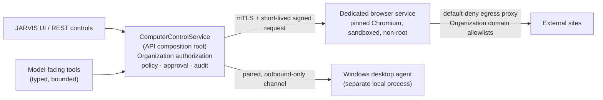

# Phase 19 — Computer & Browser Control

**Stage 19.0 — Architecture Decision Record**

| | |
|---|---|
| Status | Owner-approved architecture. **Stage 19.1 implemented and merged** (PR #14, merge commit `473bda0`, 2026-10-28). **Stage 19.2 merged** (PR #15, `863e4d3`) — see §14. **Stage 19.3 (browser egress) merged** (PR #16, `1592764`, merge `b4d3209`), **not verified in a container** — see §15. **Stage 19.4 (durable, scoped artifact storage) merged** (PR #17, merge `3707e09`), verified in a container on 2026-10-30 — see §16. **Stage 19.5 (value-free approval records, meaningful approval summaries, `UNKNOWN` answers) merged** (PR #18, merge `cc7b7f9`) — see §17. **Stage 19.6 (the Windows desktop agent) implemented in the working tree on `feat/desktop-agent-phase-19-6`, not committed and not complete: the Windows-only proofs are outstanding** — see §18.10. The headings of §14, §15 and §16 record each stage's state when it was written. |
| Date | 2026-10-23 (architecture); §13 added 2026-10-28; §14 added 2026-10-28; §14.11 (audit remediation) added 2026-10-28; §15 added 2026-10-29; §16 added 2026-10-29; §17 added 2026-10-30; §18 added 2026-10-31 |
| Branch inspected | `feat/automation-engine-phase-18` @ `435c39f8` |
| Phase 18 merge state | **Not merged** at the time of writing (`main` was `1fd1bb0e`, the Phase 17 merge). **Merged since:** PR #12 (2026-10-21) and PR #13 (2026-10-22), read from GitHub on 2026-10-28. |
| Scope of this stage | Documentation and validation only |
| Runtime changes | None in §1–§12. §§13–14 record work done in later stages. |

This record defines the architecture, security boundaries and release gates for
Phase 19 — Computer & Browser Control. Every statement is labelled as one of:
**owner-approved** (a decision the owner has made), **verified** (observed in
the source named), **proposed** (target behavior that does not exist yet), or
**unresolved** (an operational choice this stage deliberately does not make).

Sections 1–12 were written before any runtime existed, and are left as written.
They are still the plan. Sections 13 and 14 are implementation records added
afterwards; where an implementation record differs from the plan above it says
so explicitly rather than editing the plan.

---

## 1. Purpose and scope

Phase 19 adds two related capabilities behind one control path:

1. **Browser control** — JARVIS and a person can drive a real browser through a
   dedicated, sandboxed service, with typed and bounded commands.
2. **Computer control** — a person can grant a separately paired local agent
   narrowly scoped control of a Windows desktop.

Both are treated as external-action surfaces. They must pass through the same
server-side authorization, approval and audit path as every other integration,
and they must fail closed.

**In scope for Stage 19.0:** the decisions below, the trust boundaries they
create, the security acceptance criteria, the stage sequence, and the
unresolved operational choices.

**Out of scope for Stage 19.0:** application code, database schema or
migrations, package changes, Docker or service startup, browser or desktop
automation, external network activity, and any Stage 19.1 work.

---

## 2. Inspection record

### 2.1 Repository state

Observed before any documentation change:

| Item | Result |
|---|---|
| Branch | `feat/automation-engine-phase-18` |
| HEAD | `435c39f8f54fcf84af076aa3e8a28d9b3ff214ac` — `feat(automation): add trusted n8n node schema validation` |
| Upstream | `origin/feat/automation-engine-phase-18`, ahead/behind `0 0` |
| `main` | `1fd1bb0e343725441419875541701051b344af4c` — merge of Phase 17 |
| Working tree | Two pre-existing untracked files, preserved untouched |
| Phase 18 | Committed on the phase branch; **not merged into `main`** |

The two untracked files are user work. They were identified and left exactly as
found. No branch, merge, rebase, reset, stash or switch was performed.

### 2.2 Documents and code read

- `AGENTS.md` — the binding integration, shared-connection, approval, voice,
  memory, marketing, observability and deployment rules.
- `docs/DOCUMENTATION_PROTOCOL.md` — phase documents live under
  `docs/phases/`, must distinguish implemented / verified / user-accessible,
  and must not claim future work as present.
- `docs/phases/phase-17.md`, especially §7 (tenant foundation) and §8
  (multi-business hardening): the Organization ownership model and the
  `authorizeSharedConnection` / `SharedConnectionAccess` policy table.
- `docs/phases/phase-18.md` — stages 18.1 through 18.5, including the
  server-enforced voice-confirmation refusal (18.3A).
- `docs/DEPLOYMENT.md` — Organizations and shared connections; the
  operator-only assignment command.
- `docs/DEVELOPMENT.md` — quality gates and the CI slices that select tests by
  file name.
- `docs/JARVIS_MASTER_AUDIT_AND_DEVELOPMENT_LEDGER.md` — roadmap, risk register
  and documentation rules.
- Current browser, tool, approval, authorization and composition code, cited
  inline below.

### 2.3 Existing Phase 19 document

**No Phase 19 architecture document or ADR existed in the repository before
this file.** A search across `docs/` for `Phase 19`, `phase-19`, `19.0`,
computer control, browser control and desktop agent found no architecture
record: only historical forward-references in `docs/phases/phase-15.md` and
`docs/phases/phase-16.md`, and one ledger note that the old capability matrix
omitted browser control (`docs/JARVIS_MASTER_AUDIT_AND_DEVELOPMENT_LEDGER.md`,
§10.4). This file is therefore new, not a duplicate.

### 2.4 Historical numbering note

Two older planning documents refer to computer control as **Phase 18**:

- `docs/phases/phase-15.md` (out-of-scope list) — “Phase 18 browser and
  computer control, Phase 19 self-repair”.
- `docs/phases/phase-16.md` §10 — “Self-repair (the brief's Phase 19) and
  computer control (Phase 18)”.

The owner has designated this work **New Phase 19 — Computer & Browser
Control**. That designation governs this record. The historical documents are
left unchanged, because `docs/DOCUMENTATION_PROTOCOL.md` forbids rewriting
history. This is a naming difference, not a change to any hard project rule.

---

## 3. Status vocabulary used in this record

| Label | Meaning |
|---|---|
| **Owner-approved** | The owner has approved the decision in this stage. |
| **Verified** | Observed in the named source file on the inspected commit. |
| **Proposed** | Target behavior. It does **not** exist yet and is not claimed as implemented. |
| **Unresolved** | A deployment or product choice left open on purpose. |

---

## 4. Context: what exists today (verified)

These findings motivate the decisions. They are observations of the inspected
commit, not proposals.

| # | Finding | Source |
|---|---|---|
| F1 | Browser tools are **not** shared-connection tools. `SHARED_CONNECTION_TOOLS` lists Meta Ads tools and one n8n allow-list tool only, so browser actions bypass `authorizeSharedConnection` and `SharedConnectionAccess`. | `packages/core/src/types/tenant.ts` (`SHARED_CONNECTION_TOOLS`); `packages/security/src/shared-connection-authz.ts` |
| F2 | When `ToolExecutor` creates an approval it does not pass a `tenantId`. A browser approval therefore has no Organization binding and can be approved by its requester. | `packages/tools/src/executor.ts` (`requestApproval({...})`) |
| F3 | Audit rows and approval parameters receive `request.params` directly. Redaction is key/shape based. `browser.type` and `browser.submit` carry free-text field values, so a typed password can reach durable records if its key is not recognised as secret. | `packages/tools/src/executor.ts` (`audit`); `packages/tools/src/tools/browser-tools.ts` |
| F4 | `buildApprovalSummary` has no browser cases, so a browser write is confirmed without a purpose-built, reviewable summary. | `apps/api/src/services/approval-summary.ts` |
| F5 | The browser runtime launches one shared Chromium inside the API process with `--no-sandbox`. A browser compromise is an API-process compromise. | `packages/browser/src/runtime.ts`; `apps/api/src/services/container.ts` |
| F6 | The reference deployment sets `BROWSER_ENABLED=false`, and the application image does not contain Chromium. Browser control is effectively off in that deployment. | `docker-compose.yml`; `Dockerfile` |
| F7 | `DownloadStore` writes bytes under the download root but keeps its `downloadId → record` map in process memory. A restart loses ids, and several API instances cannot share artifacts. | `packages/browser/src/download.ts` |
| F8 | The navigation policy documents a DNS-rebinding residual risk and checks each request; the address-pinned fetch pattern exists separately. | `packages/browser/src/navigation-policy.ts`; `packages/browser/src/page-fetcher.ts` |
| F9 | The current controls describe document navigation and subresources; WebSocket, service-worker and popup egress are not separately enumerated. | `packages/browser/src/session.ts`; `packages/browser/src/navigation-policy.ts` |
| F10 | `VOICE_REFUSED_TOOLS` currently contains only the Automation Library sync. The global refusal of a spoken *confirmation* is verified and separate. | `packages/core/src/voice-tool-policy.ts`; `packages/core/src/types/voice.ts` |

**Verified existing controls worth preserving:** ten typed browser tools with
no raw Playwright handle at the tool boundary; per-session empty browser
contexts; opaque download ids; approval param hashing, a ten-minute TTL and
single-winner conditional consumption; Organization ownership rows; and
server-established voice-confirmation refusal.

**Verified existing gaps are not fixed by this document.** They are the work of
Stages 19.1–19.7.

---

## 5. Trust boundaries and control flow

The target flow is one control service with one authorization and approval
path. The diagram describes **target architecture**; the new boxes do not
exist today.



### 5.1 Boundary requirements

- **One service.** Manual UI controls and model-facing tools converge on the
  same `ComputerControlService`. The browser service and the desktop agent are
  never called directly by a route, a tool, a page or an agent.
- **Policy stays in the API.** The browser service executes typed, bounded
  commands. It does not decide Organization membership, role, approval or
  audit.
- **Narrow commands only.** No model-facing surface receives a raw Playwright
  handle, CDP access, arbitrary JavaScript evaluation, a general-purpose shell
  or an unrestricted filesystem.
- **No bypass.** Browser and desktop actions cannot skip the shared
  authorization, approval and audit path.
- **Unknown is a state.** An external action dispatched but not confirmed is
  recorded `UNKNOWN`. It is never automatically retried as though nothing
  happened.
- **Organization scope beside ownership.** Every read and write is filtered by
  the owning Organization as well as the user; a request-supplied tenant or
  organization identifier is never trusted.
- **Compatibility with the integration rule.** This record does not replace or
  duplicate `IntegrationCommandService`, and it creates no second authorization
  path for an existing integration. Browser and desktop control are not
  currently entries in `INTEGRATION_CATALOG`. If Stage 19.1 catalogues them as
  integrations, the command service remains the execution seam and
  `ComputerControlService` becomes its adapter — the REST router and the JARVIS
  tools still converge on one service, as `AGENTS.md` requires.

---

## 6. Architecture decisions

### ADR-19-001 — Branch and merge sequencing

**Status:** Owner-approved.

**Decision.** Preserve the committed Phase 18 work. New Phase 19 work branches
from the Phase 18 HEAD (`435c39f8`), or from `main` after Phase 18 merges. Phase
19 does not modify Phase 18. This stage performs no merge and no branch
operation.

**Why.** Phase 18 is committed but unmerged (`main` = `1fd1bb0e`). Branching
from an unmerged base keeps the Phase 19 change set reviewable and avoids
rewriting Phase 18 history. The shared authorization and approval code Phase 19
depends on is present on the Phase 18 HEAD.

**Requirements.**

- Phase 19 changes are additive and must not alter Phase 18 tables, tools or
  contracts.
- If Phase 18 merges first, Phase 19 rebases or re-branches only by explicit
  owner instruction; this record does not authorise it.
- The eventual merge order is an owner decision (see §9).

---

### ADR-19-002 — Browser-service authentication

**Status:** Owner-approved. **Implementation:** proposed, not present.

**Decision.** The dedicated browser service authenticates with **mutual TLS
plus short-lived signed requests**. The two mechanisms have distinct jobs and
are both required.

| Responsibility | Mutual TLS | Short-lived signed request |
|---|---|---|
| Purpose | Prove the transport peers are the provisioned API and the provisioned browser service. | Authorize one specific request and bind it to its exact content. |
| Identity binding | Service certificate identity, issued per deployment. | Signing key id, mapped server-side to the same service identity as the certificate. |
| Expiry | Certificate lifetime, deliberately short and rotated. | Request-level expiry, short and configurable in Stage 19.2. |
| Replay protection | Protects the channel; does **not** by itself stop a captured application request from being replayed. | Timestamp window plus a single-use nonce, rejected on reuse. |
| Rotation | Certificate replacement on a defined schedule and on suspected compromise. | Key-id rollover: the new key is accepted while the old is retired. |
| Revocation | Certificate revocation and removal from the trust bundle. | Key-id removal; outstanding requests expire quickly. |

**Requirements.**

- A request is accepted only when the certificate identity and the signing key
  id resolve to the **same** service identity. A mismatch is refused.
- The signed payload covers method, path, body hash, timestamp, nonce and key
  id. A body that does not match its hash is refused.
- A reused nonce, an expired timestamp or an unknown key id is refused before
  the browser service performs any work.
- Private keys and trust material are encrypted at rest where stored and are
  never returned to a client, logged or placed in an audit row.

**Unresolved:** certificate lifetime, rotation cadence, and how revocation is
distributed in a multi-instance deployment (see §9).

---

### ADR-19-003 — Organization-scoped browser ownership

**Status:** Owner-approved. **Implementation:** proposed, not present.

**Decision.** Authorization is enforced server-side and scoped to the owning
Organization. Cross-Organization access is denied by default. The initial
release supports **Organization-owned shared browser access only**; personal
browser profiles are not offered.

**Requirements.**

- Browser actions join the shared-connection model: ownership is recorded by
  the operator command, never inferred from the first caller or from an
  account-wide role.
- Until an Organization owns the browser connection, every caller is refused,
  platform owners and admins included.
- Reads require Organization membership; writes require an owner or admin.
  A write is approved by a **different** owner or admin of that Organization.
- Public and error responses do not reveal another Organization's existence,
  configuration or identifiers.
- An authorization lookup that fails is a refusal, never an allow.

**Why.** This is the Phase 17 model (`docs/phases/phase-17.md` §7–§8) applied to
a new connection. It keeps one policy table and one reader instead of adding a
browser-specific authorization path.

---

### ADR-19-004 — Windows-first desktop agent

**Status:** Owner-approved. **Implementation:** proposed, not present.

**Decision.** The first desktop-agent target is **Windows**. macOS and Linux are
deferred. The agent is a separate local process, paired to an authorized
identity. It communicates **outbound only** and exposes no general-purpose
shell and no unrestricted filesystem.

**Requirements.**

- The agent initiates the connection; it does not listen for inbound commands.
- Pairing binds the agent to a specific user identity and Organization, with a
  revocable credential.
- The command surface is a fixed allowlist of narrow verbs. There is no
  `exec`, no arbitrary path read or write, no registry editing and no
  credential access.
- The agent can be revoked centrally; a revoked agent is refused on its next
  request.
- Desktop control does not ship before pairing, consent, command allowlisting
  and security tests are complete (ADR-19-005).

**Unresolved:** exact Windows versions and packaging method (see §9).

---

### ADR-19-005 — Desktop consent

**Status:** Owner-approved. **Implementation:** proposed, not present.

**Decision.** Every desktop session requires **explicit consent**, uses a
**time-limited grant**, supports **immediate revocation**, shows a **visible
control indicator**, and requires **separate approval for sensitive actions**.

**Required behavior (target, not existing):**

- **Consent:** a person grants a session explicitly; consent is not implied by
  pairing or by a previous session.
- **Expiry:** a grant expires after a bounded interval; expiry ends the session
  and requires fresh consent.
- **Revocation:** a person or an Organization owner/admin can revoke
  immediately; the agent stops accepting commands and the API refuses further
  work.
- **Reconnect:** a dropped connection does not silently resume control. It
  requires a valid, unexpired grant and a fresh server-side authorization
  check.
- **Offline:** while the agent is offline, no command is queued for later
  execution. Commands fail; nothing is replayed on reconnect.
- **Visible status:** the person can see whether control is active, what scope
  was granted, and when it expires.
- **Sensitive actions:** input, file selection and anything that changes
  external state need their own approval, separate from the session grant.

**Unresolved:** grant duration, reconnect grace window and the exact consent
screen (see §9). They are requirements to define, not values to invent here.

---

### ADR-19-006 — Voice restrictions

**Status:** Owner-approved. **Implementation:** partly verified, partly
proposed.

**Decision.** Voice may request permitted **read-only** operations. Voice
cannot independently authorize sensitive writes and cannot confirm an approval.
Sensitive browser and desktop actions follow the server-enforced policy. The
exact tool denylist is a **Stage 19.1 implementation item**.

**Verified today.**

- A spoken confirmation is refused from the server-established turn mode at the
  chat route, the confirmation endpoint and `ToolExecutor`
  (`VOICE_CONFIRMATION_REFUSED_MESSAGE`).
- `VOICE_REFUSED_TOOLS` exists as the single narrowing list, but currently
  contains only the Automation Library sync.

**Proposed for Stage 19.1.**

- Add the sensitive browser and desktop tools to the voice denylist, so a
  misheard sentence cannot start them at all.
- Keep voice able to propose, cancel and change; never to confirm.
- Make the denylist and the refusal code visible to both the tool path and the
  orchestrator, so a refused spoken turn produces an ordinary reply rather than
  an execution or a pending action.

**The exact list is unresolved until Stage 19.1** (see §9). It must be defined
in the contracts, not inferred at runtime.

---

### ADR-19-007 — Artifact retention

**Status:** Owner-approved. **Implementation:** proposed, not present.
*(Since Stage 19.4: implemented in the working tree with a filesystem backend;
the duration and the backend choice remain U4 — see §16.)*

**Decision.** Browser artifacts (downloads, screenshots and other captured
files) use **opaque identifiers**, **owner and Organization scoping**,
**access checks**, **quotas** and **configurable expiry**.

**Requirements.**

- A client receives an opaque id and metadata only; never a filesystem path and
  never the bytes in an API response.
- Reading or attaching an artifact re-checks the requesting user **and** the
  owning Organization. An id from another scope is answered as not found.
- Quotas bound per-user and per-Organization storage.
- Expiry is configurable deployment policy, not a hard-coded constant.
- The current in-memory artifact index is replaced by durable, shared storage
  so a restart or a second API instance cannot lose or fork an id.

**Unresolved:** the exact retention duration and the storage backend (for
example object storage versus a database-backed store) are deployment-policy
choices (see §9). This record does not invent a duration.

---

### ADR-19-008 — Default-deny network egress

**Status:** Owner-approved. **Implementation:** proposed, not present.

**Decision.** Browser egress is controlled by a proxy with **default-deny**
rules and **Organization-level domain allowlists**. Loopback, private,
link-local, cloud-metadata and other prohibited targets are blocked. DNS and IP
restrictions are enforced at the **network boundary**, including redirects,
WebSockets, service workers and subresources.

**Requirements.**

- The browser service has no unrestricted direct egress; traffic goes through
  the proxy.
- Default is deny. A domain is reachable only when the owning Organization's
  allowlist permits it.
- Resolution and connection are both checked, so a hostname that resolves to a
  prohibited address after the policy check is refused. Redirect targets,
  WebSocket handshakes, service-worker fetches and subresource requests are
  checked the same way.
- Prohibited ranges include loopback, private, link-local, unique-local,
  carrier-grade NAT and cloud metadata endpoints.
- Allowlist administration is an Organization write: only an owner or admin
  may change it, and the change is audited.
- A denied request is a stable refusal, not a silent fallback to direct access.

**This is target behavior.** The current navigation policy is not a
default-deny network boundary, and F8/F9 record its limits.

---

### ADR-19-009 — Missing prior inspection report

**Status:** Provenance note. Owner-approved.

**Decision.** The previous Phase 19 inspection report referenced before this
stage **was not found in the repository** during the prior inspection. This
record does not assert that no copy exists outside the repository.

**Consequences.**

- This ADR is based on direct inspection of the code and documents listed in
  §2, not on that report.
- No runtime or build dependency is placed on the report.
- If the report is later supplied, it is treated as additional evidence and any
  disagreement is recorded transparently; the historical section is not
  rewritten.

---

### ADR-19-010 — Dedicated browser isolation

**Status:** Owner-approved. **Implementation:** proposed, not present.

**Decision.** Chromium runs in a dedicated, sandboxed browser service, separate
from the API process, with a pinned runtime, non-root execution, appropriate
sandboxing, resource limits, restricted filesystem access, isolated sessions
and controlled egress. No raw Playwright handles, CDP, arbitrary JavaScript or
unrestricted execution are exposed to model-facing tools.

**Requirements.**

- The browser service has its own image, pinned Chromium version, healthcheck
  and resource limits.
- It runs as a non-root user, with a read-only root filesystem, a minimal
  writable area and dropped capabilities.
- The Chromium sandbox is **not** disabled in the service. The current
  `--no-sandbox` launch in the API process is not carried forward.
- Each session gets an isolated browser context. Sessions do not share cookies,
  storage or artifacts across users or Organizations.
- The process is not on the host network and reaches the internet only through
  the egress proxy (ADR-19-008).
- The API holds only a typed client. It does not link Playwright or launch a
  browser.
- A session is destroyed when it ends, whether it ends normally, by timeout or
  by revocation.

---

## 7. Security and release acceptance criteria

These are mandatory gates. A stage that cannot demonstrate them does not ship.
They describe the required end state, not current behavior.

| # | Criterion |
|---|---|
| S1 | Organization membership, role, connection ownership and resource scope are checked **server-side for every operation**. A request-supplied tenant or organization id is never trusted. |
| S2 | Approvals are bound to the exact action and canonicalized parameters, consumed **once**, expire, and resist concurrent replay. Shared-connection writes require an independent owner or admin. |
| S3 | No typed password, secret, token or sensitive form value is persisted in audit rows or approval records. Only field names, counts, hashes and origins are kept. |
| S4 | Browser network access blocks prohibited targets, including DNS rebinding, redirects, WebSockets and service-worker requests. Denial happens at the network boundary, not only in application policy. |
| S5 | Browser sessions and artifacts cannot cross user or Organization boundaries, including after restart or across multiple API instances. |
| S6 | Desktop pairing can be revoked, and an unauthorized or out-of-scope command is rejected. A revoked or expired agent cannot act. |
| S7 | Voice cannot confirm sensitive actions. Sensitive browser and desktop tools are refused for a spoken turn in contracts and execution. |
| S8 | An uncertain external-action outcome is recorded `UNKNOWN` and is **not** automatically retried. Resolution requires a person. |
| S9 | CI covers the relevant unit, contract, integration, database and security tests, including the named slices required because several workspaces are not gated whole. |
| S10 | Real-browser security behavior is exercised in an isolated environment before release. |
| S11 | Every new capability is **off by default** until its release gates pass. `BROWSER_ENABLED` remains the operator switch, and no desktop agent is paired by default. |

---

## 8. Implementation sequence

The order is proposed. Each stage is independently reviewable, and each feature
stays disabled until its own gates pass.

| Stage | Scope | Exit gate |
|---|---|---|
| **19.1** | Typed contracts, Organization authorization entries, approval semantics, voice policy and contract tests. No runtime. | Typecheck and contract tests pass; behavior unchanged. |
| **19.2** | Dedicated browser-service skeleton and authenticated transport (mTLS + signed requests), image, healthcheck, egress proxy. **Amendment (2026-10-28):** the egress proxy moves to Stage 19.3, by owner decision, so that 19.2 neither enables nor claims default-deny egress. See §14. | Service health proven; API registers no browser tool while disabled. |
| **19.3** | Migrate existing browser tools through the common service; enforce tenant-bound authorization and approvals. | Manual and model paths reach one service; outsiders see one "not available" answer. |
| **19.4** | Durable, scoped artifact storage with expiry and quotas. | Restart and multi-instance tests pass; a stale or foreign id is not found. |
| **19.5** | Value-free audit, meaningful approval summaries, and `UNKNOWN` outcome handling. | Redaction and unknown-outcome tests pass; nothing is auto-retried. |
| **19.6** | Windows desktop agent: secure pairing, consent, revocation and a fixed command allowlist. | Pairing/consent/revocation tests pass; no inbound port; sensitive input needs independent approval. |
| **19.7** | Network hardening, real-browser security tests, CI gates, operational documentation and rollback validation. **Not started.** The owner's brief of 2026-11-01 used the same number for desktop launch and typing (§19); this row is a different piece of work and is still to do. | Security review sign-off, CI green, rollback rehearsed and documented. |

**Sequencing rules.**

- Stage 19.1 must land before any runtime work; it fixes the vocabulary both
  paths share.
- Desktop control must **not** ship before pairing, consent, command
  allowlisting and security tests are complete.
- No stage may enable a capability by default.

---

## 9. Unresolved operational choices

This stage deliberately leaves the following open. None of them blocks the
architecture; each is resolved before the stage that needs it.

| # | Open choice | Needed by |
|---|---|---|
| U1 | Merge timing and final order for Phase 19 versus Phase 18 | Before 19.1 branches |
| U2 | Certificate lifetime, rotation cadence and revocation distribution for ADR-19-002 | Stage 19.2 — **still open**; 19.2 implements the interface and refuses to start without TLS material, and automates none of the rotation (§14.7) |
| U3 | Exact voice denylist for browser and desktop tools | Stage 19.1 |
| U4 | Artifact retention duration and storage backend | Stage 19.4 |
| U5 | Desktop grant duration, reconnect grace window and consent-screen wording | Stage 19.6 — **decided by the owner** (§18.1) |
| U6 | Supported Windows versions and agent packaging | Stage 19.6 — **decided by the owner** (§18.1) |
| U7 | Organization allowlist administration screen and review flow | Stage 19.7 |
| U8 | Whether the missing prior Phase 19 inspection report exists outside the repository | Informational |

---

## 10. What this record does not do

- It does not create, modify or enable any runtime component.
- It does not add tables, migrations, routes, tools, agents or environment
  variables.
- It does not claim that mTLS, signed requests, egress filtering, the browser
  service, the desktop agent, durable artifacts or value-free audit exist.
- It does not begin Stage 19.1.
- It does not rewrite Phase 15, 16, 17 or 18 history.

---

## 11. Validation record

The documentation-only change was validated as follows on 2026-10-23. Commands
and their actual results are recorded in the Stage 19.0 completion report
returned with this file:

1. `git diff --check` — whitespace/conflict-marker check.
2. `git status --short` — confirm only the intended documentation file is new,
   and the two pre-existing untracked files are untouched.
3. Path, stage-number and cross-reference review by inspection.
4. Status review: each claim is marked owner-approved, verified, proposed or
   unresolved, and no future control is described as implemented.

No dependency installation, database, container, browser, desktop agent or
external site was used.

---

## 12. References

- `AGENTS.md` — integration parity, shared connections, approvals, voice,
  secrets, deployment and documentation precedence.
- `docs/DOCUMENTATION_PROTOCOL.md` — phase documentation and honesty rules.
- `docs/phases/phase-17.md` — tenant foundation and shared-connection
  authorization.
- `docs/phases/phase-18.md` — Automation Library and server-enforced voice
  confirmation refusal.
- `docs/DEPLOYMENT.md` — Organizations and operator-only connection assignment.
- `docs/DEVELOPMENT.md` — quality gates and CI test selection.
- `docs/JARVIS_MASTER_AUDIT_AND_DEVELOPMENT_LEDGER.md` — roadmap and risk
  register.
- Source inspected: `packages/core/src/types/tenant.ts`,
  `packages/core/src/voice-tool-policy.ts`,
  `packages/core/src/types/browser.ts`,
  `packages/tools/src/tools/browser-tools.ts`,
  `packages/tools/src/executor.ts`,
  `packages/browser/src/runtime.ts`,
  `packages/browser/src/session.ts`,
  `packages/browser/src/navigation-policy.ts`,
  `packages/browser/src/download.ts`,
  `packages/security/src/shared-connection-authz.ts`,
  `apps/api/src/services/approval-summary.ts`,
  `apps/api/src/services/container.ts`,
  `docker-compose.yml`, `Dockerfile`.

---

## 13. Stage 19.1 implementation record (merged)

Stage 19.1 is on branch `feat/computer-control-phase-19-1`, ending at commit
`4748c94` (`fix(computer-control): preserve approved publish previews`). It was
**merged into `main` by PR #14** on 2026-10-28 (05:49 UTC); the merge commit is
`473bda0`, which is `origin/main` on GitHub. Read from GitHub (`gh pr view 14`,
`git ls-remote`), not from the local clone: the clone's `main` and its
`origin/main` tracking ref were not fetched and still show `1fd1bb0e`, the
Phase 17 merge. An earlier version of this section said 19.1 was not merged;
that was stale.

Implemented (verified in the source this session):

- `packages/core/src/computer-control.ts` — the closed action sets, bounds,
  value-free approval summary and binding helpers, and
  `parseComputerControlRequest` / `BrowserControlResultSchema`, which Stage 19.2
  reuses rather than redefining.
- The tools' write path: every browser write resolves its Organization scope
  through `@jarvis/security`'s shared-connection policy, then consumes its
  approval once, atomically, with that scope
  (`packages/tools`, selected in CI as `computer-control` and
  `sprint7-browser-tools`).
- `ToolExecutor`'s refusal of a spoken sensitive action, and the pending
  action's preview preserving an approved publish item's identifying fields.
- `apps/api/src/services/approval-summary.ts`.

Test evidence for 19.1 is in the commit and in CI's
`Test computer-control contracts` step. This record does not restate it.

---

## 14. Stage 19.2 implementation record (committed `863e4d3`, not merged)

**Status: implemented in the working tree; NOT complete; NOT committed; NOT
deployed.** The service skeleton, the authenticated transport, the image, the
healthcheck, the API integration and the tests exist. Two things the plan puts
in 19.2 do not: the egress proxy (moved to 19.3 by owner decision, 2026-10-28)
and the resolution of U2 (certificate lifetime, rotation and revocation). See
§14.7.

### 14.1 What was built, and where

| Component | Path | What it is |
|---|---|---|
| Protocol, signing, client | `packages/browser-protocol` | A pure package: the versioned envelope, the request signature, nonce and clock rules, the size/deadline bounds, the endpoint loader, the HTTP client and `RemoteBrowserRuntime`. No Playwright, no I/O beyond `node:https`. |
| Browser service | `apps/browser-service` | A standalone process listening with mutual TLS only: certificate identity, signed-request verification, a session registry over `@jarvis/browser`'s `BrowserRuntime`, an engine that is **off** unless explicitly enabled, and — on a second, loopback-only listener — a liveness route with no path to a browser operation (§14.11). |
| API selection | `apps/api/src/services/container.ts` | `readBrowserServiceEndpoint()` chooses the remote runtime, the local runtime, or nothing. Same `BrowserRuntimePort`, same `createBrowserTools(...)` call, same tools, same grants and approvals. |
| Organization binding | `apps/api/src/services/tenancy/shared-connection-access.ts` | `createBrowserSessionTenantResolver` resolves the session's Organization from the shared-connection reader — never from a request body. |
| Deployment | `apps/browser-service/Dockerfile`, `docker-compose.yml` (profile `browser-service`), `Dockerfile`, `.env.example` | A separate, non-root image with resource limits, no published port, and a compose profile that is off by default. |
| Tests | `packages/browser-protocol/test/browser-service-*.test.ts`, `apps/browser-service/test/browser-service*.test.ts`, `apps/api/test/browser-service-*.test.ts`, `packages/tools/test/computer-control-write-outcome-p19.test.ts` | Counts as first built are in §14.6; after the audit remediation, §14.11.7. |

### 14.2 The wire contract

- **Version.** One string, `jarvis-browser/1`, on every request and every
  response, checked **before** the payload. A different version is
  `UNSUPPORTED_VERSION`; a missing one is `INVALID_REQUEST`.
- **Operations.** `session.open`, `session.close`, and the ten Phase 19.1
  browser actions. Desktop actions are not in the set and cannot be added by a
  request: an unknown operation is `UNKNOWN_OPERATION` before anything is
  dispatched.
- **Payloads.** Each action's payload is validated by the Phase 19.1
  `parseComputerControlRequest`, so a request cannot carry its own `action`, a
  URL scheme the browser policy forbids, a malformed UUID, an unknown envelope
  field, or an empty subject.
- **Results.** The service validates its own result against
  `BrowserControlResultSchema` before responding; the client validates the
  response envelope and the action's result again. A result that does not match
  is never passed along: `PROVIDER_ERROR` for a read, and for a write — which
  has already run — `UNKNOWN_OUTCOME` (§14.11.2).
- **Errors.** A fixed set of codes with fixed sentences. An unknown code on the
  wire collapses to `PROVIDER_ERROR`; a peer's own message is discarded, never
  shown, logged or audited. Refusals carry no page content, no URL and no
  credential.
- **Bounds.** Two kinds, and a deployment can move them differently
  (corrected 2026-10-28; this bullet used to say every bound could only be
  lowered).
  - *Ceilings, which a deployment may only lower:* request body 64 KiB,
    applied to raw bytes before JSON parsing (`BROWSER_SERVICE_MAX_BODY_BYTES`,
    1 KiB–64 KiB); session TTL 60 s by default, 1 s–240 s
    (`BROWSER_SERVICE_SESSION_TTL_MS`); at most 16 sessions per process, 2 by
    default (`BROWSER_SERVICE_MAX_SESSIONS`). The response body is held to
    4 MiB by the API's client while reading; it is not configurable.
  - *Defaults, which a deployment may raise as well as lower, within a range:*
    the per-request deadline, 30 s by default and 1 s–120 s on each side
    (`BROWSER_SERVICE_TIMEOUT_MS` for the API's client,
    `packages/browser-protocol/src/config.ts`; `BROWSER_SERVICE_REQUEST_TIMEOUT_MS`
    for the service, `apps/browser-service/src/config.ts`), and the clock skew a
    signed request may carry, 60 s by default and 1 s–300 s
    (`BROWSER_SERVICE_CLOCK_SKEW_MS`). A longer skew is a longer window in which
    a captured request could be replayed once against a freshly restarted
    process (§14.3). If the API's deadline is the shorter of the two, the API
    can give up on a write the service is still performing; that write is
    recorded `UNKNOWN`, never retried (§14.11.2).
  - *Nonce memory:* a nonce is kept for 5 min after its request's timestamp (or
    its arrival, if later) — the longer of 5 min and the configured skew, which
    is never more than 5 min.
- **The page field.** Every Phase 19.1 action names a `url` because a tool
  navigates and then acts. Over this boundary only `browser.navigate`
  navigates; every other action acts on the session's **current** page and
  ignores that field. Honouring it would let a request move a session between
  the navigation an approval was given for and the action itself. The result
  carries the page that was actually acted on.

### 14.3 Authentication, and what it proves

- **Signed requests.** HMAC-SHA256 over a canonical string of method, path,
  timestamp, nonce, key id, body SHA-256 and the caller's transport identity.
  Verification order: peer identity → required headers → nonce shape →
  timestamp window → body hash → known key → key-identity match → signature →
  nonce spend. A failed signature spends no nonce; a spent nonce is
  `REPLAY_DETECTED`.
- **Transport identity.** It is the client certificate's CN/SAN, verified by
  the TLS stack, and nothing else. Mutual TLS is the only mode: the process
  **fails to start** without certificate, key and CA paths, and it refuses to
  start when `BROWSER_SERVICE_REQUIRE_MTLS` is anything but `true` or
  `BROWSER_SERVICE_TRUST_FORWARDED_PEER_IDENTITY` is anything but `false`. The
  forwarded-identity mode this section first described — no TLS, identity from
  a request header — was removed (§14.11.4): the service could not tell a
  terminator's header from the caller's. The API's client refuses an `http:`
  endpoint and refuses to send without its client certificate.
- **Presenting identity = signing identity.** A key bound to one identity
  cannot be used by another: the signature covers the peer identity, and the
  server compares the two.
- **The secret is never echoed.** Configuration errors name a field, never a
  value; a short secret is reported as short.
- **No public surface.** Everything on the service port, `/healthz` included,
  needs a client certificate from the configured CA. The container's own
  healthcheck asks a second listener bound to `127.0.0.1` inside the container
  (`BROWSER_SERVICE_HEALTH_PORT`, default 3201), which answers `GET /healthz`
  with a fixed liveness body (status, service name, protocol version, whether
  Chromium is on) and `404` to every other path and to any non-loopback peer
  (§14.11.3). Both can be hidden behind `BROWSER_SERVICE_HEALTH_TOKEN`; when
  set, a wrong or absent token is `404`, not `403`, so the route does not
  confirm its own existence. The compose service publishes no port.
- **Replay after a restart.** The nonce store is per process
  (`ProcessNonceStore`). A restarted process has forgotten the nonces it saw,
  so a request captured inside its clock-skew window (60 s by default) could be
  accepted once more by the new process. Capturing one needs the mutual-TLS
  session; a shared, durable nonce store is Stage 19.7. Not claimed otherwise.

### 14.4 Isolation, sessions and the Organization

- **Fresh context per session**, inherited from `@jarvis/browser`: no cookie
  jar, no storage, no profile, no saved credential is shared between sessions or
  survives one. There is no "personal browser profile" option anywhere in the
  contract.
- **Artifacts are per user, not per session** (corrected, §14.11.5). Downloads
  and screenshots go to the process's one `DownloadStore`, whose index is keyed
  by `userId` alone. Another user can never read them, but every session of
  the SAME user in that process can — including a session for another
  Organization the user also belongs to. The index is in memory, so a restart
  loses it. Scoping artifacts by Organization and making them durable is Stage
  19.4 (ADR-19-007); until then the claim is "per user, per process".
- **One session, one server-resolved subject.** The API resolves
  `(userId, organizationId)` through `SharedConnectionAccess` before it opens a
  session; the service stores that pair at `session.open` and compares it on
  every later request. A different user or Organization — a request-body claim,
  a reused id, a stale screen — is `CROSS_TENANT_DENIED` before the session is
  read, so it cannot even learn whether the id is live. A `session.close` from
  another Organization is refused too.
- **Deterministic cleanup.** Close, TTL expiry and shutdown all resolve the one
  promise the runtime's `withSession` is holding, so the runtime's own `finally`
  closes the context. A sweeper runs every second; a failed or timed-out open
  removes its entry and closes a context that appears later. Shutdown ends every
  session before asking the runtime to close.
- **Resource limits.** Process-level: max sessions and max sessions per
  Organization, both checked in the same synchronous turn as the insert. Outer:
  the container's `pids_limit`, `mem_limit`, `cpus`, `shm_size` and tmpfs.
- **The writes are still the API's.** The service has no notion of an approval.
  The tools decide — grant, then scope, then approval claim, then session — and
  only then does a request exist. No route, tool or frontend path reaches the
  service directly; the model can only call a registered tool.

### 14.5 Two places a browser can run, one set of tools

| `BROWSER_ENABLED` | `BROWSER_SERVICE_URL` | Result |
|---|---|---|
| not `"true"` | either | No browser tools. Nothing is started. |
| `"true"` | unset | The in-process runtime, exactly as before 19.2. |
| `"true"` | set, configuration usable | `RemoteBrowserRuntime`. The API process holds no browser. |
| `"true"` | set, configuration unusable | **No browser tools at all.** No fallback to an in-process Chromium. |

The last row is deliberate: an operator who asked for isolation and silently got
an in-process browser would have been told the opposite of the truth. The API
logs `browser_registration_skipped` with the field that was wrong.

### 14.6 Test evidence (2026-10-28, Windows, working tree)

*Historical: the results of the stage as first built, before the Stage 19.2
security audit. Several things they describe were changed by the remediation
(plain-HTTP harness, forwarded identity, `PROVIDER_ERROR` for every failed
write). The current evidence is §14.11.7.*

| Command | Result |
|---|---|
| `pnpm install` | lockfile updated for the two new workspaces; no new external dependency except `playwright-core`, already used by `@jarvis/browser` |
| `pnpm typecheck` | 40/40 tasks |
| `pnpm typecheck:tests` | 23/23 tasks (the new workspaces opt in) |
| `pnpm lint` | 22/22 tasks |
| `pnpm build` | 22/22 tasks |
| `pnpm --filter @jarvis/browser-protocol exec vitest run` | **51 passed** |
| `pnpm --filter @jarvis/browser-service exec vitest run` | **26 passed** |
| `pnpm --filter @jarvis/api exec vitest run test/browser-service-wiring.test.ts test/sprint7-browser-wiring.test.ts` | **8 + 19 passed** |

What the tests actually exercise:

- **Protocol** (51): envelope accept/refuse for every malformed shape; version
  before payload; unknown operation and a desktop action refused; a payload that
  names its own action refused; `javascript:` refused; strict unknown field
  refused; response round trip, forged message discarded, unknown code collapsed,
  wrong version refused; canonical string and signature tampering; expired
  timestamp; malformed signature; nonce single-use and expiry; `verifySignedRequest`
  rejecting an unproven peer, a missing header, an expired request, a tampered
  body, an unknown key, a key bound to another identity, a replay; the
  endpoint's `absent`/`invalid`/`ready` distinction and its redacted reasons; the
  client signing over exact bytes (verified by the server-side verifier), a
  fresh nonce per request, oversized request refused **before** the transport,
  failure code propagation, transport error → `UNAVAILABLE` with a fixed
  sentence, deadline → `TIMEOUT`, oversized/flags response → `TOO_LARGE`,
  malformed/non-JSON response → `PROVIDER_ERROR`/`UNAVAILABLE`; the remote
  runtime's open/act/close sequence, its subject on every request, its
  tenant-refusal and read-failure refusal **before** any call, closing when the
  work throws, a mismatched result refused, an action before any navigation
  refused.
- **Service** (26): configuration refusals (missing key/secret/peer, short
  secret, missing TLS, a mode where no identity could be proven, out-of-range
  limits, Chromium off by default); the disabled engine refuses every session;
  liveness body and token; no other route; unsigned request refused before any
  work; wrong secret, expired request, replay; oversized body; unsupported
  version; unknown operation; open/act/close with the engine called exactly
  once; cross-Organization `navigate` and `close` refused with the engine
  untouched; TTL expiry ends the session; the session ceiling; an open that
  never becomes usable times out and leaves nothing; Chromium off → every
  session `UNAVAILABLE`; a provider error's own words kept out of the response
  and the log; the shared secret absent from refusals; a registry-level unknown
  id and shutdown.
- **API wiring** (8 + 19): the tenant resolver's allowed/denied/throwing paths
  and the exact connector and operation it asks; `isBrowserEnabled` separated
  from `isBrowserConfigured`; the container choosing the remote runtime through
  the same tools and port, exactly one local `new BrowserRuntime(`, the unusable
  configuration branch registering nothing and falling back to nothing, and the
  remote runtime staying behind the same opt-in. The 19 existing Sprint 7 drift
  tests still pass unchanged.

No test starts Chromium, reaches an external site, uses a database host, or
performs an external write. The service tests use a real HTTP server on
`127.0.0.1:0` and a fake engine; the protocol tests use a transport function.

### 14.7 What is deferred, and why

| Deferred | Why, and where it is tracked |
|---|---|
| **Default-deny network egress** | Owner decision (2026-10-28): the egress proxy is Stage 19.3, not 19.2. The service has ordinary outbound access today, is off by default, and must not be described as egress-filtered. ADR-19-008 remains the requirement; S4 is **not** met. *(2026-10-29: implemented in the working tree by Stage 19.3 — §15. Not yet verified in a container, so S4 is still not claimed.)* |
| **Certificate lifetime, rotation, revocation (U2)** | **Unresolved.** Not invented and not implemented. The service and the API accept certificate/key/CA paths and refuse to start or send without them; nothing generates, rotates, revokes or distributes a certificate, there is no CRL or OCSP check, and a certificate is read again only when a process restarts (the API's client re-reads its files per request). Lifetimes, a rotation cadence and a revocation path are an owner decision; until it is made, certificates are a manual deployment concern and a compromised client certificate stays valid until its CA is replaced. |
| **A shared nonce store across instances, and across restarts** | `ProcessNonceStore` is per process. Two browser-service replicas would each accept the same nonce once, and a restarted process forgets the nonces it saw, so a request captured within its clock-skew window (60 s default) could be accepted once more. The compose service runs one replica (`container_name`, no scaling); a shared store is a Stage 19.7 concern with the rest of the network hardening. |
| **Pinned Chromium** | The image installs Alpine's `chromium`, which a rebuild can change. Version pinning and a signed package source are open. *(2026-11-16, source only: the image is Debian now, its base pinned by digest and Debian's `chromium` pinned to `156.0.8078.79-1~deb13u1` from Debian's signed archive — §20.9. Not built or verified yet.)* *(Later on 2026-11-16: built and verified in an isolated run — §20.10.)* |
| **Container-as-sandbox claim** | Not claimed. The container is a process boundary with limits. Chromium keeps its own sandbox because the launcher sets `chromiumSandbox: true` (§14.11.1); if the host cannot support it the browser does not run. S10 has been run on a Windows host (§14.11.7); it has **not** been run inside the Linux container. *(2026-11-15: run inside the container under a reviewed seccomp profile — §20. Chromium's sandbox comes up whole, but the Alpine build's GPU process is killed by Chromium's own seccomp policy and the browser exits, so S10 is still not met.)* *(2026-11-16: the cause is musl's `pwrite()`, and the image moved to Debian in source — §20.9. S10 has not been run on it.)* *(Later on 2026-11-16: S10 passes on the Debian image in an isolated run on Docker Desktop, not yet on a deployment host — §20.10.)* |
| **Durable artifacts** | 19.2 returns a screenshot by id from the runtime and stores nothing durably. Artifacts are per user and per process, not per session or per Organization (§14.4). Retention, quotas, Organization scoping and cross-instance lookup are Stage 19.4. |
| **Desktop control** | Untouched. No desktop operation exists in this protocol. |

### 14.8 Exit criteria for 19.2, assessed

| Criterion | Assessment |
|---|---|
| Service health proven | **Met, in tests.** The loopback listener's `GET /healthz` returns a fixed body over plain HTTP; the mTLS port's `/healthz` answers only a peer with a valid client certificate; the compose healthcheck asks the loopback listener (§14.11.3). Not yet proven in a running deployment — no image has been built or started. |
| API registers no browser tool while disabled | **Met, in tests and by construction.** `isBrowserEnabled()` gates everything; with a URL but an unusable configuration the tools are not registered at all; the disabled engine refuses every session. |
| Egress proxy (in the plan's 19.2 scope) | **Not met.** Deferred to 19.3 by owner decision, stated in the amendment to §8. |
| U2 resolved | **Not met.** |

**19.2 is not complete.** The service-skeleton and transport halves of its exit
gate pass; the egress half is deferred and U2 is open, so the stage cannot be
marked done. Nothing in this stage is enabled by default or deployed.

### 14.9 What remains before 19.2 can be called done

1. Resolve U2: certificate lifetime, rotation cadence, revocation distribution;
   decide whether that work lands in 19.2 or moves to 19.3/19.7 explicitly.
2. Decide whether the egress proxy is formally removed from 19.2 (it is
   currently an amendment, not a plan edit) and recorded as 19.3's first item.
3. Build the browser-service image once and record its health and its limit
   behaviour (start-up refusal without TLS, one session, ceiling, expiry). No
   container has been built: Docker was not running on the machine used.
4. Run S10 (`apps/browser-service/scripts/s10-sandbox-check.mjs`) inside that
   container and record the result. It has passed on a Windows host only
   (§14.11.7). Expect it to fail closed under the shipped compose settings:
   Docker's default seccomp profile refuses the unprivileged user namespaces
   Chromium's Linux sandbox uses, and `no-new-privileges` rules out the setuid
   sandbox. If so, the fix is a reviewed seccomp profile that permits them —
   never `seccomp:unconfined` and never `--no-sandbox`. This is an expectation,
   not an observation. *(2026-11-15: observed, and the profile written and
   verified — §20. Under Docker's default profile Chromium fails closed as
   expected. Under the reviewed profile the sandbox works, and a different
   failure remains, inside Chromium: §20.5.)*
5. Commit, review and merge; then 19.3 migrates the tools fully and adds the
   egress control.

### 14.10 Files added or changed in this stage

Added:

- `packages/browser-protocol/{package.json,tsconfig.json,tsconfig.test.json,vitest.config.ts}`
- `packages/browser-protocol/src/{version,limits,errors,nonce,signing,contract,config,transport,client,remote-runtime,index}.ts`
- `packages/browser-protocol/test/browser-service-protocol.test.ts`
- `apps/browser-service/{package.json,tsconfig.json,tsconfig.test.json,vitest.config.ts,Dockerfile}`
- `apps/browser-service/src/{config,identity,engine,session-registry,server,index}.ts`
- `apps/browser-service/test/browser-service.test.ts`
- `apps/api/test/browser-service-wiring.test.ts`

Changed:

- `packages/browser/src/config.ts` — `isBrowserEnabled` split out of
  `isBrowserConfigured`; no behaviour change to the latter.
- `apps/api/src/services/container.ts` — remote/local/none selection; the port
  type widened; the tools, grants and approvals unchanged.
- `apps/api/src/services/tenancy/shared-connection-access.ts` — the session
  tenant resolver.
- `apps/api/package.json`, `pnpm-lock.yaml` — the new workspace dependency.
- `Dockerfile` — two manifests copied so `--frozen-lockfile` stays honest; the
  header says the browser service is a separate image.
- `docker-compose.yml` — the `browser-service` profile.
- `.env.example` — `BROWSER_SERVICE_*`.
- `.github/workflows/ci.yml` — one step selecting the new tests by file name.
- `docs/DEPLOYMENT.md` — how to enable, check and roll back the service.
- `docs/phases/phase-19.md` — this section.

The audit remediation's files are listed in §14.11.8.

### 14.11 Security audit remediation (2026-10-28, working tree, not committed)

The read-only Stage 19.2 audit found the stage **NO-GO** on four findings —
H1, H2, H3 and M1 — and several smaller ones. This section records what was
changed for each, what the tests prove, and what is still not verified. It
does not make 19.2 complete: §14.8's open items (egress, U2) are unchanged.

#### 14.11.1 H1 — Chromium was launched without its sandbox

**Finding.** Playwright 1.63.0 (read in its `coreBundle.js`) appends
`--no-sandbox` to every Chromium launch unless the options say
`chromiumSandbox: true`, and its default is false. The launcher passed no
`--no-sandbox` in `args`, and passed no `chromiumSandbox` either, so every
session ran unsandboxed.

**Fix.** `apps/browser-service/src/engine.ts` builds the launch options in one
exported function, `sandboxedChromiumLaunchOptions`, which sets
`chromiumSandbox: true` and refuses any argument that would switch the sandbox
off (`--no-sandbox`, `--disable-setuid-sandbox`, `--disable-namespace-sandbox`,
`--disable-seccomp-filter-sandbox`, `--disable-gpu-sandbox`,
`--no-zygote-sandbox`). The launcher uses only that. With it, a host without a
usable sandbox fails the launch ("Chromium sandboxing failed!"); the runtime
turns that into "browser unavailable" and the session is refused. Nothing
retries without the sandbox.

**Proven.** `browser-service-sandbox.test.ts` replaces `playwright-core` and
records what the real engine path (`createBrowserEngine` → `BrowserRuntime` →
the launcher) hands to `chromium.launch`: `chromiumSandbox: true`, no disabling
switch, and a sandbox failure refused on every attempt, each with the sandbox
asked for again. A mutation that set it back to false failed 3 tests. S10 is
§14.11.7.

#### 14.11.2 H2 — an uncertain remote write could be repeated

**Finding.** A submit that reached the site and then lost its answer — a
timeout, a dropped connection, a provider error, an unknown outcome — was
journaled `FAILED`, and a second approval sent it again. Two submits reached
the site. The cause was in two places: the client gave every failure the same
shape, and `inSession` in the browser tools reduced every thrown error to its
message, which for a remote error is a fixed sentence that says nothing about
whether the action ran.

**Fix.**

- `BrowserServiceError` (`packages/browser-protocol/src/errors.ts`) carries an
  `outcome`: `not-sent` (the request never left), `no-effect` (sent, and either
  refused before acting or not a write) or `uncertain` (a write was sent and no
  definitive answer came back). It also carries `phase` and
  `sideEffectPossible`, the shape the journal's `classifyWriteOutcome` already
  reads for Meta. An uncertain error's sentence is always "The outcome of the
  action is unknown; it was not retried.", whatever its code, so a person is
  never told "not available" about a submit that may have happened.
- The transport (`transport.ts`) reports whether the request was fully written
  before it failed (`BrowserServiceTransportError.requestSent`). The client
  believes "not sent" only from that; any other failure counts as sent.
- For a write, a refusal the service sent is `no-effect` only if its code is on
  a closed allowlist of refusals that come before the browser is touched
  (`INVALID_REQUEST`, `UNSUPPORTED_VERSION`, `UNKNOWN_OPERATION`,
  `UNAUTHENTICATED`, `REQUEST_EXPIRED`, `NOT_AUTHORIZED`, `CROSS_TENANT_DENIED`,
  `SESSION_NOT_FOUND`, `SESSION_EXPIRED`, `LIMIT_EXCEEDED`, `TOO_LARGE`). Every
  other code — `TIMEOUT`, `UNAVAILABLE`, `PROVIDER_ERROR`, `UNKNOWN_OUTCOME`,
  `REPLAY_DETECTED`, and any code added later — is uncertain, as are an
  answer that is too large, unreadable, not an envelope, or for another request,
  and a write result that does not match what was asked.
- The service (`session-registry.ts`, `server.ts`) reports a write the browser
  failed as `TIMEOUT` when its deadline cut it short and `UNKNOWN_OUTCOME`
  otherwise — never `PROVIDER_ERROR` — and a write whose result breaks the
  contract as `UNKNOWN_OUTCOME`. Reads are unchanged.
- The browser tools keep the thrown error beside its message
  (`inSession` → `cause`) and classify a typed transport error by its own
  fields; `classifyWriteOutcome` recognises `BrowserServiceError` structurally,
  as it does `MetaRequestAbortedError`. The stored failure text is unchanged.

**Preserved.** Phase 19.1's rule — an uncertain outcome is `UNKNOWN` and never
retried — is unchanged and now reached. The executor grant, the single-use
approval claim, the Organization scope and the audit path were not touched;
`execution-grant.ts` keeps its byte pin. A write known not to have run stays
`FAILED` and may be approved and run once more, as in 19.1.

**A deliberate difference from the in-process runtime.** Locally, a browser
error whose text names no timeout (for example "no such element") stays
`FAILED`. Remotely, the API cannot see that text, and the service cannot tell
on which side of the click or submit the error happened, so every failed
remote write is `UNKNOWN`. The cost is that a person must resolve it or change
the request; the alternative risks a second submit.

**Proven.** `apps/api/test/browser-service-write-outcome.test.ts` runs the
production path — `ToolExecutor`, its grant, the browser tools, the journal,
the approval store's single-use claim, `RemoteBrowserRuntime` and
`BrowserServiceClient` — against a script standing in for the service and the
site. For each of seven ways an answer is lost after the submit reached the
site (a connection dropped after sending; the API's deadline; the service's
`TIMEOUT`, `PROVIDER_ERROR`, `UNKNOWN_OUTCOME` and `UNAVAILABLE`; an answer that
is not an envelope), the journal is `UNKNOWN`. A second approval is refused
with "Execution already unknown": the site counts one submit, no session is
opened, and the second approval is not spent. For a request that never left,
and for two refusals before acting, the journal is `FAILED` and a second
approval runs it exactly once. With the tools fix removed, the seven uncertain
cases failed. The same rules are pinned at the protocol, tools and service
levels (§14.11.7).

#### 14.11.3 M1 — the healthcheck could not pass under mutual TLS

**Finding.** The compose healthcheck fetched `http://127.0.0.1:3200/healthz`.
Under the documented mTLS mode, port 3200 speaks TLS and requires a client
certificate, so the check could never succeed (observed in the audit: plain
HTTP fails; HTTPS without a certificate gets `CERTIFICATE_REQUIRED`).

**Fix.** A second listener, `createBrowserServiceHealthServer`, which index.ts
binds to `127.0.0.1:${BROWSER_SERVICE_HEALTH_PORT}` (default 3201) inside the
container. It is built from the health token and the Chromium switch alone —
no registry, no keys, no nonce store — so no request to it can reach a browser
session. It answers `GET`/`HEAD /healthz`, `404` to every other path, and `404`
to any peer that is not loopback even if bound wider. mTLS was not weakened:
port 3200's own `/healthz` still needs a client certificate. The compose
healthcheck asks 3201.

**Proven.** Over real mTLS with run-generated certificates: `/healthz` on the
service port answers a peer with the API's certificate and refuses the
handshake with no certificate or one from another CA. The loopback listener
answers the fixed body, `404`s `/v1/execute` (signed or not) and every other
path, requires the token when one is set, and refuses non-loopback peers.

#### 14.11.4 M2 — forwarded identity, and plain HTTP

**Finding.** With `BROWSER_SERVICE_REQUIRE_MTLS=false` and
`BROWSER_SERVICE_TRUST_FORWARDED_PEER_IDENTITY=true`, the service served plain
HTTP and took the caller's identity from a request header, which the caller
writes. The API's client sent that header, and would use an `http:` endpoint.

**Fix.** The mode is gone. The service starts only with mutual TLS and refuses
to start when either switch is set to its old insecure value; it reads identity
only from the verified certificate. There is no identity header in the
protocol. The API refuses an `http:` `BROWSER_SERVICE_URL` and an endpoint
without its client certificate (`invalid` → no browser tools, no fallback), and
the transport refuses to send either way.

**Proven.** A trusted certificate for another identity is refused
`UNAUTHENTICATED` even with the old header naming the API; plain HTTP on the
service port gets no answer; the client sends nothing over `http:` or without
a certificate; the configuration refusals are pinned.

#### 14.11.5 H3 — the browser container received every secret in .env

**Finding.** `browser-service` had `env_file: .env`, so the container running
Chromium received the database URL, the JWT and encryption secrets, and every
provider credential. It also shared the default network with PostgreSQL.

**Fix.** No `env_file`. The `environment` block names every variable the
container receives: `BROWSER_SERVICE_*` and `BROWSER_*` only, interpolated
from the shell or the project .env at `docker compose` time under their own
names, plus two fixed literals (`NODE_ENV=production`,
`CHROME_PATH=/usr/bin/chromium`; `/usr/lib/chromium/chromium` since the move
to Debian, §20.9). Two tuning variables the runtime would read
(`BROWSER_MAX_EXTRACT_CHARS`, `BROWSER_MAX_DOWNLOAD_BYTES`) are deliberately
not passed, because an empty interpolation would fail its schema; their
defaults apply. A `browser` network carries the API and the browser service and
nothing else; the browser service is on it alone, PostgreSQL and the web app
are not. It is **not** `internal` and is **not** egress control: Chromium must
reach the sites it browses, and the container can still reach the host's
published ports. Default-deny egress remains Stage 19.3. Still a profile, still
no published port.

**Proven.** `browser-service-compose.test.ts` reads `docker-compose.yml`: no
`env_file`, no `.env`, only browser variables and the two literals, every
`${…}` a browser variable under its own name, every variable the service reads
passed (except the two it only refuses), the networks as above, no port, the
profile, the container limits, and the healthcheck on 3201. A copy with
`env_file`, `DATABASE_URL` and the default network put back failed 5 of its 14
tests. `docker compose --profile browser-service config` (client-side, no
daemon) resolved the file; its output was read for key names only — 23
variables, none a database, JWT, encryption or provider credential.

#### 14.11.6 The other findings

- **U2 (certificate lifetime, rotation, revocation)** remains unresolved and is
  stated as such in §14.7. Nothing was invented.
- **Nonce persistence and replay** are documented in §14.3 and §14.7: per
  process, forgotten on restart, a captured request replayable once within the
  skew window against a fresh process. Not fixed in 19.2.
- **Merge state** corrected in the header and §13: Phase 18 (PR #12, #13) and
  Stage 19.1 (PR #14) are merged.
- **Artifact sharing** corrected in §14.4 and §14.7, and in the comment at the
  top of `session-registry.ts`: per user and per process, not per session.
- **The egress proxy** stays out of scope (Stage 19.3).

#### 14.11.7 Evidence (2026-10-28, Windows, working tree)

Fresh in this pass unless marked otherwise. No database was used; no test
starts a container; S10 ran a real browser offline.

| Check | Result |
|---|---|
| `pnpm build`, `pnpm typecheck`, `pnpm typecheck:tests`, `pnpm lint` (turbo, `--force`) | 22/22, 40/40, 23/23, 22/22 tasks |
| CI's selections: `browser-protocol` `browser-service` · `browser-service` `browser-service` · `tools` `computer-control sprint7-browser-tools` · `core` `computer-control` · `tools` `meta-ads … execution-journal` | **75 · 60 · 260 · 37 · 563 passed**, 0 failed |
| `apps/api` `browser-service-write-outcome` (the end-to-end H2 regression) | **13 passed**; with the tools fix removed, 7 failed |
| Every workspace's suite, no database, first run (`turbo run test --force`, 22 workspaces, summed by script) | 10,812 passed, 1 failed, 668 skipped. The failure was `memory-architecture-p14` "no new class manages, writes or stores memory": its scan of class names matched the nonce store, then named `InMemoryNonceStore` — added by the original 19.2 work, before this remediation. The class was renamed `ProcessNonceStore` (declaration, consumers, tests, docs); the memory suite's allowlist was not touched. |
| The same test after the rename (`vitest run test/memory-architecture-p14.test.ts` in `@jarvis/memory`) | **21 passed** |
| Every workspace's suite after the rename (`pnpm test -- --force --continue`, no database, 22 workspaces, summed by script) | **10,810 passed, 3 failed, 668 skipped.** The skips are the database-backed suites (`@jarvis/db` 346, `@jarvis/api` 226, `@jarvis/memory` 96). The 3 failures are the MCP timeout tests §15 of phase-15.md names as timing-sensitive on Windows — `@jarvis/mcp` `verify-s8` and `@jarvis/api` `mcp-integration-s8`, `mcp-pilot-failures-s8` — each failing alone here too, as recorded for Stages 18.2 and 18.4. `@jarvis/mcp` depends only on `@jarvis/core`, and neither has a working-tree change. In the first run all three had passed. |
| Database-backed suites | **Not run** — no throwaway database was available (Docker not running); the root `.env` database was not used. The remediation adds no migration and no repository. |
| S10 — `node apps/browser-service/scripts/s10-sandbox-check.mjs`, Chrome on Windows, headless, throwaway profile, all traffic to `127.0.0.1:9` | **5 passed, 0 failed**: options set `chromiumSandbox: true`; the launched browser's command line (read from `chrome://version`) has no sandbox-disabling switch; a renderer rendered an inline page; the control launch with Playwright's default showed `--no-sandbox`. `chrome://sandbox` not applicable on Windows. |
| S10 inside the Linux container | **Not run** — Docker was not running. Unverified. |
| Image build | **Not run** — Docker was not running. Unverified. |

#### 14.11.8 Files in the remediation

Added: `packages/browser-protocol/test/browser-service-write-outcome.test.ts`,
`apps/browser-service/test/helpers/test-tls.ts`,
`apps/browser-service/test/browser-service-sandbox.test.ts`,
`apps/browser-service/test/browser-service-compose.test.ts`,
`apps/browser-service/scripts/s10-sandbox-check.mjs`,
`apps/api/test/browser-service-write-outcome.test.ts`.

Changed: `packages/browser-protocol/src/{errors,contract,signing,config,transport,client,remote-runtime,nonce}.ts`
(`nonce.ts`: `InMemoryNonceStore` renamed `ProcessNonceStore`, unchanged in behaviour)
and its protocol test; `apps/browser-service/src/{config,identity,server,session-registry,engine,index}.ts`,
its Dockerfile comments and its service test;
`packages/tools/src/execution-journal.ts`,
`packages/tools/src/tools/browser-tools.ts` and
`packages/tools/test/computer-control-write-outcome-p19.test.ts`;
`docker-compose.yml`; `.env.example`; `.github/workflows/ci.yml` (the
browser-service step's comment only — its selections already match the new
files); `docs/DEPLOYMENT.md`; `docs/DEVELOPMENT.md`; this file.

---

## 15. Stage 19.3 implementation record — browser egress (working tree, not committed)

**Status: implemented in the working tree; NOT committed; NOT verified in a
container.** Docker was not available on the machine used, so the network
layer below is declared and tested as configuration, and the application layer
is tested with a real Chromium offline — but nothing here has run inside the
compose stack. S4 is not claimed until S11 passes there (§15.6).

### 15.1 Three layers, each standing on its own

| Layer | Where | Enforces |
|---|---|---|
| Network | `docker-compose.yml` | `browser` is `internal: true`. The browser container is on it alone; `browser-egress` is the only service on both it and the outbound `browser-egress` network; PostgreSQL and the web app are on `default` only; the API keeps `default` and joins `browser` to reach the service. |
| Proxy | `apps/browser-service/src/egress/` (same image, `node apps/browser-service/dist/egress/main.js`) | Every request the browser makes is judged here, one at a time, and connected to the address that was judged. |
| Browser | `apps/browser-service/src/engine.ts` | Playwright's `proxy: { server }` for everything (it adds `<-loopback>`, so loopback is proxied too); `--host-resolver-rules=MAP * ~NOTFOUND , EXCLUDE <proxy host>`, so Chromium resolves nothing itself; `--force-webrtc-ip-handling-policy=disable_non_proxied_udp`. The launch options refuse any switch that would bypass the proxy. |

The in-service navigation policy still runs every rule — schemes, ports,
credentials, the domain allowlist, and literal addresses — but no longer
resolves host names (`addressCheck: "literal-only"`): the browser container
cannot resolve external names behind an internal network, and a second,
unpinned resolution could not stop rebinding anyway. The proxy is the resolver,
and its answer is the one used.

### 15.2 The egress policy (`egress/policy.ts`)

In order: the target is canonicalised by the WHATWG URL parser (so `0x7f.1`,
`2130706433`, `0177.0.0.1`, `127.1` and `%31%32%37.0.0.1` are judged as
`127.0.0.1`); the port must be allowed (80 and 443 by default); an IP literal is
judged by `ip-rules`; a name is judged by `host-rules`; the optional domain
allowlist; then the name is resolved and EVERY answer must be public. The
decision names the one address to dial.

`ip-rules` (`@jarvis/browser`) gained, for every caller: 6to4 `2002::/16`,
Teredo `2001::/32`, local-use NAT64 `64:ff9b:1::/48`, IPv4-translated
`::ffff:0:0:0/96`, ORCHID, IPv6 benchmarking, `3fff::/20`, `5f00::/16`,
site-local `fec0::/10`, the 6to4 relay `192.88.99.0/24`, and Azure's
publicly-routable WireServer `168.63.129.16` as cloud metadata.

`host-rules` (`@jarvis/browser`, new) refuses, before any resolver is asked:
single-label names (container names such as `postgres`, `api`, `metadata`),
special-use names (`.localhost`, `.local`, `.internal`, `.home.arpa`, `.onion`,
`.test`, `.invalid`, `.example`, `.localdomain`), and the GCP and AWS metadata
names. It is applied by the egress proxy only — not by the shared navigation
policy, whose page-research tests use `.example` and `.test` names.

Fail closed: an unparsable target, a resolver error or timeout, and an empty
answer are refusals. The configuration (`egress/config.ts`) is refused at start
when unusable, and its allowlist may only list public domain names. No setting
opens a private or metadata destination.

### 15.3 The proxy (`egress/proxy.ts`)

`CONNECT host:port` for HTTPS and WebSockets, tunnelled to the judged address;
absolute-form `http://` requests forwarded to the judged address with its own
`Host` header and the hop-by-hop and `Proxy-*` headers removed. A redirect is
passed back and never followed: the browser's next request is judged on its
own. Origin-form requests, `https://` absolute URLs and plain Upgrades are
refused. A connection ceiling, connect and idle timeouts, and a loopback-only
health listener on 3129 (as the service's, Stage 19.2 M1). One log line per
refusal — reason, host, port; never a path, query, header or body.

### 15.4 Fail closed

- `BROWSER_SERVICE_CHROMIUM_ENABLED=true` without `BROWSER_SERVICE_EGRESS_PROXY_URL`
  refuses to start (`config.ts`), and `createBrowserEngine` refuses again for a
  config built any other way.
- Compose starts the browser service only once the proxy is healthy.
- Chromium given a proxy never falls back to a direct connection; a proxy that
  is down fails the request.
- The internal network leaves no other route even if all of the above failed —
  **as declared; not yet verified on a running host.**

### 15.5 Preserved

Mutual TLS, the tenant binding, the executor grants, `UNKNOWN` write outcomes,
`chromiumSandbox: true` and the authenticated health check are unchanged; their
suites pass unchanged except for the new `egressProxy` field in two fixtures.

### 15.6 Evidence (2026-10-29, Windows, working tree)

| Check | Result |
|---|---|
| `@jarvis/browser-service` (whole) | **172 passed** (100 of them the new egress suite) |
| `@jarvis/browser` (whole) | **312 passed** |
| `turbo run build typecheck typecheck:tests lint --force --filter=...@jarvis/browser` | 28/28 tasks |
| Every workspace, no database (`pnpm test -- --force --continue`, 22 workspaces) | 10,975 passed, 3 failed, 668 skipped. The skips are the database suites; the 3 failures are the MCP timeout tests of phase-15.md §15, as in every recent run on this machine |
| Mutations: drop the host-name rules; judge only the first DNS answer; dial the requested host instead of the judged address; `internal: false`; drop the resolver lock | each caught (7, 1, 4, 1 and 2 failing tests); restored byte-identical |
| S11 local — real Chrome 156, offline, the service's launch options, the proxy in-process with DNS and dialling replaced | **12 passed, 0 failed**: an allowed name loads; its `` to the metadata address, its `fetch` to a privately resolving name and its `fetch` to `127.0.0.1` all went to the proxy and were refused; HTTPS to a private name failed at CONNECT; the proxy dialled only the judged address; the command line carries the proxy, the resolver lock and `<-loopback>` |
| S10 — the sandbox check with the new options | 5 passed, 0 failed (Windows) |
| S11 container mode — no direct route from the browser container (public address, metadata, PostgreSQL, the host's published ports on the default and the internal bridge gateways) | **Not run** — Docker was not running. **Unverified.** |
| Image build, and the egress proxy as a container | **Not run.** **Unverified.** |

What S11 local does not prove: that the resolver lock prevents a resolution
(it checks the flag is on Chromium's command line; with a proxy, Chromium
does not resolve destinations anyway), and anything about the network layer.

### 15.7 Not done, and why

| Not done | Why |
|---|---|
| Verification in a container | Docker unavailable. S11 `--container` is the check; until it passes on the deployment host, S4 is not met. |
| Whether Docker's internal network blocks the host's own bridge address | Depends on the Docker version and its firewall rules; S11 `--container` probes the gateway of the container's own subnet for the published PostgreSQL and API ports. |
| Proxy authentication | The proxy is reachable only on the internal `browser` network, by the browser service and the API. It also listens on its outbound network's interface (`0.0.0.0`), where only the host's bridge could reach it. |
| UDP egress | Not proxied. WebRTC is held to the proxy; the internal network carries no other route. A UDP path out would only exist if the network layer failed. |
| Per-request DNS caching | None: every request is resolved and judged again, which is what defeats rebinding. A slow resolver slows browsing; `BROWSER_EGRESS_DNS_TIMEOUT_MS` bounds it. |
| HTTP/3 (QUIC) | Not reachable through an HTTP proxy; Chromium uses TCP through it. |

---

## 16. Stage 19.4 implementation record — durable, scoped artifact storage (working tree, not committed)

**Status: implemented in the working tree; NOT committed. Reviewed, and
verified in a container, on 2026-10-30 (§16.8).** §16.6 is the record of
2026-10-29, when Docker was not available. §16.8 records the review fixes
since then, and the image build, the volume's ownership and the store's
survival across a recreated container, observed on a host.

### 16.1 The brief against this record

Reported before the scope was widened, and resolved as follows:

| Point | This record said | The brief asked | Resolution |
|---|---|---|---|
| Retention duration | U4: deployment policy; "does not invent a duration" (ADR-19-007) | Expiry and retention | **No default.** `BROWSER_ARTIFACT_RETENTION_HOURS` is required: the browser service refuses to start with Chromium on without it, and the API registers no in-process browser tools without it. |
| Storage backend | U4: e.g. object storage versus a database-backed store | A durable storage abstraction | A **filesystem** backend behind the existing `DownloadStore`, on a named volume. No object-storage or database backend is built; U4's backend choice stays open (§16.7). |
| "A second API instance cannot lose or fork an id" | ADR-19-007 | Multi-instance | Every instance that shares the directory sees the same ids and the same quotas (tested with two instances on one directory). Instances on different hosts need a shared filesystem; none is provided. |
| Deletion | Not specified | Deletion and cleanup | `delete(scope, id)` on the store and the sweep. **No tool or route exposes deletion** to a user: that would be a new write surface needing its own approval decision. |
| §14.4: "per user, per process" | Stage 19.2 | Organization scoping | Now per user **and** Organization, durable. A session cannot be opened without an Organization. |

### 16.2 What was built, and where

| Piece | Where |
|---|---|
| The durable store | `packages/browser/src/download.ts` (`DownloadStore`) |
| Retention and quota configuration | `packages/browser/src/config.ts`; `artifactStoreFor` in `runtime.ts` |
| A session must name its Organization | `BrowserRuntime.withSession` (`runtime.ts`); `organizationId` on `BrowserSessionOptions` (`@jarvis/core`) |
| Session use of the store | `packages/browser/src/session.ts` (scope instead of user; `kind` screenshot/download) |
| The service | `apps/browser-service/src/config.ts` (directory and retention required with Chromium), `engine.ts` (the store, `sweepArtifacts`), `session-registry.ts` (passes `subject.organizationId`), `index.ts` (start-up check and interval sweep) |
| The API's in-process browser | `scopeBrowserRuntimeToOrganization` (`apps/api/src/services/tenancy/shared-connection-access.ts`), wired in `container.ts` with the operational log, a start-up sweep and an interval sweep |
| Error codes | `ARTIFACT_QUOTA_EXCEEDED` (429), `ARTIFACT_STORE_UNAVAILABLE` (503) in `@jarvis/core` |
| Deployment | `docker-compose.yml` (named volume `jarvis-browser-artifacts`, the `BROWSER_ARTIFACT_*` variables), `apps/browser-service/Dockerfile` (the directory, `node`, mode 700) |

On disk:

```
<root>/.jarvis-artifact-store               marker; a non-empty root without it is refused
<root>/tmp/                                 partial writes (.part), swept after 10 minutes
<root>/orgs/<sha256(organizationId)[0:40]>/
    meta/<uuid>.json                        the record: owner, Organization, kind, size, SHA-256, origin, created, expires
    objects/<uuid><.ext>                    the bytes
    .lock/                                  the Organization's lock (atomic mkdir)
```

### 16.3 How each requirement is met

- **Opaque ids.** A random UUID v4; anything else is not found before the disk
  is read. The client receives id and metadata — never a path, never bytes.
- **Scope from the server.** The browser service takes the Organization from
  the authenticated subject (19.2); the API's in-process runtime takes it from
  the same shared-connection resolver the remote path uses, and replaces any
  Organization a caller's options name. A lookup that fails opens no session.
- **Not found, alike.** Another user's id, another Organization's id (the
  Organization directory is a hash, so a foreign id is not even under the
  caller's directory), an expired id, a deleted id and a malformed one all
  answer `null` / not found.
- **Validation.** User and Organization ids must match `[A-Za-z0-9_:@-]{1,200}`
  (no `.`, no separators); every record field is re-validated on read; the
  origin is kept only if it is an origin; the extension comes from the bytes'
  magic number, with executables refused whatever their name.
- **Traversal and links.** No caller-supplied text becomes a path: ids are
  UUIDs, directories are hashes. A record or object that is a link, or not a
  regular file, is refused (`lstat`). The sweep never follows a link: it
  removes only entries of directory listings it judged with `lstat`, an
  expired artifact's bytes included, and keeps the bytes behind a record
  that is a link (§16.8, S1 and S2).
- **Atomic writes; interrupted writes.** Bytes, then record, each written to a
  `.part` file opened `wx`, flushed and renamed. A crash leaves a partial file
  or an orphan object, never a record without bytes; the sweep removes both
  after a grace period.
- **Integrity.** Before an upload uses an object, its size and SHA-256 must
  match the record.
- **Quotas, atomically.** Per user and per Organization, by count and by bytes,
  checked under the Organization's lock — an atomic `mkdir` shared by every
  process on the directory, with stale-lock takeover after 30 s — and counted
  again after the write: if the lock was ever shared (two writers taking a
  crashed writer's lock at once, or a holder slower than the stale limit), a
  writer over a quota removes its own write and is refused. What is kept never
  exceeds a quota.
- **Expiry.** Refused on read the moment it passes; deleted by the sweep, which
  runs at start-up and on an interval in both modes (the API's start-up sweep
  since §16.8, A1), is safe to repeat and to run on every instance at once.
- **No silent ephemeral fallback.** No default retention; no default directory
  for the service with Chromium on; a non-empty foreign directory is refused;
  the service exits if its first sweep cannot use the store. Compose moves the
  service's store off its tmpfs onto a named volume.
- **Safe errors.** Every unexpected filesystem failure on a write or a delete
  becomes `ARTIFACT_STORE_UNAVAILABLE` with a fixed sentence; an errno's
  message, which names the store's path, never leaves the store.
- **Logs.** Events with reasons and counts, and the opaque id on an integrity or
  record failure — never a user, an Organization, a path, a file name, an
  origin or contents (tested). The API writes them through the operational log
  (`browser-artifacts`).

### 16.4 Preserved

Phase 19.1's executor grants and write authorization, Phase 19.2's mutual TLS,
tenant binding and sandbox launch, and Phase 19.3's egress proxy, resolver lock
and internal network are unchanged; their suites pass. The upload path keeps its
19.1 checks and now also requires the artifact to be in the session's own user
and Organization.

### 16.5 Upgrade

An earlier `storage/browser` directory is refused (non-empty, no marker). Point
`BROWSER_DOWNLOAD_DIR` at a new, empty directory. Nothing reachable is lost: the
old files were reachable only by the process that wrote them. No migration.

### 16.6 Evidence (2026-10-29, Windows, working tree)

| Check | Result |
|---|---|
| `@jarvis/browser` (whole) | **352 passed** — `artifact-store` (new) 39; `download` and `session` updated to the scoped store |
| `@jarvis/browser-service` (whole) | **181 passed** — adds the Organization passed to the engine, the directory and retention requirements, the artifact limits' ranges, the engine's refusal without retention, its sweep, and four compose pins |
| `@jarvis/api` `browser-service-wiring` | **12 passed** — four new: the in-process runtime's Organization replaces a caller's, a refusal or failed lookup opens no session, the container wraps its runtime, the store reports through the operational log |
| CI's browser selection (`ip-rules host-rules navigation-policy artifact-store download session`) | 6 files, **294 passed**; `ci.yml` parses |
| `turbo run build typecheck typecheck:tests lint --force --continue`, whole repo | 71 tasks: 70 passed. `@jarvis/web#typecheck` failed with `TS6053` on `.next/types` files that the `next build` in the same run was regenerating; run again alone, **passed** (2/2). No source of the web app is changed |
| Every workspace, no database (`pnpm test -- --force --continue`, 22 workspaces) | **10,952 passed, 4 failed, 668 skipped.** The skips are the database suites. Three failures are the MCP timeout tests of `phase-15.md` §15 (two in `@jarvis/api`, one in `@jarvis/mcp`), which failed alone that day too. The fourth, `sprint-1.1a-memory-wiring` ("Orchestrator accepts non-noop store via config"), hit its 30 s limit on a dynamic import while every suite ran at once; alone, its file passed 24/24 |
| Mutations of the store: no lock; no owner check; no expiry on read; no integrity check; the sweep keeping orphans; no post-write re-count; raw errors leaking | each caught (2, 4, 1, 1, 1, 2 and 1 failing tests); restored byte-identical |
| Mutations of compose: the store back on `/tmp`; a retention default; the API mounting the volume | each caught (1 each); restored byte-identical |
| `docker compose --profile browser-service config` | Valid; the volume, the directory and the seven variables resolve as declared |
| Durability on real files — a restart (a new store over the same directory) and two instances sharing one directory and one quota | **Passed**, in process, on the Windows filesystem |
| Quotas under concurrency — 20 writes at once capped at 5; 24 writes from two instances with every lock taken over, and with no lock at all | **Passed**: exactly 5 kept, and never more than 5 when the lock fails, with nothing left behind |
| The image build; the volume's ownership and mode; artifacts surviving `--force-recreate`; the start-up check against a real volume | **Not run** that day — Docker was not available. Run on 2026-10-30, and passed: §16.8 |
| Database | Not applicable: no migration and no repository in this stage |

### 16.7 Not done, and why

| Not done | Why |
|---|---|
| ~~Verification in a container~~ | Done on 2026-10-30 (§16.8). What it did not cover: a real browser session writing through the service. Artifacts were written by the image's own store, as `node`, on the volume. A deployment's own host is still checked with "Checking it on a host" in `docs/DEPLOYMENT.md`. |
| An object-storage or database backend | U4's backend choice is the owner's. The filesystem backend needs a shared filesystem for instances on different hosts. |
| A user-facing delete | A new write surface; it would need its own approval and voice decisions. Expiry is the deletion path today. |
| A listing of a user's artifacts | Not asked for; a listing would be an enumeration surface. An id is returned only to the caller whose session made it. |
| Encryption at rest of artifact bytes | Not in ADR-19-007. The volume is reachable only by the browser container's `node` user (mode 700); host-level disk encryption is the deployment's. |
| Lock takeover on a network filesystem | `mkdir` is atomic on NFS, but mtime-based stale detection depends on synchronized clocks between hosts. The post-write re-count keeps quotas whole regardless. |
| Quotas over a newer release's records | A record this release cannot judge (§16.8, R1) is kept with its bytes, but is not counted against this release's quotas. After a rollback, an Organization can briefly hold more on disk than its quota, bounded by what the newer release allowed, until those records expire under that release. |

### 16.8 Review and container verification (2026-10-29 and 2026-10-30, working tree)

Each finding was fixed in the working tree. Each code fix has a test that was
seen to fail without it.

| # | Found | Fix | Proven by |
|---|---|---|---|
| R1, R2 (10-29) | The sweep removed what it could not judge: a newer release's record and its bytes, the bytes of a record it could not read, names it did not write | Records are valid, unsupported (a newer release's) or corrupt. The sweep keeps unsupported and unreadable records with their bytes, skips links and names it did not write, and reports `preserved` and `skipped` | `artifact-store`: "the sweep removes only what is this store's own and broken", "the sweep never follows a link" |
| R3, R4 (10-29) | `docs/DEPLOYMENT.md` did not say who may browse, and its troubleshooting mixed the two modes | "Who may browse"; troubleshooting with a "Where" column | Documentation |
| C1 (10-29) | Compose passes an unset `${BROWSER_MAX_DOWNLOAD_BYTES:-}` as `""`, which `createBrowserConfig` coerced to 0, so the service did not start | An empty value is unset — for it and the four `BROWSER_ARTIFACT_*` limits. An explicit 0 is still refused | `artifact-store`: "reads an empty variable … as the default, never as zero"; the container started with the variable present and empty |
| C2 (10-29) | `apps/browser-service/Dockerfile` had run no `prisma generate` since 19.2. `@jarvis/db` is in the service's build graph (browser → memory → db), so the image did not build | `RUN pnpm --filter @jarvis/db exec prisma generate` in the build stage, after `COPY . .` | `browser-service-compose`: "generates the Prisma client before the image compiles the service" (added 10-30; fails without the line); a `--no-cache` image build |
| S1 (10-30) | The sweep removed an expired artifact's bytes by a path built from its record. With a link where `objects/` should be, that deleted a file **outside** the store with the object's name | The record is removed where it was listed. The bytes are removed only from the `lstat`-judged listing of a real `objects` directory, never through a link | `artifact-store`: "expires a record whose objects directory became a link, and removes nothing through the link" (a Windows junction). On Linux, in a container: the image built before the fix deleted the outside file, the fixed one did not |
| S2 (10-30) | A link in a record's place was skipped but its id was not protected, so the sweep removed its bytes as an orphan, although it keeps the bytes of every other record it does not read | Its id is protected, like any record the sweep does not read | `artifact-store`: "keeps the bytes of a record that is a link"; the same Linux A/B |
| A1 (10-30) | In the API process the store was swept every 10 minutes but not at start-up, although `docs/DEPLOYMENT.md` and §16.3 said it was. An unusable directory, such as a pre-19.4 `storage/browser`, showed only at the first screenshot | One sweep when the in-process browser is registered, logged if it fails; the tools stay registered | `browser-service-wiring`: "the in-process artifact store is swept once at start-up, then on an interval" |

Evidence (2026-10-30, Windows, working tree):

| Check | Result |
|---|---|
| `@jarvis/browser` (whole) | **360 passed** (`artifact-store` 47) |
| `@jarvis/browser-service` (whole, which is CI's `browser-service` selection) | **182 passed** |
| `@jarvis/api` `browser-service-wiring`, `sprint7-browser-wiring` | **32 passed** (wiring 13) |
| CI's other browser and computer-control selections | `browser-protocol` 75; `browser` (`ip-rules host-rules navigation-policy artifact-store download session`) 302; `tools` (`computer-control sprint7-browser-tools`) 260; `core` (`computer-control`) 37 — all passed |
| `turbo run build --force` | 22/22 |
| `turbo run typecheck typecheck:tests lint --force --continue` | 67/67 tasks (21 `typecheck`, 5 `typecheck:tests`, 21 `lint`, and the builds they depend on). Re-run for `browser`, `browser-service` and `api` after the last test edit: 26/26 |
| Every workspace, no database (`pnpm test -- --force --continue`, 22 workspaces) | **11,038 passed, 3 failed, 668 skipped.** The three are the MCP timeout tests of §15 (one in `@jarvis/mcp`, two in `@jarvis/api`); each failed alone too. The skips are the database suites |
| Image | `docker build --no-cache -f apps/browser-service/Dockerfile .`: exit 0; `prisma generate` (Prisma Client 5.22.0) ran before the service's build |
| Container: a separate compose project (`-p jarvis-s194-verify`, its own container names and env file), Chromium on, mutual TLS | Healthy; a start-up `artifact_sweep`. Runs as `node` (uid 1000). The volume is `node:node 700`, the marker `600`, `orgs/` and `tmp/` `700`. The root filesystem is read-only; only `/tmp` and the volume are writable; `cap_drop: ALL`, `no-new-privileges` |
| Durability | Artifacts written on the volume by the image's own store, as `node`: read back intact by their owner; not found for another Organization, or for the same user in another Organization. Held after `--force-recreate` and after `down` and `up` (without `-v`). One written already expired was removed by the recreated container's start-up sweep (`expired: 1`) |
| Start-up refusals | No retention: `browser_service_config_invalid`, exit 1. A volume holding `notes.txt`: `artifact_store_unavailable` (`init`), then `browser_service_artifacts_unavailable`, exit 1, `notes.txt` left in place. A root-owned volume holding only the marker: the same, exit 1. An *empty* root-owned volume was given `node:node 700` by Docker when mounted, and the service started |
| Clean-up | The test containers, networks, five volumes and two image tags were removed by exact name. The deployment's own containers were not touched |
| Database | Not applicable: no migration and no repository |

Not covered by the container check: a real browser session writing an
artifact through the service — that needs a signed mutual-TLS client and the
egress proxy reaching a site. The store was driven directly instead: the same
compiled code, user and volume.

---

## 17. Stage 19.5 implementation record — value-free approval records, meaningful approval summaries, `UNKNOWN` answers (working tree, not committed)

**Status: implemented in the working tree on `feat/browser-audit-phase-19-5`,
branched from `origin/main` at `3707e09` (the PR #17 merge); NOT committed.**
One additive migration.

### 17.1 The brief against this record

The plan's row for 19.5 (§8) is "Value-free audit, meaningful approval
summaries, and `UNKNOWN` outcome handling", with the exit gate "Redaction and
unknown-outcome tests pass; nothing is auto-retried". It answers findings F3
and F4 (§4) and gates S3 and S8 (§7). Stages 19.1 and 19.2 had already done part
of it; what remained was found by reading the code, not assumed:

| Requirement | Already true before 19.5 | Gap found | Closed by |
|---|---|---|---|
| S3 / F3 — audit rows | Both audit writers keep only the value-free projection for a browser or desktop action (19.1) | None | Unchanged; the projection moved to core (`computerControlValueFreeParams`) so the approval record shares it |
| S3 / F3 — approval records | — | **G1.** `Approval.params` held a browser write's exact parameters: the text typed, the option chosen, every submitted value, and the URL with its query. The chat's pending action is read from that row, so it was the source of what runs | §17.2 |
| F4 — summaries on the Approvals page | Value-free browser and desktop summaries (19.1) | **G2.** Once an approval's parameters are sealed away (§17.2), a rejected, consumed or expired approval would have nothing to summarize from | The summary is read from the stored record |
| F4 — summaries in the chat | The chat card carried no parameters for a browser action (19.1, C1) | **G3.** The confirmation message — the sentence a person confirms in the chat, stored with the conversation — named only the tool: no site, no field | §17.3 |
| S8 — `UNKNOWN` recorded, never retried | Recorded `UNKNOWN` locally (19.1) and remotely (19.2, H2); a repeat is refused | **G4.** In the API process, an unknown outcome was answered with the browser's own error ("Action failed: Browser action aborted"), which reads as a failure to ask again for. **G5.** The repeat was refused as "Execution already unknown" | §17.4 |

### 17.2 Value-free approval records (G1, G2)

- **What the record keeps.** For a browser or desktop action, `Approval.params`
  holds `{ withheld: "computer-control/v1", action, summary, targetResource,
  details }`. It is the same projection as the audit row: the action, the fixed
  summary sentence, the origin, field names and counts (`computerControlApprovalRecord`
  in `@jarvis/core`). A request that does not parse keeps only its action and
  the refusal code.
- **What is sealed.** The exact parameters, encrypted by the API's
  `EncryptionService` (AES-256-GCM envelopes, key version, retired keys) behind
  core's `ApprovalParamsSealer` port (`apps/api/src/services/approval-sealer.ts`).
  They sit in the new `ApprovalSealedParams` table, written in the same insert
  as the approval. Nothing outside `PrismaApprovalRepository` reads it.
- **The binding does not change.** `paramsHash` is still the hash of the exact
  parameters. Every read hands back the exact parameters only when they unseal
  and hash to it; otherwise it hands back the record. The record never hashes
  to an approval's `paramsHash`, so it can never run. That covers no key,
  another key, a sealed copy moved from another approval, and parameters
  already deleted. Confirming, the Approvals page's integrity check, the
  executor's match and the store's single-use consumption therefore work
  unchanged, on any instance with the key.
- **When the sealed parameters go.** In the transaction that consumes the
  approval. When it is rejected (a cancel, a change, a veto). When its status
  becomes consumed, rejected or expired. Past its expiry, by a purge that runs
  when a sealed approval is created, at API start-up and every 10 minutes
  (`purgeExpiredSealedParams`). An approved approval keeps them until its
  requester runs it (Phase 17).
- **No key, no browser writes.** Without a usable `JARVIS_ENCRYPTION_KEY` the
  store refuses to create a browser or desktop approval
  (`ApprovalParamsSealingUnavailableError`, nothing written). The API then
  registers only the four read tools, in both modes, and logs
  `browser_writes_unavailable`. That is the same rule as Google tokens: never
  written unencrypted.
- **The Approvals page after the fact (G2).** `buildApprovalSummary` reads a
  rejected, consumed or expired approval's summary from its record, through core's one reader
  (`readComputerControlApprovalRecord`). The reader accepts only this action's
  record, only well formed and bounded, and nothing else.
- **Compatibility.** The migration is additive. A browser approval created
  before 19.5 still holds its parameters and runs as before within its
  10-minute life. Under a release before 19.5, a browser approval made by 19.5
  holds only its record, so it is refused, never run. Every other tool's
  approval is unchanged (the `memory.forget` case is pinned).

### 17.3 Meaningful approval summaries in the chat (G3)

`PendingActionService` builds a browser or desktop action's confirmation from
core's value-free summary — the same one the Approvals page shows: "Type into a
field on https://shop.example." with `Site`, `Field` and `Characters` lines, or
for a form its field names and "Reversible: No". A request that does not parse
says its details could not be verified and that it will not run. No typed,
selected or submitted value, no path or query and no artifact id is in it.

### 17.4 `UNKNOWN` answers (G4, G5)

- A browser write the journal records `UNKNOWN` answers with one fixed sentence
  in both modes: `COMPUTER_CONTROL_OUTCOME_UNKNOWN_MESSAGE`, "The outcome of the
  action is unknown; it was not retried." It is the remote service's own
  sentence, pinned equal by a test, and comes with `metadata.outcome:
  "unknown"` and the execution id. A failure known to come before the action
  (a missing element, a refused navigation) keeps its own message and stays
  `FAILED`, as in 19.1.
- The same action asked for again is refused with
  `COMPUTER_CONTROL_ALREADY_UNKNOWN_MESSAGE`: "This exact action was already
  attempted and its outcome is unknown, so it was not run again. Check the site
  before asking for anything that would repeat it." As before, no browser
  opens, nothing is sent and the new approval is not spent. The 19.1 and 19.2
  tests that pinned "Execution already unknown" now pin this sentence; the
  behaviour they pin is unchanged.
- Nothing is retried automatically: one approval, one attempt, however it ended
  (tested).

### 17.5 Files

| Change | Where |
|---|---|
| Value-free projection, record and reader; sealer port; the two `UNKNOWN` sentences | `packages/core/src/computer-control.ts` |
| Audit writer uses core's projection (output unchanged) | `packages/security/src/audit.ts` |
| `ApprovalSealedParams` and its migration | `packages/db/prisma/schema.prisma`, `packages/db/prisma/migrations/20261030120000_phase19_approval_sealed_params/` |
| Sealing, unsealing against the hash, deletion, purge | `packages/db/src/repositories/approval-repository.ts` (`ApprovalParamsSealingUnavailableError` exported from `@jarvis/db`) |
| The sealer; the container's wiring, write-tool gate and purge | `apps/api/src/services/approval-sealer.ts`, `apps/api/src/services/container.ts` |
| The Approvals page's summary from a record | `apps/api/src/services/approval-summary.ts` |
| The chat's confirmation message | `packages/agents/src/pending-action-service.ts` |
| The `UNKNOWN` answers | `packages/tools/src/tools/browser-tools.ts` |
| CI: the agents `computer-control` slice | `.github/workflows/ci.yml` |
| Documentation | `AGENTS.md` (the rule; the CI slice), `docs/DEVELOPMENT.md` (the CI slice), `docs/DEPLOYMENT.md` ("Browser writes: what an approval keeps, and an unknown outcome"), `.env.example` |

New tests:

- `packages/core/test/computer-control-approval-record-p19.test.ts`
- `packages/db/test/approval-sealed-params-p19-pg.integration.test.ts`
- `apps/api/test/computer-control-approval-record-p19.test.ts`
- `apps/api/test/computer-control-approval-sealer-p19.test.ts`
- `apps/api/test/computer-control-sealed-approval-p19-pg.integration.test.ts`
- `packages/agents/test/computer-control-pending-action-p19.test.ts`
- `packages/tools/test/computer-control-unknown-outcome-p19.test.ts`

Changed tests: `packages/tools/test/computer-control-write-outcome-p19.test.ts`
and `apps/api/test/browser-service-write-outcome.test.ts` (the repeat's
sentence; the latter also pins the two `UNKNOWN` sentences equal).

### 17.6 Evidence (2026-10-30, Windows, working tree)

| Check | Result |
|---|---|
| New tests, each seen to fail first | core record 22 (the file did not load: nothing it tests existed); db sealed params 11 (10 failed against `main`'s repository); api record summary 4 (3 failed); api sealer and wiring 6 (the file did not load, then 3 failed until the container was wired); agents chat message 7 (3 failed); tools `UNKNOWN` answers 8 (6 failed). The end-to-end test (2) and two db cases added in the final review (§17.8) were written after the code, and are proven by the mutations below |
| The end-to-end PostgreSQL test | 2 passed. Request (pending action), approval by another admin of the Organization, confirmation reading back exactly what was typed, `ToolExecutor` running the browser tool, which typed exactly that and consumed the approval. Afterwards the `Approval` row, `ApprovalSealedParams`, the audit rows and the journal held neither the typed text nor the URL's token, and the Approvals summary still read "Type into a field on https://shop.example." Without a key, nothing was created |
| Mutations of the store, each restored byte-identical | Raw parameters stored again: db 4 failed, end-to-end 1 failed. No deletion on consume: 1 and 1. No hash check on unseal: db 1. No deletion on reject: db 1. Stored in the clear when there is no sealer: 1 and 1. Final review: the purge ignoring an approval's status: db 1; `updateStatus` keeping the sealed parameters: db 1 |
| CI's database steps on a fresh pgvector database (re-run after the final review) | 37 migrations applied. `@jarvis/db` **447 passed** (32 files; 445 before the review's two cases). `@jarvis/memory` `pg.integration` **93 passed**. `@jarvis/api` `pg.integration sprint-1.1d-memory-e2e` **241 passed** (12 files). Nothing skipped |
| Schema drift (`prisma migrate diff`, migrated database → schema) | None for `ApprovalSealedParams`. Only the drift already recorded (`OutcomeRecord`, `OutcomeRevision`, `PerformanceRecommendation`, `_Memory_v1_backup`) |
| CI's computer-control selections | core 59 (`computer-control`); tools 268 (`computer-control sprint7-browser-tools`); agents 7 (`computer-control`). `ci.yml` parses |
| `@jarvis/security` (whole) | 216 passed — unchanged by moving the projection to core |
| `turbo run build --force` | 22/22, none cached |
| `turbo run typecheck typecheck:tests lint --force --continue` | 67/67 tasks, none cached (21 `typecheck`, 5 `typecheck:tests`, 21 `lint`, and the builds they depend on) |
| Every workspace, no database (`pnpm test -- --force --continue`, 22 workspaces, summed by script) | **11,085 passed, 3 failed, 681 skipped.** 47 more passed than §16.8's run: exactly this stage's new tests that need no database. The skips are the database suites (`@jarvis/db` 357, `@jarvis/api` 228, `@jarvis/memory` 96); this stage's two PostgreSQL files are among them, and ran in the database steps above. The three failures are the MCP timeout tests of `phase-15.md` §15 (one in `@jarvis/mcp`, two in `@jarvis/api`); each failed alone that day too, and this stage changes none of their files. **Re-run on the final tree after §17.8:** build 22/22 and checks 67/67 again, none cached. Twenty-one workspaces gave exactly the counts above (`@jarvis/db` skipping 2 more: §17.8's cases). `@jarvis/api` had 10 more failures, all "Test timed out in 30000ms" in MCP and marketing-chat files this stage does not touch. Their recorded durations, 267 s to 52 min, show the machine was paused during the run. `@jarvis/api` alone then gave 2,862 passed, 2 failed (the two MCP timeout tests), 228 skipped — its count above |

### 17.7 Not done, and why

| Not done | Why |
|---|---|
| A way for a person to settle an `UNKNOWN` browser write ("it happened" / "it did not") | It would be a new write surface: it decides whether the same submit may be sent again. It needs its own decisions — who may settle it (the requester, or an owner or admin of the Organization), whether voice may, and what the page shows — like `marketing.publish.resolve` (Phase 15). Until then an `UNKNOWN` write stays `UNKNOWN`, and the person is told to check the site |
| The remote service's copy of the `UNKNOWN` sentence | `@jarvis/browser-protocol` keeps its own fixed sentences; the API test pins them equal rather than making the protocol depend on core |
| Desktop approvals | Sealed by the same rule (every `computer-control` action), but no desktop tool exists until Stage 19.6 |
| Approvals of other tools | Out of S3's scope. A marketing publish's approval holds the text to be posted on purpose: it is what the person approves, and it is public |

### 17.8 Final review before commit (2026-10-30)

Of the whole diff against `3707e09`. What it found, and what was changed:

| # | Found | Done |
|---|---|---|
| FR1 | Several comments, the schema's and the migration's among them, said the sealed parameters go when an approval is "decided". An **approved** approval keeps them until its requester runs it | Corrected to "rejected, consumed or expired" wherever it was said |
| FR2 | Two deletion paths had no test: `updateStatus` to a state that never runs (the path `ApprovalService.reject` takes), and the purge's clause on an approval's status, which only a real database can show works | Two db cases; each fails when its branch is removed (§17.6) |
| FR3 | The upgrade notes did not say that approvals written **before** 19.5 are not rewritten, or that a rollback writes parameters in the clear again | `docs/DEPLOYMENT.md` says both, and gives a read-only query that counts such rows (checked on PostgreSQL) |

Checked and found to hold, with no change:

- **Hash binding survives the seal.** Core's canonical form skips `undefined` and writes non-finite numbers as `null`, as JSON does, so a parameter set hashes the same before and after the JSON round trip. Browser parameters are strings and maps of strings.
- **Nothing typed reaches a durable row other than the sealed one.** Audit rows and the orchestrator's audit metadata hold reasons and ids. The journal stores a fixed failure label, never the browser's words. The chat stores the projected pending action. No log line prints tool arguments. Browser writes are not task tools (`schedulableToolIds` holds only the four reads), so no task row holds one.
- **No automatic retry, in either mode.** The executor does not retry. A browser write is not schedulable. Reconciliation covers only `meta.campaign.create`. Start-up recovery maps a stale `EXECUTING` to `UNKNOWN` and runs nothing.
- **CI picks up every new test.** Core, tools and agents by their `computer-control` slices. The two non-database API tests in `Test @jarvis/api`. The db suite and the end-to-end test in the PostgreSQL steps, which the no-skip assertion covers.

Risks that remain, none introduced by this stage:

| Risk | Note |
|---|---|
| `paramsHash` is an unsalted SHA-256 of the exact parameters (since Phase 10) | S3 allows hashes. With read access to the database, a short or common typed value could be guessed offline, because the field and site are in the record. A keyed hash (HMAC) would change the binding for every tool, so it is a separate decision |
| Approvals written before 19.5 | Not rewritten (FR3). On the reference deployment, where browsing is off, there are normally none |
| An in-process write whose navigation timed out before the action | Classified `UNKNOWN` since 19.1: a timeout cannot be told apart from one after the action. Since 19.5 the person is told the outcome is unknown, which matches the journal, but the same request stays blocked |
| No way to settle an `UNKNOWN` write | §17.7 — an owner decision |
| The container's gating of the write tools | Pinned in source, as the rest of the container's wiring is; not run as a container |

---

## 18. Stage 19.6 implementation record — the Windows desktop agent (working tree, not committed)

**Status: implemented in the working tree on `feat/desktop-agent-phase-19-6`,
branched from `main` at `cc7b7f9` (the PR #18 merge); NOT committed, and NOT
complete.** One additive migration. Off unless `DESKTOP_AGENT_ENABLED=true`. The
Windows-only proofs (the MSIX, its signature, the CNG key, Windows Hello, the
running agent's sockets) need the `windows-latest` CI job and a Windows 11 test
machine, never a person's computer. §18.6 says what has run, and §18.10
assesses the exit criteria.

### 18.1 The owner's decisions, and where each is held

| Decision | Held by |
|---|---|
| U5a — a grant lasts 15 minutes by default, at most 60; extending is fresh consent | `DESKTOP_GRANT_DEFAULT_MINUTES` / `_MAX_MINUTES` (core); the grant schema (1–60, refused, never clamped); `GrantManager.Prepare` (agent); `startGrant` with `replacesGrantId` (db: only the grant it names) |
| U5b — 30 s reconnect grace, the grant's clock keeps running, the same device key, no replay | `pollGrant` (db) ends a grant silent for more than 30 s (`disconnected`) or polled by another agent process (`restart`); commands issued before a gap longer than hold + 5 s expire, never delivered; the agent ends its own grant after 30 s without a verified answer. Contact is counted when a held poll answers and when a command's result arrives, not only when a poll begins (§18.5, F1) |
| U5c — structured consent, versioned text, exact hash recorded | `renderDesktopConsentText` / `ConsentText.Render`, byte-identical (shared vectors), version `desktop-consent/1`; the server re-renders and refuses any other hash (`CONSENT_MISMATCH`) and stores the hash on the grant |
| U6a — Windows 11 x64, serviced builds only | `DESKTOP_AGENT_MIN_WINDOWS_BUILD` (no default, ≥ 22000), checked at pairing and on every poll; the agent itself refuses non-x64, Windows Server and pre-22000 Windows (`Platform.Unsupported`, from `RtlGetVersion`); the MSIX requires 10.0.22000.0 and x64 |
| U6b — .NET 10, per-user signed MSIX, no admin rights, signed update source, minimum agent version | `apps/desktop-agent` (net10.0, self-contained); `packaging/build-msix.ps1` refuses any other manifest, signs, verifies that the signer is the Publisher; the App Installer template (https only, `UpdateBlocksActivation`); `DESKTOP_AGENT_MIN_VERSION`, refused at pairing and on every poll |
| D1 — typing needs the in-app approval AND Windows Hello per action; no Hello, no typing | The server sets `requiresHello` on every `desktop.input.type` it signs; the agent refuses a typing command that does not require it, asks Hello for each one, and answers `HELLO_UNAVAILABLE` or `HELLO_FAILED` otherwise |
| D2 — a device belongs to a user and an Organization | `DesktopDevice.userId` and `tenantId`, from the pairing code, never from the agent |
| D3 — outbound HTTPS long-poll, single-use PostgreSQL command records | `POST /api/v1/desktop-agent/poll`, held up to 20 s; `claimNextCommand` is ONE conditional `UPDATE … RETURNING` joined to the active grant, and deletes the sealed payload in the same transaction |
| D4 — no screen reading in v1 | No such action, route or code: the command set is click, key, type; the agent's source and its compiled assemblies are scanned for screen APIs |
| D5 — only a person on the web page controls a desktop. **Reversed by the owner for Stage 19.7 (§19)** | Until then no model-facing desktop tool existed. Now chat may propose two actions; clicks and named keys stay on the person routes (`/api/v1/desktop/*`) |
| D6 — pairing code 10 min, command 30 s, clock skew 60 s | Core constants, pinned on both sides by the contract tests |
| D7 — pairing by Owner/Admin; revocation by the device's user or an Owner/Admin | `createPairingCode`, which reads the named Organization's membership by both ids, at that moment (§18.9); `revokeDevice`; an owner who loses Owner/Admin loses control at the device's next request. A device's own user can always stop it |

### 18.2 What was built, and where

| Part | Where |
|---|---|
| Protocol: canonical strings, signatures, consent text, pairing codes, strict schemas, JSON Schema export | `packages/core/src/desktop-agent.ts`; the shared contract `apps/desktop-agent/contract/{constants,schemas,vectors}.json`, generated by `computer-control-desktop-protocol-p19`, which fails on drift (regenerate with `UPDATE_DESKTOP_CONTRACT=1`) |
| Storage | `packages/db`: `DesktopPairingCode`, `DesktopPairingAttempt`, `DesktopDevice`, `DesktopGrant`, `DesktopCommand`, `DesktopCommandPayload`, `DesktopRequestNonce`; migration `20261031120000_phase19_desktop_agent`; `PrismaDesktopRepository` |
| The one authority | `apps/api/src/services/desktop/desktop-control-service.ts` and `config.ts`; built by the container only when enabled and the sealer exists |
| Routes | Person: `apps/api/src/routes/desktop.ts` — `GET /api/v1/desktop/organizations`, `POST /pairings`, `GET /devices`, `POST /devices/:id/confirm`, `/revoke`, `/session/end`, `/commands`, `/approvals/:approvalId/confirm`, `GET /devices/:id/commands`, `GET /commands/:id`. Agent: `apps/api/src/routes/desktop-agent.ts` — `POST /api/v1/desktop-agent/pair`, `/poll`, `/grants`, `/session/end`, `/commands/:id/result`, read as raw bytes, answered with signed bytes |
| Approvals page | `apps/api/src/routes/approvals.ts` validates a desktop approval by its own schema (no tool is registered for one) |
| Web | `apps/web/src/app/computer-control/` — pairing (an Organization chooser, and the server key id), devices, fingerprint confirmation, grant status, end session, two-step revoke, one action at a time, the Windows Hello notice; nav entry; `lib/api.ts` |
| Agent core (.NET, platform-neutral) | `apps/desktop-agent/src/Jarvis.DesktopAgent.Core`: protocol, strict parser, signatures, `CommandVerifier`, `GrantManager`, `CommandRunner`, value-free `AgentLog`, signed `AgentClient`, `AgentLoop` |
| Agent (Windows) | `apps/desktop-agent/src/Jarvis.DesktopAgent`: CNG device key (TPM first, export policy None), Windows Hello, `SendInput`, window and integrity inspection, session monitor, low-level hooks (kill switch, physical-input check), tray app, pairing, consent and indicator screens |
| Packaging | `apps/desktop-agent/packaging`: `AppxManifest.xml`, `build-msix.ps1`, `JARVIS.DesktopAgent.appinstaller.template`, `check-no-listener.ps1` |
| CI | `.github/workflows/ci.yml`: the `desktop-agent` job on `windows-latest`; the TypeScript and PostgreSQL parts in the existing job's steps |

### 18.3 How the security invariants are met

| Invariant | How |
|---|---|
| No inbound listener; outbound HTTPS only | No listening code: the source scan (`SourceBoundaryTests`) and the compiled-reference scan (`AssemblyBoundaryTests`); `AgentClient` accepts only an `https://` origin and follows no redirect; the MSIX asks only `internetClient`; `check-no-listener.ps1` samples the sockets of the agent already running, and has no way to start one (§18.5, F10) |
| Device keys non-exportable, in Windows key storage, TPM when present; the server keeps public keys only | `CngDeviceKey` (Platform Crypto Provider, then the Software KSP; `CngExportPolicies.None`); `DeviceKeyTests` prove export fails; `DesktopDevice.publicKey` is SPKI |
| Pairing codes ≥ 128 bits, hashed, single-use, 10 min, rate-limited | 160-bit Crockford codes; SHA-256 with a domain prefix; one conditional `UPDATE` redeems (two instances race, one wins); 5 codes per person per 10 min; 10 redemption attempts per source per 10 min, reserved in PostgreSQL |
| Inactive until the fingerprint is confirmed in the web UI | A `PENDING` device gets no grant and no command; only its user confirms it, by typing the fingerprint the computer shows. The page and the agent also show the server key id the agent pinned |
| Every agent request signed and replay-protected; every command server-signed, 30 s | The request signature covers method, the exact route path, timestamp (±60 s), nonce, device and body hash; the nonce is spent LAST, in PostgreSQL, so a forged request spends nothing and a replay on any instance is refused; every answer is signed over the request's nonce, status and body; every command over all its fields |
| Every command checks device, membership, grant, scope, expiry, authorization | `issueCommand` under a lock on the device row; `confirmCommand` consumes the approval once, bound to the device (`deviceId` is in its parameters); the agent re-checks signature, device, grant, scope, expiry on both clocks, and replay |
| Revoked devices cannot poll, execute or submit results | `DEVICE_REVOKED`, signed, before anything else; revocation ends the grant and expires undelivered commands with their payloads; the agent deletes its pairing and its key |
| Consent only from the local desktop UI | A grant starts only from `POST /desktop-agent/grants`, signed by the device; the page has no "start" control (tested); Allow acts only on physical input (`InputHooks`) |
| Lock, sign-out, restart end the grant; 30 s grace; no replay | `SessionMonitor` (WTS notifications, `SessionEnding`, and a secure-desktop check before every command); `agentInstanceId`; `pollGrant` and the agent's own grace check |
| Sensitive typing needs approval AND Hello per action; refused without Hello | §18.1 D1; `ExecutionTests`: Hello unavailable, failed, slower than the command, the window changed during Hello, the kill switch during Hello |
| The agent never approves its own sensitive action | Typing needs Hello at the device, and injected input cannot answer it: the agent never sends input to its own windows or to `CredentialUIBroker.exe`, `consent.exe`, `LogonUI.exe`, `LockApp.exe`, `UserAccountBroker.exe`, and runs one command at a time |
| No shell, process, script, file, clipboard, registry, elevation | The fixed command set; the source and compiled-reference scans; `asInvoker`, `uiAccess="false"`; an elevated window is refused (`ELEVATED_TARGET`), and one whose integrity cannot be read counts as elevated |
| `UNKNOWN` never retried | A command is claimed once; a partial injection is `uncertain`, recorded `UNKNOWN`; delivered and unanswered is `UNKNOWN` on the sweep; nothing is re-sent. The agent retries only its *report*, which the server takes once |
| Value-free audit and local logs | Audit rows hold ids, actions, codes and counts; typed text is sealed until delivery and its payload deleted when claimed; `AgentLog` writes only listed fields, and only identifier-shaped values |
| A person's Organizations are shown, never trusted | §18.9: the one read by user alone narrows what is shown, and every decision reads both ids |
| Off by default | `DESKTOP_AGENT_ENABLED` exactly `"true"` (`desktop-agent-config-p19`); otherwise no route is mounted |

### 18.4 Files

Modified: `.env.example`, `.github/workflows/ci.yml`, `AGENTS.md`,
`apps/api/src/index.ts`, `apps/api/src/routes/approvals.ts`,
`apps/api/src/services/container.ts`, `apps/api/src/services/rate-limiter.ts`,
`apps/api/test/approvals.test.ts`, `apps/api/test/tenant-admin-cli-p17.test.ts`,
`apps/web/src/components/dashboard/nav.ts`, `apps/web/src/lib/api.ts`,
`apps/web/test/dashboard.test.tsx`, `docs/DEPLOYMENT.md`, `docs/DEVELOPMENT.md`,
`docs/phases/phase-17.md`, `docs/phases/phase-19.md`,
`packages/core/src/computer-control.ts`, `packages/core/src/index.ts`,
`packages/db/prisma/schema.prisma`, `packages/db/src/index.ts`,
`packages/db/src/repositories/tenant-repository.ts`,
`packages/db/test/tenant-foundation-p17-pg.integration.test.ts`,
`packages/mcp/test/boundaries-s8.test.ts`.

New: `packages/core/src/desktop-agent.ts`,
`packages/core/test/computer-control-desktop-protocol-p19.test.ts`,
`packages/db/prisma/migrations/20261031120000_phase19_desktop_agent/`,
`packages/db/src/repositories/desktop-repository.ts`,
`packages/db/test/desktop-agent-p19-pg.integration.test.ts`,
`apps/api/src/services/desktop/` (`config.ts`, `desktop-control-service.ts`),
`apps/api/src/routes/desktop.ts`, `apps/api/src/routes/desktop-agent.ts`,
`apps/api/test/desktop-agent-p19-pg.integration.test.ts`,
`apps/api/test/desktop-agent-config-p19.test.ts`,
`apps/api/test/desktop-agent-organizations-p19.test.ts`,
`apps/web/src/app/computer-control/` (`layout.tsx`, `page.tsx`),
`apps/web/test/computer-control-page.test.tsx`, and `apps/desktop-agent/`
(the contract, two projects, two test projects and the packaging).

Not part of this stage, and to be kept out of its commit: the local QA watcher
(`scripts/`, `docs/QA_WATCHER.md`, and its lines in `package.json` and
`.gitignore`), which is separate work.

### 18.5 Found and fixed while building

| # | Found | Fixed |
|---|---|---|
| F1 | The reconnect grace counted from when a poll **began**. A command delivered at the end of a 20-second hold, then held up by Windows Hello for most of its 30 seconds, would have cost the grant its grace and ended it as "disconnected" | `touchGrant` (db) — contact is recorded when a held poll answers and when a command's result arrives, only on the device's own active, unexpired grant; never revives an ended one. Two API tests and one db test, each seen to fail first |
| F2 | A signature made for one agent route was accepted by another: the signed path was checked for shape, not against the route answering it | The service checks the signed path is the answering route's exact path; tested |
| F3 | Windows Hello could have stayed open past the command's life | The prompt is cancelled when the command expires or the grant ends, whichever is first (`COMMAND_EXPIRED` / `GRANT_INACTIVE`); tested with a prompt that never answers |
| F4 | At pairing the agent pins the server's key over TLS alone; nothing let a person check it | The pairing code is shown with the server key id, and the agent shows the id it pinned (tested on the page and the service) |
| F5 | `listMemberships` broke Phase 17's "no read by user alone", and the full run caught it (`tenant-admin-cli-p17`) | An owner decision: §18.9. The pin was tightened, not removed |
| F6 | Someone who administers two Organizations could not pair: the page never named one and no route listed them, so the answer was "Choose the Organization" with nothing to choose from | `GET /organizations` and the page's chooser. No chooser is drawn for one Organization, and no pairing control for none |
| F7 | Pairing inferred the Organization when a person had exactly one | Removed: a pairing names its Organization, and is decided by reading both ids |
| F8 | Someone who lost Owner/Admin could still read their computer's command history: `getCommand` and `listCommands` checked only that the device was theirs | Both re-read the membership. Seen to fail first |
| F9 | `packages/mcp/test/boundaries-s8` assumed every folder in `apps/` has a `package.json`; `apps/desktop-agent` is .NET | Named as an exception, so a real workspace that loses its manifest still fails, and its `src/` stays in the source scans. Proved by three mutations in a scratch copy |
| F10 | `check-no-listener.ps1` started its own copy of the agent. The agent is single-instance, so beside a paired agent the copy exited at once and the script reported a pass without inspecting anything. A failed socket read looked like no sockets, too | It reads the agent already running and has no way to start one. It fails with no agent, with more than one, if the agent stops, if the agent holds no connection to a server (not paired and polling), or if the sockets cannot be read. CI's start-up check is now CI's own step, and CI proves the script refuses with no agent running. Regression tests run the script against real processes holding real sockets; seen to fail first |

### 18.6 Evidence

Each result below says what it ran on. §18.10 turns this into the exit criteria.

**On the final tree (2026-10-31, Windows, working tree, no database).** Every
child process had provider keys and `DATABASE_URL` blanked.

| Gate | Result |
|---|---|
| `build` | 22/22 |
| `typecheck` | 40/40 |
| `typecheck:tests` | 23/23 |
| `lint` | 22/22 |
| The full suite, 22 workspaces, PostgreSQL suites excluded | **11,205 passed, 3 failed, 51 skipped** |

The 3 failures are not this stage's. They are the three MCP timeout tests
(`verify-s8`, `mcp-integration-s8`, `mcp-pilot-failures-s8`), named in AGENTS.md's
test record, which failed 3 runs of 3 on a clean export of `cc7b7f9` too. Two
flaky tests named there passed in this run and can fail in another:
`evidence-builder` failed 2 of 3 on that export, and `auth-session` failed once
under load on 2026-10-30 and passed 3 of 3 alone on both trees.

| Suite | Result |
|---|---|
| `boundaries-s8` (`@jarvis/mcp`) | 7/7 |
| `tenant-admin-cli-p17` | 35/35 |
| `desktop-agent-organizations-p19` | 26/26 |
| `desktop-agent-config-p19` | 11/11 |
| `approvals` | 34/34 |
| `computer-control-desktop-protocol-p19`, including 13 on the no-inbound-port check | 66/66 |
| `computer-control-page` | 13/13 |
| `dashboard` | 31/31 |

**Proving the two regressions and the tests that now hold them.** Same day, in a
scratch copy, never the working tree:

- On a clean `cc7b7f9`, `boundaries-s8` passed 7/7 and `tenant-admin-cli-p17`
  31/31. Adding only an `apps/desktop-agent` folder, or only `listMemberships`,
  reproduced each failure exactly.
- 18 deliberate breaches of §18.9, all caught, with both control runs green: a
  second by-user read, a wider select, a second caller, the read on the shared
  port, a read in another repository, pairing or stopping decided from the list,
  the Organization inferred, command history without the re-read, the list
  unfiltered, the role in the answer, an uncleaned name, and five on the page.
- 13 deliberate breaks of the no-inbound-port check, all caught, with the control
  run green: passing with no agent, starting a copy, taking an executable, hiding
  a failed read of either table, dropping the self-check on the table, ignoring
  TCP listeners or UDP endpoints, passing an agent with no connection, missing an
  agent that stopped, choosing between two agents, looking only once, and CI
  calling the script as it used to.
- Those tests run the real script against a copy of `node.exe` named as the agent,
  on loopback, with Windows PowerShell 5.1: no agent, no pairing and no input. Nine
  of the 13 need Windows, so CI's Ubuntu job skips them. They passed 8 runs of 8,
  four with every core busy, after a race in two of them was removed: they had
  acted on a timer, and now act only once the script reports a finished look.
- CI's two new steps were run here from their exact text in the workflow, against
  the same stand-in, on 5.1: `pwsh` is not installed on this machine. Both
  PowerShell scripts parse with no errors, and the workflow is valid YAML.

**The CI database steps (2026-10-31), all passed.** Run in CI's order, on the
code this stage ends with: since then only the migration's header comment (one
word; the statements are byte-identical), the no-inbound-port check, one test
file and documents have changed, and no database step reads any but the
migration, whose SQL did not change. On a throwaway
`pgvector/pgvector:pg16` container bound to `127.0.0.1:55435`, with its
own volume, on no Compose project or network, and removed afterwards. No other
database was connected to. The image is the local `pg16` tag, not the exact
digest CI pins.

| Step | Result |
|---|---|
| `prisma migrate deploy` on an empty database | 38 applied, none unfinished or rolled back. A second run: no pending migrations |
| `@jarvis/db` | 472/472 (33 files) |
| `@jarvis/memory`, `pg.integration` | 93/93 (9 files) |
| `@jarvis/api`, `pg.integration sprint-1.1d-memory-e2e` | 288/288 (13 files) |
| Memory quality evaluation | 13/13 |
| `assert-no-skipped-tests` over all four reports | 0 not run |

Inside those: `desktop-agent-p19-pg` 22/22 in `@jarvis/db` and 47/47 in
`@jarvis/api`, `tenant-foundation-p17-pg` 25/25,
`shared-connection-approvals-p17-pg` 23/23,
`shared-connection-hardening-p17-pg` 8/8 and `approval-sealed-params-p19-pg`
13/13. The five tests added for §18.9 each ran and passed, by name.

Integrity of that database, after the tests: no invalid index, no unvalidated
constraint, no disabled trigger, and `amcheck` passed on all 165 btree indexes.
`prisma migrate status` says it is up to date. `migrate diff` gives 18 statements,
all on `OutcomeRecord`, `OutcomeRevision`, `PerformanceRecommendation` and
`_Memory_v1_backup`, none on a desktop, tenant or approval table: the drift
recorded before this stage. `_Memory_v1_backup`, from an August migration, is
also the only table with no primary key.

**Before the Organization changes (2026-10-30), not re-run since.**

| Check | Result | Does it still stand? |
|---|---|---|
| .NET Core tests, in a throwaway container | 105/105 | Yes: no file in the Core project, its tests or the contract has changed since |
| .NET mutation pass | 21 of 21 caught | Yes, for the same reason |
| Both Windows projects, with warnings as errors | Built | Yes: last built after the last edit to them |
| The MSIX manifest guard | Accepted the approved manifest, refused 5 tampered ones | Yes: the guard and the manifest are unchanged |

**Not run on any tree:** the `desktop-agent` CI job, the Windows test project, the
MSIX build and signature, `check-no-listener.ps1` against a real agent (only
against the stand-in above), and real Windows Hello.

### 18.7 Not done, and why

| Not done | Why |
|---|---|
| Windows Hello proof the server can verify | The server trusts the agent's report that Hello verified. A per-device Windows Hello key (`KeyCredentialManager`) signing each typing command would make it cryptographic; it is a separate key lifecycle (enrolment, loss, re-pair), so it is a follow-up for the owner to decide |
| Rotating the command-signing key without re-pairing | One key per deployment; changing it means every computer pairs again (documented). Rotation with overlap needs a key-id list in the protocol |
| Settling an `UNKNOWN` desktop command | As for browser writes (§17.7): a person checks the computer; nothing re-sends |
| Moving desktop control under the shared-connection rules | A desktop is not a shared connection: it belongs to one person and one Organization (D2) |
| The Windows-only proofs | They need the `windows-latest` job, which runs on a push, and a Windows 11 test machine (§18.10) |
| Running `@jarvis/mcp`'s tests in CI | No CI step runs that workspace, which predates this stage, so `boundaries-s8` is checked only by `pnpm test`. Left for the owner |

### 18.8 Risks that remain

| Risk | Note |
|---|---|
| Hello is attested by the agent, not proven to the server | §18.7. A compromised agent process (running as the person) could skip Hello; it could also inject input directly, so the agent is already inside that boundary |
| Lock detection is the agent's | The server cannot see a lock; it relies on the agent's session events and its secure-desktop check |
| Server key at pairing rests on TLS and the person comparing the key id | F4 makes it checkable; it is not enforced |
| `paramsHash` is an unsalted SHA-256 (since Phase 10) | As §17.8. A desktop approval's sealed parameters are deleted once delivered |
| A label renamed after pairing makes consent fail (`CONSENT_MISMATCH`) | Fails closed. Pair again |
| Windows-only behaviour (Hello prompts, SendInput, hooks, session events, the MSIX install) | Exercised by tests only where Windows CI can do so without sending input; the rest needs a Windows 11 test machine (`docs/DEPLOYMENT.md`) |

### 18.9 The one read of memberships by user alone (owner decision, 2026-10-31)

Phase 17 allowed no read of a membership by user alone, so that no caller could
ask for "some membership of this account" and be handed one for the wrong
tenant. 19.6 needs one. A person has to be shown the Organizations they can pair
a computer with, and an Owner or Admin has to see an Organization's computers to
revoke them (D7). A device has no owner record to take its Organization from, as
a shared connection does.

The alternative that kept the rule whole was to type an Organization id into the
page, and to type it again to see a computer. No route lists those ids, so people
would have had to get them from the operator. The owner chose a narrow exception
instead (Option A), on these terms:

| Boundary | Held by |
|---|---|
| One read | `PrismaTenantRepository.listMemberships`, the only `tenantMembership.findMany` or `findFirst` in runtime code |
| Three fields | The tenant's id and name, and the role. Nothing about any other member can be selected |
| One caller | `DesktopControlService`, through its private `adminMemberships`: one `.listMemberships(` call in all runtime code |
| Not on the shared port | `TenantMembershipReader`, which `SharedConnectionAccess` and every other boundary read, does not offer it |
| It shows and narrows | Only `listOrganizations` (what the page offers) and `listDevices` (whose computers to show) use it |
| It never decides | `createPairingCode`, `confirmDevice`, every command, command history, and the agent's `pair`, `poll`, `grants` and result requests read `findMembership` by both ids, at that moment. A list that has gone out of date can pair nothing and reach no device |
| Stopping is the one exception | Deliberate: ending control must never be refused. `POST /desktop-agent/session/end` reads no membership. It still needs the device's signature and an unspent nonce, and a revoked device is refused before it runs. On the page, a device's own user may revoke it or end its session with no membership; anyone else is held to `findMembership` |
| Never inferred | A pairing names its Organization or is refused (`ORGANIZATION_REQUIRED`). A person with exactly one is not assumed to mean it: a computer stays with its Organization |
| An id and a name, of your own | `GET /api/v1/desktop/organizations` answers those two fields, for Organizations the caller owns or administers, cleaned as a device label is |
| Nothing to learn from outside | A real Organization and an invented one get the same `403` |
| Fails closed | A read that fails is `503 UNAVAILABLE`, says nothing of why, and spends nothing |
| No cache | Read from the database for every request |

What did not change: the shared-connection rules, `auth.role` deciding nothing,
and the Organization owning a connection coming from its owner record. A
different query, in `approval-repository`, has long filtered approvals by the
caller's membership; it returns approvals, reads no membership out, and is
unaffected.

A person can still stop their own computer after losing their role or leaving
the Organization, and so can the agent itself: `revokeDevice` and `endSession`
allow a device's own user first, and the agent's `session/end` reads no
membership. Stopping only ever takes control away. Everything else they could
do with it ends.

The boundary is pinned by source tests in `tenant-admin-cli-p17`, behaviour tests
in `desktop-agent-organizations-p19` and `desktop-agent-p19-pg`, and the read
itself in `tenant-foundation-p17-pg`. The page's side is in
`computer-control-page`. Moving the query to another file, or adding a second
caller, fails a test; §18.6 records the mutation pass that proved it.

### 18.10 Exit criteria, assessed

**Stage 19.6 is not complete.** These are the criteria in §8, with what stands
behind each today.

| Criterion | State | What is missing |
|---|---|---|
| Pairing tests pass | Pass on the final tree: no-database, PostgreSQL and .NET Core suites | The non-exportable device key test (CI job), and a real pairing (test machine) |
| Consent tests pass | Pass on the final tree, as above | The consent screen on physical input (test machine) |
| Revocation tests pass | Pass on the final tree, as above | Revoking a running agent (test machine) |
| No inbound port | **Not proven on a running agent.** The source scan passed | The compiled-reference scan (CI job), and `check-no-listener.ps1` on a paired agent, polling under a grant (test machine) |
| Sensitive input needs independent approval | Server and agent logic pass with a fake Hello, and the approval and sealed parameters pass on PostgreSQL | Real Windows Hello (test machine) |

Two different things are still needed, and neither replaces the other:

- **The `desktop-agent` CI job**, which runs on a push: the build on Windows, the
  Windows test project (including the non-exportable key and the compiled-reference
  scan), the MSIX build, its signature and publisher check. `dotnet test` cannot
  load freshly built DLLs on this machine because of Smart App Control.
- **A Windows 11 test machine.** The CI runner is Windows Server, where the agent
  stops at its platform check, so CI's own step shows only that start-up opens
  nothing, and `check-no-listener.ps1` cannot pass there: it needs a running,
  paired agent. Pairing, consent, Windows Hello, input, the kill switch,
  lock and sign-out, and the installed MSIX need a real Windows 11 session
  (`docs/DEPLOYMENT.md`). It must not be a person's working computer.

---

## 19. Stage 19.7 implementation record — desktop application launch and controlled typing (working tree, not committed)

The owner's brief of 2026-11-01, "Intelligent Desktop Execution". It shares its
number with the hardening stage in §8, which is a different piece of work and has
not started.

**Stage 19.7 is not complete.** The code, the automated tests and the runbook are
done. **No real application has been opened and nothing has been typed**: the brief
reserves that for a separate approval. §19.6 says what only that can prove.

### 19.1 The owner's decisions

| Decision | Held by |
|---|---|
| D5 reversed: a model may propose desktop actions | `DESKTOP_CHAT_TOOL_IDS`: `desktop.app.launch` and `desktop.input.type`. Clicks and named keys have no tool |
| Five applications, by fixed id | `DESKTOP_APP_IDS`, on both sides, held equal by `constants.json` |
| No shell, no arbitrary path | `Windows/AppLauncher.cs`: a table the agent owns, known folders only, no arguments, `UseShellExecute = false` |
| Text is restricted | `isTypeableText` (both sides), `DESKTOP_TYPE_MAX_LENGTH` and `isSensitiveDesktopText` (server, both arms) |
| Fresh Windows Hello for every typing action | D1, unchanged. No fallback |
| Launch and typing are approved separately | `desktopOwnerAuthorization` refuses typing in a message that also opens an application |
| Only the owner's instructions authorize | The same function, over the turn's original message. Nothing a model read reaches it |

### 19.2 What was built, and where

| Part | Where |
|---|---|
| Protocol | `packages/core/src/desktop-agent.ts`, `computer-control.ts`; the same in `Jarvis.DesktopAgent.Core`. Signed commands are `jarvis-desktop-command/2`, consent `desktop-consent/2`, the agent 1.1.0. Transport stays `jarvis-desktop/1`, so a device stays paired |
| Chat's rules | `packages/core/src/desktop-chat.ts`, pure: the owner's words, what is never typed, fixed refusals, what chat reports |
| One service | `DesktopControlService`: `propose` and `runApproved` beside the page's methods, through `confirmCommand` for both |
| Tools | `packages/tools/src/tools/desktop-tools.ts`: one port, no provider logic |
| Agent | `packages/agents/src/agents/desktop-agent.ts`; the only holder of the tools, with nothing that reads the outside world |
| Gate | `orchestrator.ts`, before any approval exists |
| Launcher | `apps/desktop-agent/src/Jarvis.DesktopAgent/Windows/AppLauncher.cs` |
| Page | `apps/web/src/app/computer-control/page.tsx`, and the result on `pending-action-card.tsx` |

No migration: `action` and `scope` are strings. `DESKTOP_TYPE_MAX_LENGTH` is the one new
setting.

### 19.3 How a request runs

1. The router sends it to the Desktop Agent. That authorizes nothing.
2. The model proposes a tool. The orchestrator asks `propose` with the owner's
   original message. It checks the parameters, the owner's words and the text, then
   finds the device and the grant from the account. Refused, nothing exists.
3. A pending action is created, its parameters sealed. The card shows what will
   happen, and for typing the exact text.
4. The person confirms. `ToolExecutor` grants the call, and the tool calls
   `runApproved`, which spends the approval through `confirmCommand`.
5. The agent collects it on a signed poll and verifies it. For typing it waits 6
   seconds, fixes the window, and asks Windows Hello, naming that window.
6. The agent answers once. Chat reports what it answered, and says what it does not
   know. A wait that runs out says so, and nothing is sent again.

**The exception to F4.** The card for desktop typing shows the exact text, by the
brief's "show the exact text before execution". A pending message is stored with its
conversation, so this is a change to what is stored there. It adds nothing new: the
proposal has already held the text to appear word for word in the owner's own
message in that conversation, and refused it if it looked like a secret. The
approval, the sealed record and the audit row are unchanged and value-free.

### 19.4 Found while building

| Found | How | Done |
|---|---|---|
| "Open Notepad." reads as AMBIGUOUS to the write-intent gate, and "Type Hello" as INFO, so the feature could never run | Running the real classifier | Desktop tools take the stricter gate instead |
| `modifyPendingAction` would change a parameter after every check | Reading it | Desktop actions cannot be modified |
| **Typed text would land in the chat.** The person confirms in a browser on the same computer, so the browser has the focus when the command arrives | Walking the first target through by hand: no mock shows it | `DESKTOP_TYPE_FOCUS_WAIT_MS`, then Windows Hello names the window |
| Windows Hello's own window holds the focus as it closes, so the same-window check could refuse every typing command | The same walk | Up to 2 seconds for the focus to return. Any other window is refused |
| The gate missed a model's sanitized tool name where no policy translated it | A test that failed | It matches both spellings |
| A second action in a later round of a turn replaced the one being read | A test that failed | It asks what is waiting in the conversation |
| `run` is a work-request word: "Run calculator" went to the planner, which has no desktop tools | Reading the detector | Chat skips the detector for a desktop request |
| The agent lacked the capability tools every agent must have | The full suite | Granted: they describe JARVIS itself, and bring in nobody's words |
| `sweepCommands` is global, so the two desktop database suites expired each other's commands | The database replay | They take turns on an advisory lock. This would have flaked in CI |
| A password said in words was not recognised | Probing `containsSecret` | `isSensitiveDesktopText` adds phrases and card numbers |

### 19.5 Evidence (2026-11-01, on Windows from the working tree)

| Gate | Result |
|---|---|
| `pnpm typecheck`, `typecheck:tests`, `lint`, `build` | 40/40, 23/23, 22/22, 22/22 |
| .NET, clean rebuild | 0 warnings. Core 282/282, Windows 54/54, three more runs identical |
| Full suite, no database, 22 workspaces, cache bypassed | 11,494 passed, 1 failed, 796 skipped |
| CI's database steps, fresh database, 0 skipped | 38 migrations; `@jarvis/db` 472/472, `@jarvis/memory` 93/93, `@jarvis/api` 319/319 twice, evaluation 13/13 |
| Chat end to end on PostgreSQL | 28/28, in both of those runs |
| Mutations on a scratch copy | 79 of 79 caught, after two weak tests were sharpened |

- The one failure is the MCP timeout test in `verify-s8`, failing here since before
  this work (§15).
- Among the skipped are the 10 no-inbound-port tests, which refuse to run beside a
  real agent. One was running, and it was not stopped for them. `@jarvis/core` exits
  1 for that reason alone.
- `@jarvis/web`'s 881 are from a run of its own: the computer entered standby during
  the full run (Windows' power log, 18:38 and 18:42), and 21 of its files timed out
  starting a worker. No test failed, and alone it took 15 seconds. The same standby
  explains four `REQUEST_EXPIRED` refusals in the agent's log. The clocks of Windows
  and the API's container were checked, and they agree.

Everything runs with the launcher, Windows Hello, the input injector and the model
replaced. One test starts a real process: `hostname.exe`, which has no window, to
prove the no-shell starter works on Windows. The computer in the end-to-end suite is a
test agent that signs and verifies as the .NET one does; the two protocols are held
equal by the shared contract, not by a test that runs them together.

### 19.6 Not proven

Each needs the owner's approval and the steps in `docs/DEPLOYMENT.md`, "Test opening
and typing on Windows".

- **That any application opens.** No real launch has run. What has run: on
  2026-11-01 the owner sent a key and a click from the Computer Control page, and
  both succeeded on the installed 1.0.0 agent. Those were the first real commands,
  and they prove the page-to-agent path on this computer, not this stage's code.
- **That the MSIX does not change what a browser does.** A process started by a
  packaged app may run with its file redirection, so a browser could open a separate,
  empty profile.
- **That Windows Hello hands the focus back in time,** and that a window opened by a
  background app gets the focus at all.
- **What a live model does.** The tests script its choices. They prove the gates, not
  its judgement: a model could still fail to call a tool, and then nothing happens.
- **The installer.** `build-msix.ps1` was not run for this version, and the installed
  agent is still the build of 2026-10-31. An update in place keeping the pairing is
  expected of Windows and has not been observed here.
- **CI.** Nothing here is pushed, so neither CI job has run on it.

The secret check is a heuristic. It recognises shapes and words, and something that
looks like neither passes it. The person reading the exact text is the real check.

### 19.7 Exit criteria, assessed

| The brief's list | State |
|---|---|
| Allowed and rejected application ids; invalid paths | Pass, on both sides |
| Unauthorized launch requests; expired grants | Pass, on PostgreSQL |
| Invalid signatures and replays | Pass, on both sides |
| Typing length and character validation | Pass, on both sides. The configured limit and the secret check are the server's |
| Missing Windows Hello | Pass, with a fake Hello. **Real Hello not run** |
| Prompt injection | Pass: the gate, with a scripted model |
| Chat tool selection and approval | The routing, the gate and the approval pass. **A live model's choice not run** |
| Actual result reporting | Pass, from a signing test agent. **A real agent not run** |
| Agent restart and recovery | Pass, on PostgreSQL and in the agent's tests |
| Windows integration tests with fake launchers | Pass. Real applications are not opened by any test |

---

## 20. S10 — Chromium's sandbox in the browser container (2026-11-15, working tree, not committed)

**Status: Chromium's sandbox now works in the container, but S10 is still not
met.** A reviewed seccomp profile gives Chromium the user namespaces its sandbox
needs. Under it, `chrome://sandbox` reports a complete sandbox. On the image's
Alpine Chromium, however, Chromium's **own** seccomp policy kills the GPU
process, and the browser exits within seconds (§20.6). The way to fix that is
an owner decision. `BROWSER_SERVICE_CHROMIUM_ENABLED` stays off.

*(2026-11-16: `--disable-gpu` was tried and did not help. The cause was then
found in musl's `pwrite()`, and the owner chose a Debian/glibc image. That
image is written but not yet built or run — §20.9. S10 is still not met.)*

*(Later on 2026-11-16: the Debian image was built and verified in an isolated
run. S10, the 30 s stability check and S11 all pass — §20.10. The browser
service stays disabled: deployment-host verification and full integration
testing are still pending.)*

### 20.1 Before this change

The read-only investigation (same day) found three things that, under the
shipped compose settings, kept Chromium from starting with its sandbox in the
container:

- **No user namespaces.** Docker's default seccomp profile allows `clone` only
  when `(flags & 0x7E020000) == 0` for a process without `CAP_SYS_ADMIN`. It
  also refuses `unshare` without that capability. Together these take away the
  user namespaces Chromium's namespace sandbox (Layer 1) is built on.
- **No setuid fallback.** `no-new-privileges` rules out the setuid helper
  (`chrome-sandbox`, which Alpine installs mode 4755).
- **No writable home.** The root filesystem is read-only, and `HOME`
  (`/home/node`) was not writable.

Chromium therefore failed closed. The launcher sets `chromiumSandbox: true` and
refuses every switch that would disable the sandbox (§14.11.1).

### 20.2 What changed

All of these apply to the browser service only:

- `apps/browser-service/seccomp/docker-default-profiles-v0.2.4.json`: new.
  Docker's default profile, byte for byte (§20.3).
- `apps/browser-service/seccomp/browser-service.json`: new. That profile plus
  three rules (§20.3).
- `docker-compose.yml`:
  - `seccomp=./apps/browser-service/seccomp/browser-service.json` beside
    `no-new-privileges:true`;
  - a tmpfs `/home/node:size=32m,uid=1000,gid=1000,mode=0700`;
  - nothing else. `browser-egress` keeps Docker's default profile. The
    `cap_drop: ALL`, the `node` user, the read-only root, `/tmp`, the limits
    and the networks are as they were.
- `apps/browser-service/scripts/s10-sandbox-check.mjs`: rewritten (§20.4).
- `apps/browser-service/test/browser-service-compose.test.ts`: ten structural
  tests (§20.5).
- `docs/DEPLOYMENT.md`: the browser-service section and its step 5.
- This section, and the dated notes in §14.7 and §14.9.

There is one other uncommitted change from earlier the same day, approved
separately. In local mode, `apps/browser-service/scripts/s11-egress-check.mjs`
now starts Chrome with `--disable-features=HttpsUpgrades,HttpsFirstBalancedMode`.
Chrome 157 upgrades plain-HTTP navigations to HTTPS, which broke the harness's
local checks. The change is to the harness only, not to any policy.

### 20.3 The profile

**Where Docker's default comes from.** Docker Desktop runs Engine 29.9.2
(`docker info`: `name=seccomp,profile=builtin`) on kernel
`6.18.58.1-microsoft-standard-WSL2`. Its default profile was traced as follows:

- At the engine's tag (`docker-v29.9.2`, commit `0367cbeb`), `go.mod` requires
  `github.com/moby/profiles/seccomp v0.2.4`, with no `replace`.
- The engine builds its profile from that module's Go `DefaultProfile()`, from
  which `default.json` is generated.
- Two copies of the JSON are byte-identical: the one at the `moby/profiles` tag
  `seccomp/v0.2.4`, and the one vendored in the moby tree at `0367cbeb`. Both
  have SHA-256 `785b2429264afba4d594320337cb17f144f3c7d51585f9805eef72e28f4f9334`,
  are 14,122 bytes, and have git blob `77df9d19e844f4403e41e401aca25ab28861e317`.
  GitHub's API reports the same blob.
- The Go rules for `clone`, `clone3`, `unshare`, `setns`, `mount` and `chroot`
  were compared with the JSON, and they agree.
- runc 1.5.2 builds each condition with `MakeCondition(index, op, value,
  valueTwo)`. So `SCMP_CMP_MASKED_EQ` means `(arg & value) == valueTwo`, and
  `valueTwo` defaults to 0.

**The applied profile.** `browser-service.json`, SHA-256
`043dcf8be4f77590f68b7017826c014eb2f58f1083658c3aadaeb2a76f3536df`, is that
object with three rules appended, taking it from 37 rules to 40. Each new rule
is commented "JARVIS browser-service (Phase 19 S10): …".

| Syscall | Added rule | Default's rule | What it now allows |
|---|---|---|---|
| `clone` | Allow when `(flags & 0x0E020000) == 0` (`MASKED_EQ`, value 235012096). Like the default's rule, it excludes holders of `CAP_SYS_ADMIN` and the s390/s390x arches | Allow when `(flags & 0x7E020000) == 0` | `CLONE_NEWUSER`, `CLONE_NEWPID` and `CLONE_NEWNET`. `CLONE_NEWNS`, `NEWUTS`, `NEWIPC` and `NEWCGROUP` stay refused. The kernel still demands `CAP_SYS_ADMIN` over the owning user namespace for a PID or network namespace, so those two work only together with a new user namespace |
| `unshare` | Allow when flags are exactly `CLONE_NEWUSER` (`EQ` 0x10000000) | Needs `CAP_SYS_ADMIN` | A user namespace and nothing else. This is narrower than the masked rule the investigation proposed |
| `chroot` | Allow, with no argument condition | Needs `CAP_SYS_CHROOT` | The call passes the filter, but the kernel still demands `CAP_SYS_CHROOT`. The container has none (`cap_drop: ALL`), so it works only inside the caller's own user namespace. That is where Chromium chroots, to `/proc/self/fdinfo/` |

Every other rule is the default's, unchanged. The compose test holds the
applied file to "the vendored object plus exactly these three rules".

- `clone3` still returns `ENOSYS`, so the C library falls back to `clone`,
  whose flags the filter can inspect.
- `setns` and `mount` still need `CAP_SYS_ADMIN`.
- No capability is added. There is no privileged mode, no `seccomp:unconfined`
  and no AppArmor change.
- `no-new-privileges` stays, so the setuid sandbox stays unusable. S10
  requires Layer 1 to be the namespace sandbox, never SUID.

**Residual risk.** Allowing unprivileged user namespaces exposes kernel code
that is otherwise reachable only with capabilities. Inside its own user
namespace a process holds capabilities over the new network namespace it
created, and that code has a history of privilege-escalation bugs. Refusing
mount namespaces removes the mount-related part of that surface. This is the
price of Chromium's own sandbox. The alternative, the setuid helper, needs a
privilege that `no-new-privileges` forbids. The host's `max_user_namespaces`
bounds how many can exist; it is 30462 here.

### 20.4 The S10 check

The rewritten check works like this:

- **Preconditions, for information only.** It prints the uid, `NoNewPrivs`,
  the seccomp mode, the effective and bounding capabilities, whether the root
  is read-only, whether `HOME` is writable, and `max_user_namespaces`.
- **Required checks:**
  - the service's launch options;
  - Chromium starts with its sandbox;
  - no switch that disables the sandbox;
  - `chrome://sandbox` shows Layer 1 as `Namespace` (SUID or None fails), with
    PID namespaces, network namespaces and Seccomp-BPF, and says the browser is
    adequately sandboxed;
  - an offline page renders;
  - a live renderer runs in a user, PID and network namespace that each differ
    from the browser process's own (read from `/proc/<pid>/ns/*`);
  - the browser is still up five seconds later and renders a second page;
  - a control launch with Playwright's default options shows `--no-sandbox`,
    and the check sees it.
- **Exit codes.** 0 when every check passes, 1 when any fails, and 2 when a
  prerequisite is missing (not Linux, no Chromium, an unbuilt service).
- **Guarded steps.** Every launch and every step is guarded. A browser that
  dies mid-check produces FAIL lines carrying Chromium's own error lines,
  never a hang or an unsettled promise. Each step times out at 30 s.
- **Finding renderers.** Zombies and the crash handler are skipped. A
  process's type is read from its whole command line, because Chromium
  rewrites its children's process titles.

### 20.5 Evidence (2026-11-15, Docker Desktop on Windows, isolated)

**Method.** A `git archive` of `HEAD` (`9b10140`) with only this change's files
laid over it. The image was built under its own tag. It ran in compose project
`jarvis-p19-stage1-verify2`, with its own container names, a throwaway env file
and throwaway test certificates, and only `browser-service` and
`browser-egress`. Chromium was on, and the checks ran offline. The image holds
Alpine 3.24.4, `chromium-156.0.8078.79-r0`, `musl-1.2.6-r3` and Node 24.22.3.

| Check | Result |
|---|---|
| The container | Runs as uid 1000, with `NoNewPrivs` 1, `Seccomp` 2 (filter), `CapEff` 0 and `CapBnd` 0. The root is read-only. `HOME` `/home/node` is a writable tmpfs (mode 700, owner 1000:1000). The profile inside the container has the same content as the file; compose re-serialises it |
| S10 under the reviewed profile, three runs | Every sandbox check passed in every run: started with its sandbox (156.0.8078.79); no switch that disables it; `chrome://sandbox` showing Layer 1 `Namespace`, PID Yes, network Yes, Seccomp-BPF Yes and "adequately sandboxed"; and the control saw `--no-sandbox`. Runs 1 and 2: 9 passed, 3 failed. The browser exited before the page rendered, so the namespace check was not reached, and the stay-up check failed. Run 3: 11 passed, 1 failed. The page rendered, and the renderer check passed: browser `user:[4026531837] pid:[4026532693] net:[4026532695]`, renderer `user:[4026532844] pid:[4026532766] net:[4026532774]`, with 3 live renderers. Then the browser exited within 5 s. Every run exited 1 |
| Negative control | Same image and hardening, under Docker's default profile (`docker run`, `--network none`). Chromium did not start: "Failed to move to new namespace: PID namespaces supported, Network namespace supported, but failed: errno = Operation not permitted". The setuid sandbox was "not running as root", because of `PR_SET_NO_NEW_PRIVS`, and the zygote exited. S10 gave 2 passed, 1 failed, exit 1. **It failed closed: nothing ran unsandboxed** |
| Containment, as `node`, under the reviewed profile (busybox) | Allowed: a user namespace; `chroot` inside the caller's own user namespace. Refused (EPERM): a mount namespace, alone or inside a new user namespace; UTS and IPC namespaces inside a new user namespace; a network namespace through `unshare`; `chroot` outside a user namespace; `setns` into PID 1's mount namespace. The cgroup probe never ran, because busybox's `unshare` has no `-C` option. `CLONE_NEWCGROUP` is refused by both the clone mask and the exact `unshare` rule, and the compose test holds that |
| Containment under Docker's default | `unshare(CLONE_NEWUSER)` refused, and so a `chroot` inside one is refused too |
| S11, container mode, reviewed profile | **12 passed, 0 failed** |
| S11, local mode (host Chrome 157) | **12 passed, 0 failed** |
| `@jarvis/browser-service` | **192 passed** (4 files). `browser-service-compose` is 36 of them, 10 new. `typecheck`, `typecheck:tests`, `lint`, and ESLint on both scripts are clean |

### 20.6 What still fails: Chromium kills its own GPU process (open, an owner decision)

This was captured with `DEBUG=pw:browser`, in the same container, under the
reviewed profile:

1. The GPU process twice fails to initialise ANGLE on Vulkan (SwiftShader):
   "Internal Vulkan error (-7): A requested extension is not supported". Each
   time this is followed by "Exiting GPU process due to errors during
   initialization".
2. Chromium restarts it three times. Each restart dies in Chromium's own SIGSYS
   handler — `sigsys_handlers.cc:**CRASHING**:seccomp-bpf failure in syscall
   nr=0x148` (`pwritev2` on x86-64) — and then "GPU process exited
   unexpectedly: exit_code=139".
3. `FATAL:content/browser/gpu/gpu_data_manager_impl_private.cc:389` "GPU process
   isn't usable. Goodbye." The browser exits 1.3 to 2.8 s after it was
   launched. A page that renders before then, as in run 3, does not change
   this.

The filter that trapped the call is Chromium's own Layer 2 (its GPU-process
policy), not Docker's. Docker's default allows `pwritev2`, and the report comes
from Chromium's own SIGSYS handler. No change to Docker's profile can fix it,
and loosening that profile would not help. Why the GPU process makes this call
on this build was not established. A musl build reaching a syscall that the
policy does not expect is a plausible guess, not a finding.

There are three ways forward. None was applied, because each is outside this
change's approval:

- **a. A launch switch** that keeps the GPU process off the failing path
  (`--disable-gpu`, for example), added in `sandboxedChromiumLaunchOptions`.
  - It is not known whether that avoids the GPU process on this build:
    headless Chromium may still start one for software compositing.
  - It must be proven by S10, including `chrome://sandbox`.
  - It must never be `--disable-gpu-sandbox`, `--in-process-gpu` (which moves
    the GPU code into the unsandboxed browser process) or any switch the
    launcher refuses.
- **b. A glibc-based image with a pinned Chromium build** (Playwright's, or a
  Debian package). This also closes the "Pinned Chromium" deferral in §14.7.
  It is a larger change: the image, its size and its update path.
- **c. Report it to Alpine's chromium maintainers** and wait for a fixed
  package. This does not help now.

Until one of these is chosen and S10 passes, `BROWSER_SERVICE_CHROMIUM_ENABLED`
stays off.

*(2026-11-16: (a) was tried and ruled out; (b) was chosen, as a Debian
package. The cause is now established — §20.9.)*

### 20.7 Also found, not changed

- **No init process in the browser container.** Chromium children that die are
  re-parented to PID 1, the Node service, which does not reap them. The
  zombies count against `pids_limit: 512`. `init: true` would add a reaper, but
  that is outside this change.
- **Profile upkeep.** An Engine upgrade can change Docker's default profile,
  and the vendored copy then lags behind. `docs/DEPLOYMENT.md` says what to do,
  and the compose test pins the vendored copy's hash.
- **Chromium is not pinned** (§14.7). These results are for
  `chromium-156.0.8078.79-r0`; a rebuild can change them.
- **Docker Desktop on WSL2 only.** A Linux server host's own policy on user
  namespaces can refuse them as well (Ubuntu's AppArmor restriction on
  unprivileged user namespaces, for example). Run S10 on the deployment host.

### 20.8 Exit criteria, assessed

| The brief's criterion | State |
|---|---|
| Docker's exact default, with its source and checksum verified | Met (§20.3) |
| Only the reviewed rules, for the browser service only; the egress proxy on Docker's default | Met; the compose tests hold it |
| No `seccomp:unconfined`, `--no-sandbox`, `CAP_SYS_ADMIN` or privileged mode; `no-new-privileges`, `cap_drop: ALL`, non-root and the limits kept | Met; the compose tests hold it |
| A tmpfs home for the browser service | Met |
| The S10 script: guarded launches, preconditions for information only, required checks, exit codes 0/1/2 | Met |
| `chrome://sandbox` evidence | Met: Layer 1 `Namespace`, PID, network, Seccomp-BPF, adequate, in every run |
| A renderer's separate user, PID and network namespaces | Met in the one run that reached it (run 3). Runs 1 and 2 did not reach it: the browser exited first |
| Offline rendering | Intermittent: a race with the GPU process's FATAL exit |
| The browser stays up | **Not met** (§20.6) |
| Negative control fails closed | Met |
| Containment | Met. The cgroup probe could not run under busybox; the rule refuses it, and the test holds that |
| S11, container mode 12/12 and local mode 12/12 | Met |
| **S10 overall** | **Not met** |

### 20.9 `--disable-gpu`, the cause, and the move to Debian (2026-11-16, working tree, not committed)

**Status: the Debian image is written but not built or run. S10 is not met,
and `BROWSER_SERVICE_CHROMIUM_ENABLED` stays off.**

*(Later the same day: built and verified in isolation, with every acceptance
criterion in §20.9.4 met — §20.10.)*

#### 20.9.1 `--disable-gpu` (isolated experiment, ruled out)

The method was as in §20.5, in compose project `jarvis-p19-gpu-verify`:

- a `git archive` of `9c17dd4` with this stage's uncommitted files laid over it;
- one line added to `sandboxedChromiumLaunchOptions` in that snapshot only
  (`"--disable-gpu"`); `engine.ts` in the working tree was not changed;
- the same image contents otherwise (`chromium-156.0.8078.79-r0`,
  `musl-1.2.6-r3`).

| Check | Result |
|---|---|
| The flag reached Chromium | Yes, on the browser's real command line |
| S10, three runs | Each 9 passed, 3 failed, exit 1. Every `chrome://sandbox` check passed; the browser exited before the page rendered |
| The browser stays up | 0.9 s and 1.0 s in a 30 s diagnostic; 1.18 s in S10's debug run |
| Chromium's log | A GPU process still starts and fails ANGLE/Vulkan initialisation. Three restarts each die with `seccomp-bpf failure in syscall nr=0x148` (exit 139), then `GPU process isn't usable. Goodbye.` and SIGABRT. The counts and arguments are the same as without the flag |
| S11, container and local mode | 12/12 and 12/12 |
| `@jarvis/browser-service`, in the snapshot | 192 passed; typecheck and lint clean |

Cleanup removed only that project's resources. Afterwards the Docker
inventory, the database counts and the working tree were as before.

#### 20.9.2 The cause (read-only audit, from source)

1. **musl 1.2.6 changed `pwrite()` and `pwritev()`.** Each now calls
   `pwritev2(fd, iov, count, offset, RWF_NOAPPEND)` first. It falls back to the
   older call only when that returns `ENOSYS` or `EOPNOTSUPP`. The change is
   musl commit `5370070fde` ("fix pwrite/pwritev handling of O_APPEND files");
   the 1.2.6 release notes say "pwrite now handles O_APPEND correctly". musl
   1.2.5 called `pwrite64` directly. The crash's arguments (a file descriptor,
   one iovec, offset 0) are that call's.
2. **Chromium's GPU-process policy allows `pwrite64` and not `pwritev2`**
   (`sandbox/policy/linux/bpf_gpu_policy_linux.cc` at 156.0.8078.79). The
   baseline policy answers any syscall it does not list with `CrashSIGSYS()`,
   so the process dies before musl's fallback can run.
3. **Alpine's `musl-sandbox.patch` adds `pwritev2` to the renderer policy
   only.** None of its chromium patches touches the GPU policy, on 3.24-stable
   (156) or on master (157.0.8103.50). An Alpine upgrade would not fix it.
4. **glibc does not make the call.** glibc 2.36 and 2.41 implement `pwrite()`
   with `pwrite64` and `pwritev()` with `pwritev`, both of which the GPU
   policy allows.

Not established:

- which Chromium code calls `pwrite` in the GPU process (no stack trace was
  taken);
- whether a glibc Chromium has some other GPU-process failure in this
  container. On Alpine the ANGLE/Vulkan initialisation errors were not fatal;
  the SIGSYS crashes were.

#### 20.9.3 What changed (source only; nothing built)

The owner approved changes to these five files only.

- **`apps/browser-service/Dockerfile`:**
  - Every stage is built from
    `node:24.22.3-trixie-slim@sha256:af02d57b57719b9657a45199a79264a9437940cd55b3c7b3fc99615654f124a0`:
    Node 24.22.3 on Debian 13, with the digest checked against the registry.
    Its `node` user is uid/gid 1000, as before.
  - The base stage installs `openssl` with apt, for Prisma's generator. It
    was `apk add libc6-compat openssl`.
  - The runtime stage installs `chromium=156.0.8078.79-1~deb13u1` and
    `chromium-common=156.0.8078.79-1~deb13u1`, with
    `--no-install-recommends`, plus `fonts-liberation` so that pages render
    text. This is the same upstream version as the Alpine package, so the C
    library is what changes.
  - The same RUN fails the build if `chromium-sandbox` (Debian's setuid
    helper, a separate package) is installed, if
    `/usr/lib/chromium/chrome-sandbox` exists, or if
    `/usr/lib/chromium/chromium` is not executable.
  - `CHROME_PATH` is `/usr/lib/chromium/chromium`. `/usr/bin/chromium` is
    Debian's wrapper script, which adds switches from `/etc/chromium.d`
    (`--enable-gpu-rasterization`, `--disable-pings` and others) to every
    launch.
- **`docker-compose.yml`:** `CHROME_PATH: /usr/lib/chromium/chromium`, and
  nothing else.
- **`apps/browser-service/test/browser-service-compose.test.ts`:** the
  `CHROME_PATH` literal, and six structural tests of the image:
  - the base is pinned by digest;
  - nothing from Alpine is left;
  - exactly the pinned packages are installed, with no recommends;
  - `chromium-sandbox` is never installed, and the build-time checks run in
    order;
  - `CHROME_PATH` names the real binary in both places;
  - Chromium is installed before `USER node`, which is the only `USER`.
- **`docs/DEPLOYMENT.md`** and this document.

Unchanged:

- `engine.ts` and every launch option;
- both seccomp profiles;
- the tmpfs mounts, limits, networks, `read_only`, `cap_drop: ALL`,
  `no-new-privileges` and the non-root user;
- the S10 and S11 scripts and their acceptance criteria;
- Playwright (`playwright-core` 1.63.0);
- the root `Dockerfile`.

The egress proxy runs from the same image, so it moves to Debian too.

Debian's sandbox patch (`debianization/sandbox.patch`) still fails closed.
Where upstream logs FATAL when no sandbox is usable, Debian logs an error and
exits.

#### 20.9.4 Still to do

*(Done the same day — §20.10. The acceptance below is what that run was held
to.)*

The image must be built and verified in an isolated project, as in §20.5,
before anything else, and that needs the owner's approval. Acceptance is
everything §20.8 lists, plus:

- S10 passes in three runs (exit 0);
- the browser stays up at least 30 s and renders again;
- `chrome://sandbox` still holds afterwards;
- Chromium's log shows no `seccomp-bpf failure`, no "GPU process exited
  unexpectedly" and no FATAL;
- under Docker's default profile it fails closed;
- the containment probes give the §20.5 answers;
- S11 passes 12/12 in both modes;
- the image holds `chromium` at the pinned version and no `chromium-sandbox`,
  and its setuid files and its size are recorded.

Risks and open points:

- **The fix is inferred from source, not yet observed** (§20.9.2). *(Observed
  since, in isolation: §20.10.)*
- **An exact pin can stop resolving.** Debian keeps only the current version
  in trixie-security, so after a new advisory the build fails. That is the
  signal to take the update (`docs/DEPLOYMENT.md`), not to unpin.
- **Debian lags Chrome stable by days to weeks.** On 2026-11-16 it had 156,
  against stable 157.0.8103.78.
- **Playwright skew.** `playwright-core` 1.63.0 was built against Chromium
  153.0.8010.12; 156 is the skew already in use on Alpine. Version 1.64.1
  targets 156.0.8078.4. Upgrading is a separate change.
- **The image grows.** `chromium` and `chromium-common` alone are about 390 MB
  installed (Debian's metadata), and they bring dependencies such as
  `x11-utils` and `xdg-utils`. Debian's base also carries setuid tools (`su`,
  `mount`, `passwd`), which `no-new-privileges` neutralises. None of this is
  measured yet. *(Measured since: §20.10.2.)*
- **No init process** (§20.7): unchanged.
- **Build-time network.** The build needs Debian's archive, as well as npm and
  Prisma's engine host as before.

### 20.10 The Debian image, verified in isolation (2026-11-16, working tree, not committed)

**Status: PASS in an isolated run on Docker Desktop (WSL2).** Every acceptance
criterion in §20.9.4 is met. The browser service **stays disabled**
(`BROWSER_SERVICE_CHROMIUM_ENABLED` off) until the open items in §20.10.6 are
resolved.

#### 20.10.1 Method

- **Isolation.** The run used compose project `jarvis-p19-glibc-verify`, with
  only `browser-service` and `browser-egress`, on the project's own networks
  and with no published port. It had a throwaway env file and test TLS
  material. The existing JARVIS containers, networks, volumes and databases
  were not touched.
- **Source.** A `git archive` of `9c17dd4`, with the nine approved uncommitted
  files laid over it, each checked by SHA-256 against the working tree: the
  Dockerfile, `docker-compose.yml`, both seccomp profiles, the S10 and S11
  scripts, the compose test, `docs/DEPLOYMENT.md` and this document.
  `engine.ts` is unchanged. The image tag was
  `jarvis-p19-glibc-verify/browser-service:9c17dd4-43a01b757db0`.
- **Host.** Docker Desktop, Engine 29.9.2, kernel
  `6.18.58.1-microsoft-standard-WSL2`.
- **The 30 s stability check** is a scratch diagnostic, not a repository file.
  It was piped into the container and:
  - launches Chromium with the service's own launch options, offline;
  - renders a page;
  - holds the browser for 35 s, sampling every 5 s whether it is still
    connected and which GPU-process PID exists;
  - renders again and re-reads `chrome://sandbox`.

  Chromium's own log was captured throughout (`DEBUG=pw:browser`).
- **The containment probes** are the ten from §20.5, run with Debian's
  `unshare` and `nsenter` (util-linux) and `chroot` (coreutils) instead of
  busybox.

#### 20.10.2 The image

| | |
|---|---|
| Build | Exit 0 in 108 s. The base resolved at `sha256:af02d57b…f124a0`, the digest in §20.9.3 |
| Size | 2,745,574,344 bytes (the Alpine image: 2,722,951,777) |
| System | Debian 13.7, glibc 2.41-12+deb13u4, no musl loader |
| Chromium | `chromium` and `chromium-common` 156.0.8078.79-1~deb13u1, from trixie-security. The binary reports Chromium 156.0.8078.79 |
| The other named packages | `fonts-liberation` 1:2.1.5-3 and `openssl` 3.5.7-1~deb13u3 |
| Setuid helper | `chromium-sandbox` is not installed, and `/usr/lib/chromium/chrome-sandbox` is absent |
| `CHROME_PATH` | `/usr/lib/chromium/chromium`, which is executable |
| Packages the runtime step installed | 170 (169 new and 1 upgraded), with recommends off. Chromium's dependencies bring in `systemd`, `dbus`, GTK 3, Mesa, LLVM 19, `x11-utils` and `xdg-utils` |
| Setuid and setgid files | 12: `chage`, `chfn`, `chsh`, `expiry`, `gpasswd`, `mount`, `newgrp`, `passwd`, `su`, `umount` and `unix_chkpwd` from Debian's base, and `dbus-daemon-launch-helper` from Chromium's dependencies. `no-new-privileges` (`NoNewPrivs` 1) keeps any of them from gaining privilege |
| Container | uid 1000; `NoNewPrivs` 1; `Seccomp` 2; `CapEff` and `CapBnd` 0; read-only root; `HOME` a writable tmpfs (700, 1000:1000); `pids.max` 512; `memory.max` 2 GiB. The applied profile is content-identical to `browser-service.json` (40 rules, the 3 JARVIS ones). The egress proxy is on Docker's default |

#### 20.10.3 Results

| Check | Result |
|---|---|
| S10, three runs | **3/3 passed, 12/12 and exit 0 in each.** Layer 1 `Namespace`; PID namespaces, network namespaces and Seccomp-BPF Yes; "adequately sandboxed"; no sandbox-disabling switch. The renderers run in their own namespaces, for example browser `user:[4026531837] pid:[4026532693] net:[4026532695]` and renderer `user:[4026532838] pid:[4026532840] net:[4026532770]`, with 3 live renderers. The offline page renders, the browser is up 5 s later, and the control sees `--no-sandbox` |
| Stability, three runs | **3/3 passed, each over 30 s** (exit 0). The browser stayed connected for 35.4, 35.4 and 35.6 s and rendered a second page after the hold. `chrome://sandbox` then still reported `Namespace`, PID, network and Seccomp-BPF, and "adequately sandboxed". Each run kept one GPU-process PID throughout (1752, 2081, 2405), so there was no restart |
| Chromium's log, all three stability runs | **Seccomp-BPF failures 0. Unexpected GPU-process exits ("GPU process exited unexpectedly") 0. FATAL errors 0.** GPU initialisation exits 0. Its 78 error lines are all D-Bus connection failures; the container has no system bus. Chromium exited with code 0 when closed |
| Negative control | **PASS: fails closed.** With the same image and hardening under Docker's default profile (`--network none`), Chromium did not start. It printed "No usable sandbox! If this is a Debian system, please install the chromium-sandbox package…" and exited 1; S10 gave 2 passed, 1 failed, exit 1. Nothing ran unsandboxed. Under that profile the user-namespace probes are refused |
| Containment, reviewed profile | **10/10 PASS.** Allowed: a user namespace, and `chroot` inside the process's own user namespace. Refused: a mount, UTS, IPC and cgroup namespace inside a new user namespace; a network namespace through `unshare`; a mount namespace alone; `chroot` outside a user namespace; and `setns` into PID 1's mount namespace. The cgroup probe ran this time (util-linux `unshare -C`) |
| S11, container mode | **12/12**, exit 0. No route to a public address, the metadata address or PostgreSQL by name, nor to either gateway's published PostgreSQL and API ports. The proxy is reachable, and metadata, PostgreSQL and the API are refused through it (403) |
| S11, local mode | **12/12**, exit 0, from the snapshot with the host's Chrome. An allowed name loads through the proxy (200). The metadata address, a private name and loopback all go to the proxy and are refused |
| Regression and static checks | **PASS.** In the snapshot: `@jarvis/browser-service` 198/198 (the compose test 42/42); `typecheck`, `typecheck:tests` and `lint` exit 0; ESLint on the S10 and S11 scripts exit 0. In the working tree: `apps/api`'s `docker-healthchecks` and `docker-oauth-callback` tests 10/10 |

The negative control's message suggests installing `chromium-sandbox`. Never do
that here (§20.9.3).

#### 20.10.4 Cleanup and integrity (PASS)

- **Removed**, each by exact name and label: the 2 containers, 2 networks,
  1 volume and 1 image tag of `jarvis-p19-glibc-verify`, plus the throwaway
  certificates, env file and snapshot.
- **No base image was left locally**: BuildKit kept its layers in the build
  cache. Nothing was pruned, so the build cache remains.
- **Docker inventory** afterwards was identical to the pre-flight: 4 containers
  (IDs, images, start times, restart counts, policies, mounts, networks and
  configuration hashes), 5 networks, 51 volumes and 8 images. Docker Desktop
  was left running.
- **Databases**, read only: `jarvis-docker-postgres` had 1 user and 38
  migrations, and `jarvis-postgres` 2 users and 39 migrations, each with the
  same latest migration time as before.
- **Git** was identical before and after: branch, HEAD `9c17dd4`, 0 staged,
  all 81 status entries and the hash of every changed and untracked file.
- **`BROWSER_SERVICE_CHROMIUM_ENABLED`** stayed off: the compose default is
  `false`, and no live browser-service container exists.

#### 20.10.5 What this establishes

The GPU-process crash came from musl's `pwrite()` (§20.9.2). With the same
Chromium version built against glibc, the GPU process starts once and stays
up, and Chromium's sandbox is whole. S10's criteria are met in this isolated
environment.

#### 20.10.6 Still open

The browser service **must remain disabled**. Before it can be enabled:

1. **Deployment-host verification is pending.** These results are from Docker
   Desktop on WSL2. S10 and S11 must pass on the host that will run the
   service, whose own policy on unprivileged user namespaces may differ
   (§20.7).
2. **Full browser-service integration testing is pending:** navigation,
   screenshots and downloads through the service itself, with Chromium
   enabled. S10 and S11 launch Chromium directly.
3. **Playwright 1.63 with Chromium 156 has not been fully validated.**
   `playwright-core` 1.63.0 was built against Chromium 153.0.8010.12, and S10
   and S11 exercise only part of what the service uses.
4. **Zombie processes accumulate, and the init-process decision is open.**
   Between 24 and 33 unreaped processes were present during these runs, rising
   from run to run (§20.7). They count against `pids_limit: 512`.
5. **`BROWSER_SERVICE_CHROMIUM_ENABLED` stays off** until all of the above are
   resolved.

Also still true:

- the pinned version stops resolving at Debian's next Chromium advisory
  (§20.9.4);
- Debian lags Chrome stable;
- the image carries Chromium's whole Debian dependency chain (§20.10.2).

Nothing in §20 is committed.

---

## 21. P0 — the API's wiring to the browser service, and a real-Chromium E2E (2026-11-16, working tree, not committed)

**Status: P0 complete in the working tree (not committed). The real-Chromium E2E
passed 18/18 on its third owner-approved run, with the artifact check 12/12 and
the Docker inventory unchanged (§21.5). The first two runs found one product
defect (in-page scripts, now fixed) and three test-harness errors, all fixed.
This is not production enablement. The browser service stays disabled:**
`BROWSER_ENABLED` is `false` in the default stack, and
`BROWSER_SERVICE_CHROMIUM_ENABLED` is `false` everywhere except the E2E's own
isolated project. What remains before enabling it anywhere is in §21.6.

### 21.1 What was missing

- **The Docker stack could not browse at all.** The compose API had
  `BROWSER_ENABLED: "false"` as a literal, overriding the `.env` it also
  loads, and nothing wired it to the browser service or mounted its client
  certificate.
- **The TLS files were checked only for being named.**
  `readBrowserServiceEndpoint` checked that the client certificate and key
  paths were SET, never that they were usable. An unreadable, mismatched,
  expired or wrong-identity file surfaced only as "unavailable" on the first
  browser request a person made.
- **Nothing said whether the API could talk to the service.** That covers
  reachability, the TLS handshake, the API's identity, the signature, the
  clock and the protocol version.

### 21.2 The wiring (scope A)

- **The default stays off.** `docker-compose.yml` keeps the API's
  `BROWSER_ENABLED` at `"false"`, now with the reason stated beside it.
- **The opt-in is `docker-compose.browser.yml`**, named on the command line
  together with the `browser-service` profile. It is not a
  `docker-compose.override.yml`, which compose would load by itself; the
  compose test pins that none exists. It sets:
  - the API's `BROWSER_ENABLED`, `BROWSER_SERVICE_URL`
    (`https://browser-service:3200`, over the internal `browser` network the
    API was already on) and its client certificate, key and CA paths;
  - the service's own certificate, key and CA paths;
  - two read-only mounts from `JARVIS_BROWSER_TLS_DIR`, which compose refuses
    to run without: `api/` into the API only, `service/` into the service
    only. Neither container holds the other's private key.

  It sets nothing else: no network, port, limit, capability, user or security
  option. It never sets `BROWSER_SERVICE_CHROMIUM_ENABLED`, which stays a
  separate switch.
- **The TLS check** (`checkBrowserServiceClientTls`, in
  `@jarvis/browser-protocol`) runs before any browser tool is registered. It
  requires each file to be readable; the certificate and the CA to parse; the
  key to parse and match the certificate; both certificates to be in date; and
  the certificate to name `BROWSER_SERVICE_PEER_IDENTITY`. The last uses the
  service's own rule: its CN, or else its first subject alternative name. A
  failure registers no tool and never falls back to an in-process browser.
  Reasons name the variable to fix, never a path, contents or a value.
- **The probe** (`probeBrowserService`) runs in the background after
  registration and never blocks start-up. It is one authenticated no-op over
  the real protocol: `session.close` for a random session id that was never
  issued, as the subject `jarvis-startup-probe`. The service authenticates it
  (mutual TLS, signature, timestamp, nonce), checks the protocol version and
  answers `{ closed: true }` without touching any session. No operation was
  added, and it works with Chromium off.
  - Transport failures are classified by their error CODE only, never the
    message (`BrowserServiceTransportError.failure`).
  - Transient reasons are retried at 0, 5, 15, 30 and 60 s. A configuration
    failure is logged once.
- **Diagnostics.** Every registration outcome is its own `cause`; the table is
  in `docs/DEPLOYMENT.md`, step 4. The disabled event says whether a service
  URL is being ignored. `readBrowserServiceEndpoint`'s `invalid` result now
  carries `problem: missing | invalid-url | invalid-value`.

### 21.3 The real-Chromium E2E (scope B)

Command: `node scripts/browser-e2e/run.mjs`. `--dry-run` prints the plan and
every command and touches nothing; `--keep` leaves the project running.

**The path under test**
(`apps/api/test/e2e/browser-real-chromium.e2e.ts`). Every link is the
production class:

1. a request whose tool choice comes from a scripted model;
2. the `Orchestrator` and the `BrowserAgent`, with its policy;
3. `ToolApprovalService`, for the approval-gated writes;
4. `ToolExecutor`, with `PermissionService`, `ApprovalService` and the
   shared-connection access gate;
5. the browser tools, with the journal, approval consumption and write scope;
6. `RemoteBrowserRuntime`, whose Organization comes from the real resolver
   over an in-memory tenancy;
7. `BrowserServiceClient` and the real `node:https` transport, with mutual
   TLS;
8. the browser service, built from the working tree on Debian 13 with
   Chromium 156, under the reviewed seccomp profile;
9. the egress proxy's policy;
10. a fixture site.

In memory rather than PostgreSQL: the approval rows (`MemoryOrgApprovals`,
which applies the Phase 17 rules), the journal and the audit stores. The
executor's audit rows are written by the production `AuditLogger` from
`@jarvis/security`, so the leak check reads them after its redaction, as
production stores them.

**What it does not cover.** The E2E's orchestrator has no
`PendingActionService`, so a write stops at `ToolApprovalService` or at the
executor's own approval, not at a chat pending action. The pending-action path
and its access gate are covered by unit tests
(`computer-control-pending-action-p19` in `@jarvis/agents`), not by this E2E.
The orchestrator's own audit logger in the harness discards its rows, so those
rows are not part of the leak check.

**What it checks**

- **Start-up:** the endpoint read, the TLS check and the probe, exactly as the
  API makes them.
- **Reads, through the orchestrator:**
  - navigate: the tool chosen, the operations the service received, and their
    statuses;
  - inspect;
  - extract, including text the fixture's own script wrote, which only a real
    engine produces;
  - a screenshot, stored and returned by id only.
- **Navigation and egress policy:** the metadata address, a name off the
  allowlist and a privately resolving name are all refused, and the site
  receives none of them. A page that never answers ends at the browser's own
  deadline.
- **Approval-gated download and submit:**
  - each is asked for in explicit words, because the orchestrator's
    write-intent gate reads the request before any approval can exist;
  - the orchestrator stops at approval, and the approval belongs to the owning
    Organization;
  - an unapproved run is refused;
  - the requester's own approval is refused (`self_approval_forbidden`);
  - an independent admin approves;
  - the confirm path runs once, the journal says `SUCCEEDED`, and the approval
    is consumed;
  - a replay is refused;
  - the site's side is read back through the browser.
- **Unknown outcome:** a client with a 3 s deadline and a submit control that
  appears only after 4 s. The result is `UNKNOWN`, with the fixed sentence. A
  new approval for the same write is refused without a request being sent, and
  the site never receives it twice.
- **Tenancy:**
  - the outsider's account is refused before any request;
  - at the service, another Organization, another user, or a false
    Organization claim against a live session gets `CROSS_TENANT_DENIED`, and
    the page's confidential text appears in none of the refusals;
  - an artifact is usable by its owner (`browser.upload`), and refused for a
    colleague in the same Organization and for another Organization.
- **Sessions:** a never-issued id, a closed one and an expired one (30 s TTL)
  are all refused.
- **Failures:**
  - a wrong secret is `UNAUTHENTICATED`;
  - a certificate for another identity, no client certificate at all, and one
    from an untrusted CA are all refused;
  - an unreadable certificate file, a service that is down and an unusable URL
    are each reported before anything is sent;
  - nothing surfaced or audited carries the secret, key material, a TLS path,
    the page's confidential text or a submitted value.

After the test, `fixture/verify-artifacts.mjs` runs inside the service
container. It asks the service's own `DownloadStore` about the screenshot and
the download in the owner's scope (found; PNG bytes; the CSV's exact SHA-256;
the type sniffed; the name generated) and in three other scopes (not found).
There is no user-facing artifact route or UI. That stays a separate product
decision, and nothing here adds one.

**What is substituted, and why**

- **The egress container** runs `fixture/fixture-egress.mjs`: the real
  `createEgressProxy` with the real `loadEgressConfig` policy and health
  listener. Only name resolution and the final dial are substituted, as in
  S11's local mode. The fixture name resolves to a public address the policy
  judges, and only a dial to that address reaches the in-process fixture site.
  It can resolve and dial nothing real. No environment variable gives the
  production proxy this behaviour.
- **A relay** (`fixture/relay.mjs`, on `127.0.0.1` only) forwards raw TCP to
  `browser-service:3200`, because an internal network cannot publish a port.
  Mutual TLS runs end to end between the host-side client and the service. The
  service's own network position is unchanged.

**Isolation**

- The project is `jarvis-p19-browser-e2e`, with project-scoped container,
  network and volume names, the label `jarvis.test=browser-e2e`, and a unique
  image tag (never `jarvis-browser-service:latest`).
- It contains no database, API or web container.
- The runner works in a temporary directory outside the repository: copies of
  the compose file and the profiles, an empty `.env` (so the real one is never
  read), and throwaway TLS material and a secret.
- It refuses to start if any resource already carries the project's name.
- It removes exactly its own containers, networks, volume and image tag, each
  checked by name and label. It never prunes.
- It compares the full inventory before and after.
- `apps/api/vitest.browser-e2e.config.ts` is the only configuration that
  collects the E2E file; `pnpm test` does not, and without
  `JARVIS_BROWSER_E2E=1` every test in it is skipped.

### 21.4 Verification (2026-11-16, Windows, from the working tree)

| What | Result |
|---|---|
| Static: `docker compose config` on the default stack, the opt-in and the E2E project | 28/28. Run on copies with an empty `.env`; no resource was created |
| `@jarvis/browser-protocol` | 114 passed (39 new); typecheck, test typecheck and lint pass |
| `@jarvis/browser` | 360 passed; typecheck, test typecheck and lint pass |
| `@jarvis/browser-service` | 250 passed (52 new: the opt-in compose test 11, the real-socket TLS and probe tests 24, the harness pins 17); typecheck, test typecheck and lint pass |
| `@jarvis/api` | 3,096 passed and 306 skipped (the database suites, with no test database); typecheck, test typecheck, lint and build pass. The new diagnostics test is 16 of them |
| `@jarvis/tools` computer-control, sprint7-browser, shared-connection and meta-ads; `@jarvis/core` computer-control; `@jarvis/agents` computer-control, sprint7-browser and shared-connection | 842, 244 and 102 passed |
| ESLint on every new file, scripts and tests included | Clean |
| The E2E's opt-in | Without the switch, 18/18 skipped. Not collected by the default configuration (0 of 144 files) |
| **Real-Chromium E2E** | Not run at the time of this table. **Passed 18/18 on the third run** (§21.5) |

The table records the state before the E2E runs. The fixes made after them
were verified again (§21.5.4). The Debian/glibc S10/S11 results in §20.10 were
not re-run for this change.

### 21.5 The real-Chromium E2E runs (2026-11-16, each approved by the owner)

Each run was `node scripts/browser-e2e/run.mjs`. Each kept its evidence in a
temporary directory (`jarvis-browser-e2e-evidence-*`):

- the test output and the artifact check;
- the service, egress and relay logs;
- the build and compose logs;
- the inventory before and after.

#### 21.5.1 The three runs

| Run | Started | Tests | Artifact check | What failed, and why |
|---|---|---|---|---|
| 1 (`cTA3TP`) | 16:48 | 10 passed, 8 failed, 0 skipped | Not reached | **A product defect:** inspect and extract returned nothing (5 failures, including the tests that read the site through extract). **The test's own wording:** "please use browser.download" and "…submit" never reached an approval (2). The artifact test needed the download's id (1) |
| 2 (`egwHGj`) | 17:46 | 16 passed, 2 failed, 0 skipped | 12/12 | **Two test-harness errors, no product defect:** an off-by-one in the egress count, and a leak check that read the logger's raw input instead of the stored rows |
| 3 (`INsRR1`) | 18:02 | **18 passed, 0 failed, 0 skipped** (57 s) | **12/12** | Nothing |

#### 21.5.2 What was fixed between runs

- **The product defect (after run 1).** `BrowserSession` passed its in-page
  code to Playwright as source strings. Playwright 1.63 evaluates a string and
  never calls the function it produces, so the page returned the function
  itself, which serializes to `undefined`. Inspect failed and extract came
  back empty.
  - The three in-page functions now live, self-contained, in
    `packages/browser/src/page-scripts.ts`. They are passed as functions, with
    their arguments.
  - `PageLike.evaluate` accepts only a function, so a string no longer
    compiles. No string evaluation was added, and nothing else about their
    behaviour changed.
  - `page-scripts-p19.test.ts` has 9 tests, and all pass against the new
    implementation. Its 3 session-level tests fail against the old one, the
    way the E2E did.
  - A host-Chrome check through the real `BrowserRuntime` passed 7/7. It is not
    a container result.
- **The test's wording (after run 1).** The download and submit requests now
  say what they want:
  - `Please download report.csv from <fixture>/: click the "Download the report" link and save the file.`
  - `Submit the contact form on <fixture>/ with the email e2e@example.test.`

  The write-intent gate and the approvals are unchanged. "download" is not one
  of the gate's action verbs, so the download request also says "click" and
  "save" (§21.6). One assertion was corrected too: download is `LOW_IMPACT`, so
  the turn reaches the executor once and is answered `approval_pending`, with
  nothing sent.
- **The harness errors (after run 2).**
  - The fixture counts the `/state` read that reports the count, so the egress
    test now expects `before + 1`. In run 2 the count rose by exactly one,
    which showed that none of the three refused destinations reached the site.
  - The executor's audit logger in the harness was a stand-in that kept its
    raw input. It is now the production `AuditLogger`, and the leak check
    reads the stored rows. The check now also requires that:
    - neither submitted value (`e2e@…`, `slow@…`) appears;
    - every submit row holds only `action`, `summary`, `targetResource` and
      `details`, with field names.

    The production redaction was not changed. Run against the old stand-in's
    rows, the new check fails, so it is not vacuous.

#### 21.5.3 The final run's evidence

- **Tests:** 18 passed of 18, in the one collected file. There was no failure,
  skip or todo, and no stderr, warning or unhandled error in the output. The
  file's only skip is the suite-level switch, which was on.
- **The image:** `jarvis-p19-browser-e2e/browser-service:9c17dd4-a4944f`,
  built from the working tree. It uses the pinned
  `node:24.22.3-trixie-slim@sha256:af02d57b…` (Debian 13), with the
  Dockerfile's pinned Chromium 156 package. All three containers reported
  healthy.
- **Reads:** navigate, inspect, extract (including the text the fixture's own
  script wrote) and a screenshot passed.
- **Writes and approvals:**
  - download and submit each stopped at approval for the owning Organization;
  - unapproved runs were refused;
  - the requester's own approval was refused (the download test checks this;
    the submit test does not);
  - an admin's approval ran each exactly once, and replays were refused;
  - the site received one download and one submit;
  - the unknown-outcome test passed: `UNKNOWN`, never sent again, even with a
    new approval.
- **Egress:** the metadata address, a name off the allowlist and a privately
  resolving name were all refused, and none reached the site.
  - The proxy refused the private name (`blocked-address`/`private`).
  - It also refused 24 background requests that Chromium made by itself to
    four Google hosts (`not-allowlisted`, §21.6).
- **Tenancy and sessions:** the service logged `CROSS_TENANT_DENIED` ×3,
  `SESSION_NOT_FOUND` ×3 and `UNAUTHENTICATED` ×3. The outsider's account was
  refused before any request.
- **Transport:** these were refused:
  - a wrong secret;
  - a certificate for another identity;
  - no client certificate;
  - an untrusted CA.

  An unreadable certificate, a service that is down and an unusable URL were
  each reported without sending anything.
- **Artifacts (`verify-artifacts.mjs`, 12/12):**
  - the screenshot (a 17,239-byte PNG) was found in the owner's scope;
  - so was the download: `text/csv`, 47 bytes, the fixture's exact SHA-256,
    with a generated name;
  - neither was found in the three other scopes.
- **Nothing leaked:** no secret, key line, PEM header, TLS path, confidential
  page text or submitted value appears in any surfaced error, audit row or
  evidence log.
  - The production `AuditLogger` wrote 29 executor rows, and the five submit
    rows hold field names only.
  - The service log holds codes and request ids only.
- **Cleanup:** the inventory after cleanup equals the one before it:
  - 9 containers, with the same start times and restart counts, so none was
    restarted;
  - 6 networks, 54 volumes and 12 images.

  No resource carrying the project's name remained. The runner's temporary
  directory, with its throwaway TLS material and secret, was removed.

#### 21.5.4 Verification after the fixes (Windows, from the working tree, no Docker)

| What | Result |
|---|---|
| `@jarvis/browser` | 369 passed (9 new); typecheck and lint pass |
| `@jarvis/browser-service` | 250 passed; test typecheck passes |
| `@jarvis/api` browser tests (4 files) | 61 passed. Test typecheck (which includes the E2E file) and ESLint on the E2E file pass. Without its switch, the E2E's 18 tests are skipped |
| `@jarvis/tools` computer-control and sprint7-browser | 293 passed |
| `@jarvis/agents` computer-control, sprint7-browser and write-intent | 141 passed |
| `@jarvis/security` audit, redaction and computer-control | 51 passed |
| `@jarvis/core` computer-control | 244 passed |
| `node scripts/browser-e2e/run.mjs --dry-run` | Exit 0; nothing created |

#### 21.5.5 What a run creates

The E2E starts containers, so every run waits for the owner. `node
scripts/browser-e2e/run.mjs --dry-run` prints every command. A run creates,
and then removes:

- containers `jarvis-p19-browser-e2e-browser`, `-egress` and `-relay`;
- networks `jarvis-p19-browser-e2e_browser` (internal),
  `_browser-egress` and `_browser-e2e-access`;
- the volume `jarvis-p19-browser-e2e_jarvis-browser-artifacts`;
- an image `jarvis-p19-browser-e2e/browser-service:<head>-<random>`.

It also leaves BuildKit cache, which is not pruned.

### 21.6 Still open (not in this scope)

P0 is the wiring and the passing E2E. Nothing below is done, and none of it is
marked done by P0.

- **Found by the E2E runs, deferred (P1/P2), for the owner to judge:**
  - **Duplicate approval requests.** Each unapproved executor attempt at an
    approval-gated write opens a new pending approval. In run 2 that was
    `apr_0002` and `apr_0004`, beside the proposals' own. Retries therefore
    pile up in the approver's queue.
  - **Chromium's own background traffic.** Chromium calls Google services by
    itself (component updates, accounts, autofill). The egress allowlist
    refused every attempt, 24 in the final run. Switching them off with
    Chromium flags would remove the noise.
  - **An outsider's approval row on the direct path.** Without a
    `PendingActionService`, the orchestrator asks no access gate before
    `ToolApprovalService`. An outsider's explicit write request therefore
    leaves a pending approval in the owning Organization's queue.
    - It can never run: even once approved, the executor refuses the outsider
      and nothing reaches the browser.
    - Production wires the pending-action service, where the access gate runs
      first.
    - Seen in a fake-browser check during P0, not in the E2E.
  - **"download" is not a write-intent verb.** A plain "Download report.csv
    from …" is held as ambiguous and never reaches an approval. The request
    has to say "click" or "save" as well.
- **Recorded as follow-ups, not built:** a user-facing artifact retrieval API
  and UI; browser session reuse; a shared persistent nonce store; capacity
  and queueing across Organizations; timeout and abort propagation; approval
  ordering; metrics and alerting; a Chromium or Playwright upgrade.
- **Before enabling the service anywhere:** deployment-host verification and
  production enablement.
- **From §20.10.6, unchanged:** the deployment host, Playwright 1.63 with
  Chromium 156, and zombie processes and the init decision.
- **Seen while building the harness.** These are product behaviour this
  change does not alter, for the owner to judge:
  - `browser.submit` returns once the click lands; it does not wait for the
    navigation the click starts. Since a session closes as soon as its tool
    call ends, a slow form post may not leave the browser before the session
    is closed. The E2E reads the site's side to observe this.
  - `browser.upload` sets the file and returns. It does not submit the form.
