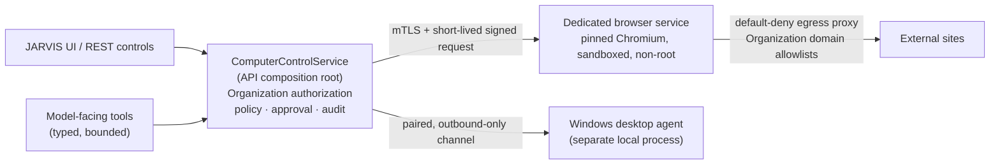

# Phase 19 — Computer & Browser Control

**Stage 19.0 — Architecture Decision Record**

| | |
|---|---|
| Status | Owner-approved architecture. **Stage 19.1 implemented and merged** (PR #14, merge commit `473bda0`, 2026-10-28). **Stage 19.2 implemented in the working tree, not committed, and not complete** — see §14. |
| Date | 2026-10-23 (architecture); §13 added 2026-10-28; §14 added 2026-10-28; §14.11 (audit remediation) added 2026-10-28 |
| Branch inspected | `feat/automation-engine-phase-18` @ `435c39f8` |
| Phase 18 merge state | **Not merged** at the time of writing (`main` was `1fd1bb0e`, the Phase 17 merge). **Merged since:** PR #12 (2026-10-21) and PR #13 (2026-10-22), read from GitHub on 2026-10-28. |
| Scope of this stage | Documentation and validation only |
| Runtime changes | None in §1–§12. §§13–14 record work done in later stages. |

This record defines the architecture, security boundaries and release gates for
Phase 19 — Computer & Browser Control. Every statement is labelled as one of:
**owner-approved** (a decision the owner has made), **verified** (observed in
the source named), **proposed** (target behavior that does not exist yet), or
**unresolved** (an operational choice this stage deliberately does not make).

Sections 1–12 were written before any runtime existed, and are left as written.
They are still the plan. Sections 13 and 14 are implementation records added
afterwards; where an implementation record differs from the plan above it says
so explicitly rather than editing the plan.

---

## 1. Purpose and scope

Phase 19 adds two related capabilities behind one control path:

1. **Browser control** — JARVIS and a person can drive a real browser through a
   dedicated, sandboxed service, with typed and bounded commands.
2. **Computer control** — a person can grant a separately paired local agent
   narrowly scoped control of a Windows desktop.

Both are treated as external-action surfaces. They must pass through the same
server-side authorization, approval and audit path as every other integration,
and they must fail closed.

**In scope for Stage 19.0:** the decisions below, the trust boundaries they
create, the security acceptance criteria, the stage sequence, and the
unresolved operational choices.

**Out of scope for Stage 19.0:** application code, database schema or
migrations, package changes, Docker or service startup, browser or desktop
automation, external network activity, and any Stage 19.1 work.

---

## 2. Inspection record

### 2.1 Repository state

Observed before any documentation change:

| Item | Result |
|---|---|
| Branch | `feat/automation-engine-phase-18` |
| HEAD | `435c39f8f54fcf84af076aa3e8a28d9b3ff214ac` — `feat(automation): add trusted n8n node schema validation` |
| Upstream | `origin/feat/automation-engine-phase-18`, ahead/behind `0 0` |
| `main` | `1fd1bb0e343725441419875541701051b344af4c` — merge of Phase 17 |
| Working tree | Two pre-existing untracked files, preserved untouched |
| Phase 18 | Committed on the phase branch; **not merged into `main`** |

The two untracked files are user work. They were identified and left exactly as
found. No branch, merge, rebase, reset, stash or switch was performed.

### 2.2 Documents and code read

- `AGENTS.md` — the binding integration, shared-connection, approval, voice,
  memory, marketing, observability and deployment rules.
- `docs/DOCUMENTATION_PROTOCOL.md` — phase documents live under
  `docs/phases/`, must distinguish implemented / verified / user-accessible,
  and must not claim future work as present.
- `docs/phases/phase-17.md`, especially §7 (tenant foundation) and §8
  (multi-business hardening): the Organization ownership model and the
  `authorizeSharedConnection` / `SharedConnectionAccess` policy table.
- `docs/phases/phase-18.md` — stages 18.1 through 18.5, including the
  server-enforced voice-confirmation refusal (18.3A).
- `docs/DEPLOYMENT.md` — Organizations and shared connections; the
  operator-only assignment command.
- `docs/DEVELOPMENT.md` — quality gates and the CI slices that select tests by
  file name.
- `docs/JARVIS_MASTER_AUDIT_AND_DEVELOPMENT_LEDGER.md` — roadmap, risk register
  and documentation rules.
- Current browser, tool, approval, authorization and composition code, cited
  inline below.

### 2.3 Existing Phase 19 document

**No Phase 19 architecture document or ADR existed in the repository before
this file.** A search across `docs/` for `Phase 19`, `phase-19`, `19.0`,
computer control, browser control and desktop agent found no architecture
record: only historical forward-references in `docs/phases/phase-15.md` and
`docs/phases/phase-16.md`, and one ledger note that the old capability matrix
omitted browser control (`docs/JARVIS_MASTER_AUDIT_AND_DEVELOPMENT_LEDGER.md`,
§10.4). This file is therefore new, not a duplicate.

### 2.4 Historical numbering note

Two older planning documents refer to computer control as **Phase 18**:

- `docs/phases/phase-15.md` (out-of-scope list) — “Phase 18 browser and
  computer control, Phase 19 self-repair”.
- `docs/phases/phase-16.md` §10 — “Self-repair (the brief's Phase 19) and
  computer control (Phase 18)”.

The owner has designated this work **New Phase 19 — Computer & Browser
Control**. That designation governs this record. The historical documents are
left unchanged, because `docs/DOCUMENTATION_PROTOCOL.md` forbids rewriting
history. This is a naming difference, not a change to any hard project rule.

---

## 3. Status vocabulary used in this record

| Label | Meaning |
|---|---|
| **Owner-approved** | The owner has approved the decision in this stage. |
| **Verified** | Observed in the named source file on the inspected commit. |
| **Proposed** | Target behavior. It does **not** exist yet and is not claimed as implemented. |
| **Unresolved** | A deployment or product choice left open on purpose. |

---

## 4. Context: what exists today (verified)

These findings motivate the decisions. They are observations of the inspected
commit, not proposals.

| # | Finding | Source |
|---|---|---|
| F1 | Browser tools are **not** shared-connection tools. `SHARED_CONNECTION_TOOLS` lists Meta Ads tools and one n8n allow-list tool only, so browser actions bypass `authorizeSharedConnection` and `SharedConnectionAccess`. | `packages/core/src/types/tenant.ts` (`SHARED_CONNECTION_TOOLS`); `packages/security/src/shared-connection-authz.ts` |
| F2 | When `ToolExecutor` creates an approval it does not pass a `tenantId`. A browser approval therefore has no Organization binding and can be approved by its requester. | `packages/tools/src/executor.ts` (`requestApproval({...})`) |
| F3 | Audit rows and approval parameters receive `request.params` directly. Redaction is key/shape based. `browser.type` and `browser.submit` carry free-text field values, so a typed password can reach durable records if its key is not recognised as secret. | `packages/tools/src/executor.ts` (`audit`); `packages/tools/src/tools/browser-tools.ts` |
| F4 | `buildApprovalSummary` has no browser cases, so a browser write is confirmed without a purpose-built, reviewable summary. | `apps/api/src/services/approval-summary.ts` |
| F5 | The browser runtime launches one shared Chromium inside the API process with `--no-sandbox`. A browser compromise is an API-process compromise. | `packages/browser/src/runtime.ts`; `apps/api/src/services/container.ts` |
| F6 | The reference deployment sets `BROWSER_ENABLED=false`, and the application image does not contain Chromium. Browser control is effectively off in that deployment. | `docker-compose.yml`; `Dockerfile` |
| F7 | `DownloadStore` writes bytes under the download root but keeps its `downloadId → record` map in process memory. A restart loses ids, and several API instances cannot share artifacts. | `packages/browser/src/download.ts` |
| F8 | The navigation policy documents a DNS-rebinding residual risk and checks each request; the address-pinned fetch pattern exists separately. | `packages/browser/src/navigation-policy.ts`; `packages/browser/src/page-fetcher.ts` |
| F9 | The current controls describe document navigation and subresources; WebSocket, service-worker and popup egress are not separately enumerated. | `packages/browser/src/session.ts`; `packages/browser/src/navigation-policy.ts` |
| F10 | `VOICE_REFUSED_TOOLS` currently contains only the Automation Library sync. The global refusal of a spoken *confirmation* is verified and separate. | `packages/core/src/voice-tool-policy.ts`; `packages/core/src/types/voice.ts` |

**Verified existing controls worth preserving:** ten typed browser tools with
no raw Playwright handle at the tool boundary; per-session empty browser
contexts; opaque download ids; approval param hashing, a ten-minute TTL and
single-winner conditional consumption; Organization ownership rows; and
server-established voice-confirmation refusal.

**Verified existing gaps are not fixed by this document.** They are the work of
Stages 19.1–19.7.

---

## 5. Trust boundaries and control flow

The target flow is one control service with one authorization and approval
path. The diagram describes **target architecture**; the new boxes do not
exist today.

### 5.1 Boundary requirements

- **One service.** Manual UI controls and model-facing tools converge on the
  same `ComputerControlService`. The browser service and the desktop agent are
  never called directly by a route, a tool, a page or an agent.
- **Policy stays in the API.** The browser service executes typed, bounded
  commands. It does not decide Organization membership, role, approval or
  audit.
- **Narrow commands only.** No model-facing surface receives a raw Playwright
  handle, CDP access, arbitrary JavaScript evaluation, a general-purpose shell
  or an unrestricted filesystem.
- **No bypass.** Browser and desktop actions cannot skip the shared
  authorization, approval and audit path.
- **Unknown is a state.** An external action dispatched but not confirmed is
  recorded `UNKNOWN`. It is never automatically retried as though nothing
  happened.
- **Organization scope beside ownership.** Every read and write is filtered by
  the owning Organization as well as the user; a request-supplied tenant or
  organization identifier is never trusted.
- **Compatibility with the integration rule.** This record does not replace or
  duplicate `IntegrationCommandService`, and it creates no second authorization
  path for an existing integration. Browser and desktop control are not
  currently entries in `INTEGRATION_CATALOG`. If Stage 19.1 catalogues them as
  integrations, the command service remains the execution seam and
  `ComputerControlService` becomes its adapter — the REST router and the JARVIS
  tools still converge on one service, as `AGENTS.md` requires.

---

## 6. Architecture decisions

### ADR-19-001 — Branch and merge sequencing

**Status:** Owner-approved.

**Decision.** Preserve the committed Phase 18 work. New Phase 19 work branches
from the Phase 18 HEAD (`435c39f8`), or from `main` after Phase 18 merges. Phase
19 does not modify Phase 18. This stage performs no merge and no branch
operation.

**Why.** Phase 18 is committed but unmerged (`main` = `1fd1bb0e`). Branching
from an unmerged base keeps the Phase 19 change set reviewable and avoids
rewriting Phase 18 history. The shared authorization and approval code Phase 19
depends on is present on the Phase 18 HEAD.

**Requirements.**

- Phase 19 changes are additive and must not alter Phase 18 tables, tools or
  contracts.
- If Phase 18 merges first, Phase 19 rebases or re-branches only by explicit
  owner instruction; this record does not authorise it.
- The eventual merge order is an owner decision (see §9).

---

### ADR-19-002 — Browser-service authentication

**Status:** Owner-approved. **Implementation:** proposed, not present.

**Decision.** The dedicated browser service authenticates with **mutual TLS
plus short-lived signed requests**. The two mechanisms have distinct jobs and
are both required.

| Responsibility | Mutual TLS | Short-lived signed request |
|---|---|---|
| Purpose | Prove the transport peers are the provisioned API and the provisioned browser service. | Authorize one specific request and bind it to its exact content. |
| Identity binding | Service certificate identity, issued per deployment. | Signing key id, mapped server-side to the same service identity as the certificate. |
| Expiry | Certificate lifetime, deliberately short and rotated. | Request-level expiry, short and configurable in Stage 19.2. |
| Replay protection | Protects the channel; does **not** by itself stop a captured application request from being replayed. | Timestamp window plus a single-use nonce, rejected on reuse. |
| Rotation | Certificate replacement on a defined schedule and on suspected compromise. | Key-id rollover: the new key is accepted while the old is retired. |
| Revocation | Certificate revocation and removal from the trust bundle. | Key-id removal; outstanding requests expire quickly. |

**Requirements.**

- A request is accepted only when the certificate identity and the signing key
  id resolve to the **same** service identity. A mismatch is refused.
- The signed payload covers method, path, body hash, timestamp, nonce and key
  id. A body that does not match its hash is refused.
- A reused nonce, an expired timestamp or an unknown key id is refused before
  the browser service performs any work.
- Private keys and trust material are encrypted at rest where stored and are
  never returned to a client, logged or placed in an audit row.

**Unresolved:** certificate lifetime, rotation cadence, and how revocation is
distributed in a multi-instance deployment (see §9).

---

### ADR-19-003 — Organization-scoped browser ownership

**Status:** Owner-approved. **Implementation:** proposed, not present.

**Decision.** Authorization is enforced server-side and scoped to the owning
Organization. Cross-Organization access is denied by default. The initial
release supports **Organization-owned shared browser access only**; personal
browser profiles are not offered.

**Requirements.**

- Browser actions join the shared-connection model: ownership is recorded by
  the operator command, never inferred from the first caller or from an
  account-wide role.
- Until an Organization owns the browser connection, every caller is refused,
  platform owners and admins included.
- Reads require Organization membership; writes require an owner or admin.
  A write is approved by a **different** owner or admin of that Organization.
- Public and error responses do not reveal another Organization's existence,
  configuration or identifiers.
- An authorization lookup that fails is a refusal, never an allow.

**Why.** This is the Phase 17 model (`docs/phases/phase-17.md` §7–§8) applied to
a new connection. It keeps one policy table and one reader instead of adding a
browser-specific authorization path.

---

### ADR-19-004 — Windows-first desktop agent

**Status:** Owner-approved. **Implementation:** proposed, not present.

**Decision.** The first desktop-agent target is **Windows**. macOS and Linux are
deferred. The agent is a separate local process, paired to an authorized
identity. It communicates **outbound only** and exposes no general-purpose
shell and no unrestricted filesystem.

**Requirements.**

- The agent initiates the connection; it does not listen for inbound commands.
- Pairing binds the agent to a specific user identity and Organization, with a
  revocable credential.
- The command surface is a fixed allowlist of narrow verbs. There is no
  `exec`, no arbitrary path read or write, no registry editing and no
  credential access.
- The agent can be revoked centrally; a revoked agent is refused on its next
  request.
- Desktop control does not ship before pairing, consent, command allowlisting
  and security tests are complete (ADR-19-005).

**Unresolved:** exact Windows versions and packaging method (see §9).

---

### ADR-19-005 — Desktop consent

**Status:** Owner-approved. **Implementation:** proposed, not present.

**Decision.** Every desktop session requires **explicit consent**, uses a
**time-limited grant**, supports **immediate revocation**, shows a **visible
control indicator**, and requires **separate approval for sensitive actions**.

**Required behavior (target, not existing):**

- **Consent:** a person grants a session explicitly; consent is not implied by
  pairing or by a previous session.
- **Expiry:** a grant expires after a bounded interval; expiry ends the session
  and requires fresh consent.
- **Revocation:** a person or an Organization owner/admin can revoke
  immediately; the agent stops accepting commands and the API refuses further
  work.
- **Reconnect:** a dropped connection does not silently resume control. It
  requires a valid, unexpired grant and a fresh server-side authorization
  check.
- **Offline:** while the agent is offline, no command is queued for later
  execution. Commands fail; nothing is replayed on reconnect.
- **Visible status:** the person can see whether control is active, what scope
  was granted, and when it expires.
- **Sensitive actions:** input, file selection and anything that changes
  external state need their own approval, separate from the session grant.

**Unresolved:** grant duration, reconnect grace window and the exact consent
screen (see §9). They are requirements to define, not values to invent here.

---

### ADR-19-006 — Voice restrictions

**Status:** Owner-approved. **Implementation:** partly verified, partly
proposed.

**Decision.** Voice may request permitted **read-only** operations. Voice
cannot independently authorize sensitive writes and cannot confirm an approval.
Sensitive browser and desktop actions follow the server-enforced policy. The
exact tool denylist is a **Stage 19.1 implementation item**.

**Verified today.**

- A spoken confirmation is refused from the server-established turn mode at the
  chat route, the confirmation endpoint and `ToolExecutor`
  (`VOICE_CONFIRMATION_REFUSED_MESSAGE`).
- `VOICE_REFUSED_TOOLS` exists as the single narrowing list, but currently
  contains only the Automation Library sync.

**Proposed for Stage 19.1.**

- Add the sensitive browser and desktop tools to the voice denylist, so a
  misheard sentence cannot start them at all.
- Keep voice able to propose, cancel and change; never to confirm.
- Make the denylist and the refusal code visible to both the tool path and the
  orchestrator, so a refused spoken turn produces an ordinary reply rather than
  an execution or a pending action.

**The exact list is unresolved until Stage 19.1** (see §9). It must be defined
in the contracts, not inferred at runtime.

---

### ADR-19-007 — Artifact retention

**Status:** Owner-approved. **Implementation:** proposed, not present.

**Decision.** Browser artifacts (downloads, screenshots and other captured
files) use **opaque identifiers**, **owner and Organization scoping**,
**access checks**, **quotas** and **configurable expiry**.

**Requirements.**

- A client receives an opaque id and metadata only; never a filesystem path and
  never the bytes in an API response.
- Reading or attaching an artifact re-checks the requesting user **and** the
  owning Organization. An id from another scope is answered as not found.
- Quotas bound per-user and per-Organization storage.
- Expiry is configurable deployment policy, not a hard-coded constant.
- The current in-memory artifact index is replaced by durable, shared storage
  so a restart or a second API instance cannot lose or fork an id.

**Unresolved:** the exact retention duration and the storage backend (for
example object storage versus a database-backed store) are deployment-policy
choices (see §9). This record does not invent a duration.

---

### ADR-19-008 — Default-deny network egress

**Status:** Owner-approved. **Implementation:** proposed, not present.

**Decision.** Browser egress is controlled by a proxy with **default-deny**
rules and **Organization-level domain allowlists**. Loopback, private,
link-local, cloud-metadata and other prohibited targets are blocked. DNS and IP
restrictions are enforced at the **network boundary**, including redirects,
WebSockets, service workers and subresources.

**Requirements.**

- The browser service has no unrestricted direct egress; traffic goes through
  the proxy.
- Default is deny. A domain is reachable only when the owning Organization's
  allowlist permits it.
- Resolution and connection are both checked, so a hostname that resolves to a
  prohibited address after the policy check is refused. Redirect targets,
  WebSocket handshakes, service-worker fetches and subresource requests are
  checked the same way.
- Prohibited ranges include loopback, private, link-local, unique-local,
  carrier-grade NAT and cloud metadata endpoints.
- Allowlist administration is an Organization write: only an owner or admin
  may change it, and the change is audited.
- A denied request is a stable refusal, not a silent fallback to direct access.

**This is target behavior.** The current navigation policy is not a
default-deny network boundary, and F8/F9 record its limits.

---

### ADR-19-009 — Missing prior inspection report

**Status:** Provenance note. Owner-approved.

**Decision.** The previous Phase 19 inspection report referenced before this
stage **was not found in the repository** during the prior inspection. This
record does not assert that no copy exists outside the repository.

**Consequences.**

- This ADR is based on direct inspection of the code and documents listed in
  §2, not on that report.
- No runtime or build dependency is placed on the report.
- If the report is later supplied, it is treated as additional evidence and any
  disagreement is recorded transparently; the historical section is not
  rewritten.

---

### ADR-19-010 — Dedicated browser isolation

**Status:** Owner-approved. **Implementation:** proposed, not present.

**Decision.** Chromium runs in a dedicated, sandboxed browser service, separate
from the API process, with a pinned runtime, non-root execution, appropriate
sandboxing, resource limits, restricted filesystem access, isolated sessions
and controlled egress. No raw Playwright handles, CDP, arbitrary JavaScript or
unrestricted execution are exposed to model-facing tools.

**Requirements.**

- The browser service has its own image, pinned Chromium version, healthcheck
  and resource limits.
- It runs as a non-root user, with a read-only root filesystem, a minimal
  writable area and dropped capabilities.
- The Chromium sandbox is **not** disabled in the service. The current
  `--no-sandbox` launch in the API process is not carried forward.
- Each session gets an isolated browser context. Sessions do not share cookies,
  storage or artifacts across users or Organizations.
- The process is not on the host network and reaches the internet only through
  the egress proxy (ADR-19-008).
- The API holds only a typed client. It does not link Playwright or launch a
  browser.
- A session is destroyed when it ends, whether it ends normally, by timeout or
  by revocation.

---

## 7. Security and release acceptance criteria

These are mandatory gates. A stage that cannot demonstrate them does not ship.
They describe the required end state, not current behavior.

| # | Criterion |
|---|---|
| S1 | Organization membership, role, connection ownership and resource scope are checked **server-side for every operation**. A request-supplied tenant or organization id is never trusted. |
| S2 | Approvals are bound to the exact action and canonicalized parameters, consumed **once**, expire, and resist concurrent replay. Shared-connection writes require an independent owner or admin. |
| S3 | No typed password, secret, token or sensitive form value is persisted in audit rows or approval records. Only field names, counts, hashes and origins are kept. |
| S4 | Browser network access blocks prohibited targets, including DNS rebinding, redirects, WebSockets and service-worker requests. Denial happens at the network boundary, not only in application policy. |
| S5 | Browser sessions and artifacts cannot cross user or Organization boundaries, including after restart or across multiple API instances. |
| S6 | Desktop pairing can be revoked, and an unauthorized or out-of-scope command is rejected. A revoked or expired agent cannot act. |
| S7 | Voice cannot confirm sensitive actions. Sensitive browser and desktop tools are refused for a spoken turn in contracts and execution. |
| S8 | An uncertain external-action outcome is recorded `UNKNOWN` and is **not** automatically retried. Resolution requires a person. |
| S9 | CI covers the relevant unit, contract, integration, database and security tests, including the named slices required because several workspaces are not gated whole. |
| S10 | Real-browser security behavior is exercised in an isolated environment before release. |
| S11 | Every new capability is **off by default** until its release gates pass. `BROWSER_ENABLED` remains the operator switch, and no desktop agent is paired by default. |

---

## 8. Implementation sequence

The order is proposed. Each stage is independently reviewable, and each feature
stays disabled until its own gates pass.

| Stage | Scope | Exit gate |
|---|---|---|
| **19.1** | Typed contracts, Organization authorization entries, approval semantics, voice policy and contract tests. No runtime. | Typecheck and contract tests pass; behavior unchanged. |
| **19.2** | Dedicated browser-service skeleton and authenticated transport (mTLS + signed requests), image, healthcheck, egress proxy. **Amendment (2026-10-28):** the egress proxy moves to Stage 19.3, by owner decision, so that 19.2 neither enables nor claims default-deny egress. See §14. | Service health proven; API registers no browser tool while disabled. |
| **19.3** | Migrate existing browser tools through the common service; enforce tenant-bound authorization and approvals. | Manual and model paths reach one service; outsiders see one "not available" answer. |
| **19.4** | Durable, scoped artifact storage with expiry and quotas. | Restart and multi-instance tests pass; a stale or foreign id is not found. |
| **19.5** | Value-free audit, meaningful approval summaries, and `UNKNOWN` outcome handling. | Redaction and unknown-outcome tests pass; nothing is auto-retried. |
| **19.6** | Windows desktop agent: secure pairing, consent, revocation and a fixed command allowlist. | Pairing/consent/revocation tests pass; no inbound port; sensitive input needs independent approval. |
| **19.7** | Network hardening, real-browser security tests, CI gates, operational documentation and rollback validation. | Security review sign-off, CI green, rollback rehearsed and documented. |

**Sequencing rules.**

- Stage 19.1 must land before any runtime work; it fixes the vocabulary both
  paths share.
- Desktop control must **not** ship before pairing, consent, command
  allowlisting and security tests are complete.
- No stage may enable a capability by default.

---

## 9. Unresolved operational choices

This stage deliberately leaves the following open. None of them blocks the
architecture; each is resolved before the stage that needs it.

| # | Open choice | Needed by |
|---|---|---|
| U1 | Merge timing and final order for Phase 19 versus Phase 18 | Before 19.1 branches |
| U2 | Certificate lifetime, rotation cadence and revocation distribution for ADR-19-002 | Stage 19.2 — **still open**; 19.2 implements the interface and refuses to start without TLS material, and automates none of the rotation (§14.7) |
| U3 | Exact voice denylist for browser and desktop tools | Stage 19.1 |
| U4 | Artifact retention duration and storage backend | Stage 19.4 |
| U5 | Desktop grant duration, reconnect grace window and consent-screen wording | Stage 19.6 |
| U6 | Supported Windows versions and agent packaging | Stage 19.6 |
| U7 | Organization allowlist administration screen and review flow | Stage 19.7 |
| U8 | Whether the missing prior Phase 19 inspection report exists outside the repository | Informational |

---

## 10. What this record does not do

- It does not create, modify or enable any runtime component.
- It does not add tables, migrations, routes, tools, agents or environment
  variables.
- It does not claim that mTLS, signed requests, egress filtering, the browser
  service, the desktop agent, durable artifacts or value-free audit exist.
- It does not begin Stage 19.1.
- It does not rewrite Phase 15, 16, 17 or 18 history.

---

## 11. Validation record

The documentation-only change was validated as follows on 2026-10-23. Commands
and their actual results are recorded in the Stage 19.0 completion report
returned with this file:

1. `git diff --check` — whitespace/conflict-marker check.
2. `git status --short` — confirm only the intended documentation file is new,
   and the two pre-existing untracked files are untouched.
3. Path, stage-number and cross-reference review by inspection.
4. Status review: each claim is marked owner-approved, verified, proposed or
   unresolved, and no future control is described as implemented.

No dependency installation, database, container, browser, desktop agent or
external site was used.

---

## 12. References

- `AGENTS.md` — integration parity, shared connections, approvals, voice,
  secrets, deployment and documentation precedence.
- `docs/DOCUMENTATION_PROTOCOL.md` — phase documentation and honesty rules.
- `docs/phases/phase-17.md` — tenant foundation and shared-connection
  authorization.
- `docs/phases/phase-18.md` — Automation Library and server-enforced voice
  confirmation refusal.
- `docs/DEPLOYMENT.md` — Organizations and operator-only connection assignment.
- `docs/DEVELOPMENT.md` — quality gates and CI test selection.
- `docs/JARVIS_MASTER_AUDIT_AND_DEVELOPMENT_LEDGER.md` — roadmap and risk
  register.
- Source inspected: `packages/core/src/types/tenant.ts`,
  `packages/core/src/voice-tool-policy.ts`,
  `packages/core/src/types/browser.ts`,
  `packages/tools/src/tools/browser-tools.ts`,
  `packages/tools/src/executor.ts`,
  `packages/browser/src/runtime.ts`,
  `packages/browser/src/session.ts`,
  `packages/browser/src/navigation-policy.ts`,
  `packages/browser/src/download.ts`,
  `packages/security/src/shared-connection-authz.ts`,
  `apps/api/src/services/approval-summary.ts`,
  `apps/api/src/services/container.ts`,
  `docker-compose.yml`, `Dockerfile`.

---

## 13. Stage 19.1 implementation record (merged)

Stage 19.1 is on branch `feat/computer-control-phase-19-1`, ending at commit
`4748c94` (`fix(computer-control): preserve approved publish previews`). It was
**merged into `main` by PR #14** on 2026-10-28 (05:49 UTC); the merge commit is
`473bda0`, which is `origin/main` on GitHub. Read from GitHub (`gh pr view 14`,
`git ls-remote`), not from the local clone: the clone's `main` and its
`origin/main` tracking ref were not fetched and still show `1fd1bb0e`, the
Phase 17 merge. An earlier version of this section said 19.1 was not merged;
that was stale.

Implemented (verified in the source this session):

- `packages/core/src/computer-control.ts` — the closed action sets, bounds,
  value-free approval summary and binding helpers, and
  `parseComputerControlRequest` / `BrowserControlResultSchema`, which Stage 19.2
  reuses rather than redefining.
- The tools' write path: every browser write resolves its Organization scope
  through `@jarvis/security`'s shared-connection policy, then consumes its
  approval once, atomically, with that scope
  (`packages/tools`, selected in CI as `computer-control` and
  `sprint7-browser-tools`).
- `ToolExecutor`'s refusal of a spoken sensitive action, and the pending
  action's preview preserving an approved publish item's identifying fields.
- `apps/api/src/services/approval-summary.ts`.

Test evidence for 19.1 is in the commit and in CI's
`Test computer-control contracts` step. This record does not restate it.

---

## 14. Stage 19.2 implementation record (working tree, not committed)

**Status: implemented in the working tree; NOT complete; NOT committed; NOT
deployed.** The service skeleton, the authenticated transport, the image, the
healthcheck, the API integration and the tests exist. Two things the plan puts
in 19.2 do not: the egress proxy (moved to 19.3 by owner decision, 2026-10-28)
and the resolution of U2 (certificate lifetime, rotation and revocation). See
§14.7.

### 14.1 What was built, and where

| Component | Path | What it is |
|---|---|---|
| Protocol, signing, client | `packages/browser-protocol` | A pure package: the versioned envelope, the request signature, nonce and clock rules, the size/deadline bounds, the endpoint loader, the HTTP client and `RemoteBrowserRuntime`. No Playwright, no I/O beyond `node:https`. |
| Browser service | `apps/browser-service` | A standalone process listening with mutual TLS only: certificate identity, signed-request verification, a session registry over `@jarvis/browser`'s `BrowserRuntime`, an engine that is **off** unless explicitly enabled, and — on a second, loopback-only listener — a liveness route with no path to a browser operation (§14.11). |
| API selection | `apps/api/src/services/container.ts` | `readBrowserServiceEndpoint()` chooses the remote runtime, the local runtime, or nothing. Same `BrowserRuntimePort`, same `createBrowserTools(...)` call, same tools, same grants and approvals. |
| Organization binding | `apps/api/src/services/tenancy/shared-connection-access.ts` | `createBrowserSessionTenantResolver` resolves the session's Organization from the shared-connection reader — never from a request body. |
| Deployment | `apps/browser-service/Dockerfile`, `docker-compose.yml` (profile `browser-service`), `Dockerfile`, `.env.example` | A separate, non-root image with resource limits, no published port, and a compose profile that is off by default. |
| Tests | `packages/browser-protocol/test/browser-service-*.test.ts`, `apps/browser-service/test/browser-service*.test.ts`, `apps/api/test/browser-service-*.test.ts`, `packages/tools/test/computer-control-write-outcome-p19.test.ts` | Counts as first built are in §14.6; after the audit remediation, §14.11.7. |

### 14.2 The wire contract

- **Version.** One string, `jarvis-browser/1`, on every request and every
  response, checked **before** the payload. A different version is
  `UNSUPPORTED_VERSION`; a missing one is `INVALID_REQUEST`.
- **Operations.** `session.open`, `session.close`, and the ten Phase 19.1
  browser actions. Desktop actions are not in the set and cannot be added by a
  request: an unknown operation is `UNKNOWN_OPERATION` before anything is
  dispatched.
- **Payloads.** Each action's payload is validated by the Phase 19.1
  `parseComputerControlRequest`, so a request cannot carry its own `action`, a
  URL scheme the browser policy forbids, a malformed UUID, an unknown envelope
  field, or an empty subject.
- **Results.** The service validates its own result against
  `BrowserControlResultSchema` before responding; the client validates the
  response envelope and the action's result again. A result that does not match
  is never passed along: `PROVIDER_ERROR` for a read, and for a write — which
  has already run — `UNKNOWN_OUTCOME` (§14.11.2).
- **Errors.** A fixed set of codes with fixed sentences. An unknown code on the
  wire collapses to `PROVIDER_ERROR`; a peer's own message is discarded, never
  shown, logged or audited. Refusals carry no page content, no URL and no
  credential.
- **Bounds.** Two kinds, and a deployment can move them differently
  (corrected 2026-10-28; this bullet used to say every bound could only be
  lowered).
  - *Ceilings, which a deployment may only lower:* request body 64 KiB,
    applied to raw bytes before JSON parsing (`BROWSER_SERVICE_MAX_BODY_BYTES`,
    1 KiB–64 KiB); session TTL 60 s by default, 1 s–240 s
    (`BROWSER_SERVICE_SESSION_TTL_MS`); at most 16 sessions per process, 2 by
    default (`BROWSER_SERVICE_MAX_SESSIONS`). The response body is held to
    4 MiB by the API's client while reading; it is not configurable.
  - *Defaults, which a deployment may raise as well as lower, within a range:*
    the per-request deadline, 30 s by default and 1 s–120 s on each side
    (`BROWSER_SERVICE_TIMEOUT_MS` for the API's client,
    `packages/browser-protocol/src/config.ts`; `BROWSER_SERVICE_REQUEST_TIMEOUT_MS`
    for the service, `apps/browser-service/src/config.ts`), and the clock skew a
    signed request may carry, 60 s by default and 1 s–300 s
    (`BROWSER_SERVICE_CLOCK_SKEW_MS`). A longer skew is a longer window in which
    a captured request could be replayed once against a freshly restarted
    process (§14.3). If the API's deadline is the shorter of the two, the API
    can give up on a write the service is still performing; that write is
    recorded `UNKNOWN`, never retried (§14.11.2).
  - *Nonce memory:* a nonce is kept for 5 min after its request's timestamp (or
    its arrival, if later) — the longer of 5 min and the configured skew, which
    is never more than 5 min.
- **The page field.** Every Phase 19.1 action names a `url` because a tool
  navigates and then acts. Over this boundary only `browser.navigate`
  navigates; every other action acts on the session's **current** page and
  ignores that field. Honouring it would let a request move a session between
  the navigation an approval was given for and the action itself. The result
  carries the page that was actually acted on.

### 14.3 Authentication, and what it proves

- **Signed requests.** HMAC-SHA256 over a canonical string of method, path,
  timestamp, nonce, key id, body SHA-256 and the caller's transport identity.
  Verification order: peer identity → required headers → nonce shape →
  timestamp window → body hash → known key → key-identity match → signature →
  nonce spend. A failed signature spends no nonce; a spent nonce is
  `REPLAY_DETECTED`.
- **Transport identity.** It is the client certificate's CN/SAN, verified by
  the TLS stack, and nothing else. Mutual TLS is the only mode: the process
  **fails to start** without certificate, key and CA paths, and it refuses to
  start when `BROWSER_SERVICE_REQUIRE_MTLS` is anything but `true` or
  `BROWSER_SERVICE_TRUST_FORWARDED_PEER_IDENTITY` is anything but `false`. The
  forwarded-identity mode this section first described — no TLS, identity from
  a request header — was removed (§14.11.4): the service could not tell a
  terminator's header from the caller's. The API's client refuses an `http:`
  endpoint and refuses to send without its client certificate.
- **Presenting identity = signing identity.** A key bound to one identity
  cannot be used by another: the signature covers the peer identity, and the
  server compares the two.
- **The secret is never echoed.** Configuration errors name a field, never a
  value; a short secret is reported as short.
- **No public surface.** Everything on the service port, `/healthz` included,
  needs a client certificate from the configured CA. The container's own
  healthcheck asks a second listener bound to `127.0.0.1` inside the container
  (`BROWSER_SERVICE_HEALTH_PORT`, default 3201), which answers `GET /healthz`
  with a fixed liveness body (status, service name, protocol version, whether
  Chromium is on) and `404` to every other path and to any non-loopback peer
  (§14.11.3). Both can be hidden behind `BROWSER_SERVICE_HEALTH_TOKEN`; when
  set, a wrong or absent token is `404`, not `403`, so the route does not
  confirm its own existence. The compose service publishes no port.
- **Replay after a restart.** The nonce store is per process
  (`ProcessNonceStore`). A restarted process has forgotten the nonces it saw,
  so a request captured inside its clock-skew window (60 s by default) could be
  accepted once more by the new process. Capturing one needs the mutual-TLS
  session; a shared, durable nonce store is Stage 19.7. Not claimed otherwise.

### 14.4 Isolation, sessions and the Organization

- **Fresh context per session**, inherited from `@jarvis/browser`: no cookie
  jar, no storage, no profile, no saved credential is shared between sessions or
  survives one. There is no "personal browser profile" option anywhere in the
  contract.
- **Artifacts are per user, not per session** (corrected, §14.11.5). Downloads
  and screenshots go to the process's one `DownloadStore`, whose index is keyed
  by `userId` alone. Another user can never read them, but every session of
  the SAME user in that process can — including a session for another
  Organization the user also belongs to. The index is in memory, so a restart
  loses it. Scoping artifacts by Organization and making them durable is Stage
  19.4 (ADR-19-007); until then the claim is "per user, per process".
- **One session, one server-resolved subject.** The API resolves
  `(userId, organizationId)` through `SharedConnectionAccess` before it opens a
  session; the service stores that pair at `session.open` and compares it on
  every later request. A different user or Organization — a request-body claim,
  a reused id, a stale screen — is `CROSS_TENANT_DENIED` before the session is
  read, so it cannot even learn whether the id is live. A `session.close` from
  another Organization is refused too.
- **Deterministic cleanup.** Close, TTL expiry and shutdown all resolve the one
  promise the runtime's `withSession` is holding, so the runtime's own `finally`
  closes the context. A sweeper runs every second; a failed or timed-out open
  removes its entry and closes a context that appears later. Shutdown ends every
  session before asking the runtime to close.
- **Resource limits.** Process-level: max sessions and max sessions per
  Organization, both checked in the same synchronous turn as the insert. Outer:
  the container's `pids_limit`, `mem_limit`, `cpus`, `shm_size` and tmpfs.
- **The writes are still the API's.** The service has no notion of an approval.
  The tools decide — grant, then scope, then approval claim, then session — and
  only then does a request exist. No route, tool or frontend path reaches the
  service directly; the model can only call a registered tool.

### 14.5 Two places a browser can run, one set of tools

| `BROWSER_ENABLED` | `BROWSER_SERVICE_URL` | Result |
|---|---|---|
| not `"true"` | either | No browser tools. Nothing is started. |
| `"true"` | unset | The in-process runtime, exactly as before 19.2. |
| `"true"` | set, configuration usable | `RemoteBrowserRuntime`. The API process holds no browser. |
| `"true"` | set, configuration unusable | **No browser tools at all.** No fallback to an in-process Chromium. |

The last row is deliberate: an operator who asked for isolation and silently got
an in-process browser would have been told the opposite of the truth. The API
logs `browser_registration_skipped` with the field that was wrong.

### 14.6 Test evidence (2026-10-28, Windows, working tree)

*Historical: the results of the stage as first built, before the Stage 19.2
security audit. Several things they describe were changed by the remediation
(plain-HTTP harness, forwarded identity, `PROVIDER_ERROR` for every failed
write). The current evidence is §14.11.7.*

| Command | Result |
|---|---|
| `pnpm install` | lockfile updated for the two new workspaces; no new external dependency except `playwright-core`, already used by `@jarvis/browser` |
| `pnpm typecheck` | 40/40 tasks |
| `pnpm typecheck:tests` | 23/23 tasks (the new workspaces opt in) |
| `pnpm lint` | 22/22 tasks |
| `pnpm build` | 22/22 tasks |
| `pnpm --filter @jarvis/browser-protocol exec vitest run` | **51 passed** |
| `pnpm --filter @jarvis/browser-service exec vitest run` | **26 passed** |
| `pnpm --filter @jarvis/api exec vitest run test/browser-service-wiring.test.ts test/sprint7-browser-wiring.test.ts` | **8 + 19 passed** |

What the tests actually exercise:

- **Protocol** (51): envelope accept/refuse for every malformed shape; version
  before payload; unknown operation and a desktop action refused; a payload that
  names its own action refused; `javascript:` refused; strict unknown field
  refused; response round trip, forged message discarded, unknown code collapsed,
  wrong version refused; canonical string and signature tampering; expired
  timestamp; malformed signature; nonce single-use and expiry; `verifySignedRequest`
  rejecting an unproven peer, a missing header, an expired request, a tampered
  body, an unknown key, a key bound to another identity, a replay; the
  endpoint's `absent`/`invalid`/`ready` distinction and its redacted reasons; the
  client signing over exact bytes (verified by the server-side verifier), a
  fresh nonce per request, oversized request refused **before** the transport,
  failure code propagation, transport error → `UNAVAILABLE` with a fixed
  sentence, deadline → `TIMEOUT`, oversized/flags response → `TOO_LARGE`,
  malformed/non-JSON response → `PROVIDER_ERROR`/`UNAVAILABLE`; the remote
  runtime's open/act/close sequence, its subject on every request, its
  tenant-refusal and read-failure refusal **before** any call, closing when the
  work throws, a mismatched result refused, an action before any navigation
  refused.
- **Service** (26): configuration refusals (missing key/secret/peer, short
  secret, missing TLS, a mode where no identity could be proven, out-of-range
  limits, Chromium off by default); the disabled engine refuses every session;
  liveness body and token; no other route; unsigned request refused before any
  work; wrong secret, expired request, replay; oversized body; unsupported
  version; unknown operation; open/act/close with the engine called exactly
  once; cross-Organization `navigate` and `close` refused with the engine
  untouched; TTL expiry ends the session; the session ceiling; an open that
  never becomes usable times out and leaves nothing; Chromium off → every
  session `UNAVAILABLE`; a provider error's own words kept out of the response
  and the log; the shared secret absent from refusals; a registry-level unknown
  id and shutdown.
- **API wiring** (8 + 19): the tenant resolver's allowed/denied/throwing paths
  and the exact connector and operation it asks; `isBrowserEnabled` separated
  from `isBrowserConfigured`; the container choosing the remote runtime through
  the same tools and port, exactly one local `new BrowserRuntime(`, the unusable
  configuration branch registering nothing and falling back to nothing, and the
  remote runtime staying behind the same opt-in. The 19 existing Sprint 7 drift
  tests still pass unchanged.

No test starts Chromium, reaches an external site, uses a database host, or
performs an external write. The service tests use a real HTTP server on
`127.0.0.1:0` and a fake engine; the protocol tests use a transport function.

### 14.7 What is deferred, and why

| Deferred | Why, and where it is tracked |
|---|---|
| **Default-deny network egress** | Owner decision (2026-10-28): the egress proxy is Stage 19.3, not 19.2. The service has ordinary outbound access today, is off by default, and must not be described as egress-filtered. ADR-19-008 remains the requirement; S4 is **not** met. |
| **Certificate lifetime, rotation, revocation (U2)** | **Unresolved.** Not invented and not implemented. The service and the API accept certificate/key/CA paths and refuse to start or send without them; nothing generates, rotates, revokes or distributes a certificate, there is no CRL or OCSP check, and a certificate is read again only when a process restarts (the API's client re-reads its files per request). Lifetimes, a rotation cadence and a revocation path are an owner decision; until it is made, certificates are a manual deployment concern and a compromised client certificate stays valid until its CA is replaced. |
| **A shared nonce store across instances, and across restarts** | `ProcessNonceStore` is per process. Two browser-service replicas would each accept the same nonce once, and a restarted process forgets the nonces it saw, so a request captured within its clock-skew window (60 s default) could be accepted once more. The compose service runs one replica (`container_name`, no scaling); a shared store is a Stage 19.7 concern with the rest of the network hardening. |
| **Pinned Chromium** | The image installs Alpine's `chromium`, which a rebuild can change. Version pinning and a signed package source are open. |
| **Container-as-sandbox claim** | Not claimed. The container is a process boundary with limits. Chromium keeps its own sandbox because the launcher sets `chromiumSandbox: true` (§14.11.1); if the host cannot support it the browser does not run. S10 has been run on a Windows host (§14.11.7); it has **not** been run inside the Linux container. |
| **Durable artifacts** | 19.2 returns a screenshot by id from the runtime and stores nothing durably. Artifacts are per user and per process, not per session or per Organization (§14.4). Retention, quotas, Organization scoping and cross-instance lookup are Stage 19.4. |
| **Desktop control** | Untouched. No desktop operation exists in this protocol. |

### 14.8 Exit criteria for 19.2, assessed

| Criterion | Assessment |
|---|---|
| Service health proven | **Met, in tests.** The loopback listener's `GET /healthz` returns a fixed body over plain HTTP; the mTLS port's `/healthz` answers only a peer with a valid client certificate; the compose healthcheck asks the loopback listener (§14.11.3). Not yet proven in a running deployment — no image has been built or started. |
| API registers no browser tool while disabled | **Met, in tests and by construction.** `isBrowserEnabled()` gates everything; with a URL but an unusable configuration the tools are not registered at all; the disabled engine refuses every session. |
| Egress proxy (in the plan's 19.2 scope) | **Not met.** Deferred to 19.3 by owner decision, stated in the amendment to §8. |
| U2 resolved | **Not met.** |

**19.2 is not complete.** The service-skeleton and transport halves of its exit
gate pass; the egress half is deferred and U2 is open, so the stage cannot be
marked done. Nothing in this stage is enabled by default or deployed.

### 14.9 What remains before 19.2 can be called done

1. Resolve U2: certificate lifetime, rotation cadence, revocation distribution;
   decide whether that work lands in 19.2 or moves to 19.3/19.7 explicitly.
2. Decide whether the egress proxy is formally removed from 19.2 (it is
   currently an amendment, not a plan edit) and recorded as 19.3's first item.
3. Build the browser-service image once and record its health and its limit
   behaviour (start-up refusal without TLS, one session, ceiling, expiry). No
   container has been built: Docker was not running on the machine used.
4. Run S10 (`apps/browser-service/scripts/s10-sandbox-check.mjs`) inside that
   container and record the result. It has passed on a Windows host only
   (§14.11.7). Expect it to fail closed under the shipped compose settings:
   Docker's default seccomp profile refuses the unprivileged user namespaces
   Chromium's Linux sandbox uses, and `no-new-privileges` rules out the setuid
   sandbox. If so, the fix is a reviewed seccomp profile that permits them —
   never `seccomp:unconfined` and never `--no-sandbox`. This is an expectation,
   not an observation.
5. Commit, review and merge; then 19.3 migrates the tools fully and adds the
   egress control.

### 14.10 Files added or changed in this stage

Added:

- `packages/browser-protocol/{package.json,tsconfig.json,tsconfig.test.json,vitest.config.ts}`
- `packages/browser-protocol/src/{version,limits,errors,nonce,signing,contract,config,transport,client,remote-runtime,index}.ts`
- `packages/browser-protocol/test/browser-service-protocol.test.ts`
- `apps/browser-service/{package.json,tsconfig.json,tsconfig.test.json,vitest.config.ts,Dockerfile}`
- `apps/browser-service/src/{config,identity,engine,session-registry,server,index}.ts`
- `apps/browser-service/test/browser-service.test.ts`
- `apps/api/test/browser-service-wiring.test.ts`

Changed:

- `packages/browser/src/config.ts` — `isBrowserEnabled` split out of
  `isBrowserConfigured`; no behaviour change to the latter.
- `apps/api/src/services/container.ts` — remote/local/none selection; the port
  type widened; the tools, grants and approvals unchanged.
- `apps/api/src/services/tenancy/shared-connection-access.ts` — the session
  tenant resolver.
- `apps/api/package.json`, `pnpm-lock.yaml` — the new workspace dependency.
- `Dockerfile` — two manifests copied so `--frozen-lockfile` stays honest; the
  header says the browser service is a separate image.
- `docker-compose.yml` — the `browser-service` profile.
- `.env.example` — `BROWSER_SERVICE_*`.
- `.github/workflows/ci.yml` — one step selecting the new tests by file name.
- `docs/DEPLOYMENT.md` — how to enable, check and roll back the service.
- `docs/phases/phase-19.md` — this section.

The audit remediation's files are listed in §14.11.8.

### 14.11 Security audit remediation (2026-10-28, working tree, not committed)

The read-only Stage 19.2 audit found the stage **NO-GO** on four findings —
H1, H2, H3 and M1 — and several smaller ones. This section records what was
changed for each, what the tests prove, and what is still not verified. It
does not make 19.2 complete: §14.8's open items (egress, U2) are unchanged.

#### 14.11.1 H1 — Chromium was launched without its sandbox

**Finding.** Playwright 1.63.0 (read in its `coreBundle.js`) appends
`--no-sandbox` to every Chromium launch unless the options say
`chromiumSandbox: true`, and its default is false. The launcher passed no
`--no-sandbox` in `args`, and passed no `chromiumSandbox` either, so every
session ran unsandboxed.

**Fix.** `apps/browser-service/src/engine.ts` builds the launch options in one
exported function, `sandboxedChromiumLaunchOptions`, which sets
`chromiumSandbox: true` and refuses any argument that would switch the sandbox
off (`--no-sandbox`, `--disable-setuid-sandbox`, `--disable-namespace-sandbox`,
`--disable-seccomp-filter-sandbox`, `--disable-gpu-sandbox`,
`--no-zygote-sandbox`). The launcher uses only that. With it, a host without a
usable sandbox fails the launch ("Chromium sandboxing failed!"); the runtime
turns that into "browser unavailable" and the session is refused. Nothing
retries without the sandbox.

**Proven.** `browser-service-sandbox.test.ts` replaces `playwright-core` and
records what the real engine path (`createBrowserEngine` → `BrowserRuntime` →
the launcher) hands to `chromium.launch`: `chromiumSandbox: true`, no disabling
switch, and a sandbox failure refused on every attempt, each with the sandbox
asked for again. A mutation that set it back to false failed 3 tests. S10 is
§14.11.7.

#### 14.11.2 H2 — an uncertain remote write could be repeated

**Finding.** A submit that reached the site and then lost its answer — a
timeout, a dropped connection, a provider error, an unknown outcome — was
journaled `FAILED`, and a second approval sent it again. Two submits reached
the site. The cause was in two places: the client gave every failure the same
shape, and `inSession` in the browser tools reduced every thrown error to its
message, which for a remote error is a fixed sentence that says nothing about
whether the action ran.

**Fix.**

- `BrowserServiceError` (`packages/browser-protocol/src/errors.ts`) carries an
  `outcome`: `not-sent` (the request never left), `no-effect` (sent, and either
  refused before acting or not a write) or `uncertain` (a write was sent and no
  definitive answer came back). It also carries `phase` and
  `sideEffectPossible`, the shape the journal's `classifyWriteOutcome` already
  reads for Meta. An uncertain error's sentence is always "The outcome of the
  action is unknown; it was not retried.", whatever its code, so a person is
  never told "not available" about a submit that may have happened.
- The transport (`transport.ts`) reports whether the request was fully written
  before it failed (`BrowserServiceTransportError.requestSent`). The client
  believes "not sent" only from that; any other failure counts as sent.
- For a write, a refusal the service sent is `no-effect` only if its code is on
  a closed allowlist of refusals that come before the browser is touched
  (`INVALID_REQUEST`, `UNSUPPORTED_VERSION`, `UNKNOWN_OPERATION`,
  `UNAUTHENTICATED`, `REQUEST_EXPIRED`, `NOT_AUTHORIZED`, `CROSS_TENANT_DENIED`,
  `SESSION_NOT_FOUND`, `SESSION_EXPIRED`, `LIMIT_EXCEEDED`, `TOO_LARGE`). Every
  other code — `TIMEOUT`, `UNAVAILABLE`, `PROVIDER_ERROR`, `UNKNOWN_OUTCOME`,
  `REPLAY_DETECTED`, and any code added later — is uncertain, as are an
  answer that is too large, unreadable, not an envelope, or for another request,
  and a write result that does not match what was asked.
- The service (`session-registry.ts`, `server.ts`) reports a write the browser
  failed as `TIMEOUT` when its deadline cut it short and `UNKNOWN_OUTCOME`
  otherwise — never `PROVIDER_ERROR` — and a write whose result breaks the
  contract as `UNKNOWN_OUTCOME`. Reads are unchanged.
- The browser tools keep the thrown error beside its message
  (`inSession` → `cause`) and classify a typed transport error by its own
  fields; `classifyWriteOutcome` recognises `BrowserServiceError` structurally,
  as it does `MetaRequestAbortedError`. The stored failure text is unchanged.

**Preserved.** Phase 19.1's rule — an uncertain outcome is `UNKNOWN` and never
retried — is unchanged and now reached. The executor grant, the single-use
approval claim, the Organization scope and the audit path were not touched;
`execution-grant.ts` keeps its byte pin. A write known not to have run stays
`FAILED` and may be approved and run once more, as in 19.1.

**A deliberate difference from the in-process runtime.** Locally, a browser
error whose text names no timeout (for example "no such element") stays
`FAILED`. Remotely, the API cannot see that text, and the service cannot tell
on which side of the click or submit the error happened, so every failed
remote write is `UNKNOWN`. The cost is that a person must resolve it or change
the request; the alternative risks a second submit.

**Proven.** `apps/api/test/browser-service-write-outcome.test.ts` runs the
production path — `ToolExecutor`, its grant, the browser tools, the journal,
the approval store's single-use claim, `RemoteBrowserRuntime` and
`BrowserServiceClient` — against a script standing in for the service and the
site. For each of seven ways an answer is lost after the submit reached the
site (a connection dropped after sending; the API's deadline; the service's
`TIMEOUT`, `PROVIDER_ERROR`, `UNKNOWN_OUTCOME` and `UNAVAILABLE`; an answer that
is not an envelope), the journal is `UNKNOWN`. A second approval is refused
with "Execution already unknown": the site counts one submit, no session is
opened, and the second approval is not spent. For a request that never left,
and for two refusals before acting, the journal is `FAILED` and a second
approval runs it exactly once. With the tools fix removed, the seven uncertain
cases failed. The same rules are pinned at the protocol, tools and service
levels (§14.11.7).

#### 14.11.3 M1 — the healthcheck could not pass under mutual TLS

**Finding.** The compose healthcheck fetched `http://127.0.0.1:3200/healthz`.
Under the documented mTLS mode, port 3200 speaks TLS and requires a client
certificate, so the check could never succeed (observed in the audit: plain
HTTP fails; HTTPS without a certificate gets `CERTIFICATE_REQUIRED`).

**Fix.** A second listener, `createBrowserServiceHealthServer`, which index.ts
binds to `127.0.0.1:${BROWSER_SERVICE_HEALTH_PORT}` (default 3201) inside the
container. It is built from the health token and the Chromium switch alone —
no registry, no keys, no nonce store — so no request to it can reach a browser
session. It answers `GET`/`HEAD /healthz`, `404` to every other path, and `404`
to any peer that is not loopback even if bound wider. mTLS was not weakened:
port 3200's own `/healthz` still needs a client certificate. The compose
healthcheck asks 3201.

**Proven.** Over real mTLS with run-generated certificates: `/healthz` on the
service port answers a peer with the API's certificate and refuses the
handshake with no certificate or one from another CA. The loopback listener
answers the fixed body, `404`s `/v1/execute` (signed or not) and every other
path, requires the token when one is set, and refuses non-loopback peers.

#### 14.11.4 M2 — forwarded identity, and plain HTTP

**Finding.** With `BROWSER_SERVICE_REQUIRE_MTLS=false` and
`BROWSER_SERVICE_TRUST_FORWARDED_PEER_IDENTITY=true`, the service served plain
HTTP and took the caller's identity from a request header, which the caller
writes. The API's client sent that header, and would use an `http:` endpoint.

**Fix.** The mode is gone. The service starts only with mutual TLS and refuses
to start when either switch is set to its old insecure value; it reads identity
only from the verified certificate. There is no identity header in the
protocol. The API refuses an `http:` `BROWSER_SERVICE_URL` and an endpoint
without its client certificate (`invalid` → no browser tools, no fallback), and
the transport refuses to send either way.

**Proven.** A trusted certificate for another identity is refused
`UNAUTHENTICATED` even with the old header naming the API; plain HTTP on the
service port gets no answer; the client sends nothing over `http:` or without
a certificate; the configuration refusals are pinned.

#### 14.11.5 H3 — the browser container received every secret in .env

**Finding.** `browser-service` had `env_file: .env`, so the container running
Chromium received the database URL, the JWT and encryption secrets, and every
provider credential. It also shared the default network with PostgreSQL.

**Fix.** No `env_file`. The `environment` block names every variable the
container receives: `BROWSER_SERVICE_*` and `BROWSER_*` only, interpolated
from the shell or the project .env at `docker compose` time under their own
names, plus two fixed literals (`NODE_ENV=production`,
`CHROME_PATH=/usr/bin/chromium`). Two tuning variables the runtime would read
(`BROWSER_MAX_EXTRACT_CHARS`, `BROWSER_MAX_DOWNLOAD_BYTES`) are deliberately
not passed, because an empty interpolation would fail its schema; their
defaults apply. A `browser` network carries the API and the browser service and
nothing else; the browser service is on it alone, PostgreSQL and the web app
are not. It is **not** `internal` and is **not** egress control: Chromium must
reach the sites it browses, and the container can still reach the host's
published ports. Default-deny egress remains Stage 19.3. Still a profile, still
no published port.

**Proven.** `browser-service-compose.test.ts` reads `docker-compose.yml`: no
`env_file`, no `.env`, only browser variables and the two literals, every
`${…}` a browser variable under its own name, every variable the service reads
passed (except the two it only refuses), the networks as above, no port, the
profile, the container limits, and the healthcheck on 3201. A copy with
`env_file`, `DATABASE_URL` and the default network put back failed 5 of its 14
tests. `docker compose --profile browser-service config` (client-side, no
daemon) resolved the file; its output was read for key names only — 23
variables, none a database, JWT, encryption or provider credential.

#### 14.11.6 The other findings

- **U2 (certificate lifetime, rotation, revocation)** remains unresolved and is
  stated as such in §14.7. Nothing was invented.
- **Nonce persistence and replay** are documented in §14.3 and §14.7: per
  process, forgotten on restart, a captured request replayable once within the
  skew window against a fresh process. Not fixed in 19.2.
- **Merge state** corrected in the header and §13: Phase 18 (PR #12, #13) and
  Stage 19.1 (PR #14) are merged.
- **Artifact sharing** corrected in §14.4 and §14.7, and in the comment at the
  top of `session-registry.ts`: per user and per process, not per session.
- **The egress proxy** stays out of scope (Stage 19.3).

#### 14.11.7 Evidence (2026-10-28, Windows, working tree)

Fresh in this pass unless marked otherwise. No database was used; no test
starts a container; S10 ran a real browser offline.

| Check | Result |
|---|---|
| `pnpm build`, `pnpm typecheck`, `pnpm typecheck:tests`, `pnpm lint` (turbo, `--force`) | 22/22, 40/40, 23/23, 22/22 tasks |
| CI's selections: `browser-protocol` `browser-service` · `browser-service` `browser-service` · `tools` `computer-control sprint7-browser-tools` · `core` `computer-control` · `tools` `meta-ads … execution-journal` | **75 · 60 · 260 · 37 · 563 passed**, 0 failed |
| `apps/api` `browser-service-write-outcome` (the end-to-end H2 regression) | **13 passed**; with the tools fix removed, 7 failed |
| Every workspace's suite, no database, first run (`turbo run test --force`, 22 workspaces, summed by script) | 10,812 passed, 1 failed, 668 skipped. The failure was `memory-architecture-p14` "no new class manages, writes or stores memory": its scan of class names matched the nonce store, then named `InMemoryNonceStore` — added by the original 19.2 work, before this remediation. The class was renamed `ProcessNonceStore` (declaration, consumers, tests, docs); the memory suite's allowlist was not touched. |
| The same test after the rename (`vitest run test/memory-architecture-p14.test.ts` in `@jarvis/memory`) | **21 passed** |
| Every workspace's suite after the rename (`pnpm test -- --force --continue`, no database, 22 workspaces, summed by script) | **10,810 passed, 3 failed, 668 skipped.** The skips are the database-backed suites (`@jarvis/db` 346, `@jarvis/api` 226, `@jarvis/memory` 96). The 3 failures are the MCP timeout tests §15 of phase-15.md names as timing-sensitive on Windows — `@jarvis/mcp` `verify-s8` and `@jarvis/api` `mcp-integration-s8`, `mcp-pilot-failures-s8` — each failing alone here too, as recorded for Stages 18.2 and 18.4. `@jarvis/mcp` depends only on `@jarvis/core`, and neither has a working-tree change. In the first run all three had passed. |
| Database-backed suites | **Not run** — no throwaway database was available (Docker not running); the root `.env` database was not used. The remediation adds no migration and no repository. |
| S10 — `node apps/browser-service/scripts/s10-sandbox-check.mjs`, Chrome on Windows, headless, throwaway profile, all traffic to `127.0.0.1:9` | **5 passed, 0 failed**: options set `chromiumSandbox: true`; the launched browser's command line (read from `chrome://version`) has no sandbox-disabling switch; a renderer rendered an inline page; the control launch with Playwright's default showed `--no-sandbox`. `chrome://sandbox` not applicable on Windows. |
| S10 inside the Linux container | **Not run** — Docker was not running. Unverified. |
| Image build | **Not run** — Docker was not running. Unverified. |

#### 14.11.8 Files in the remediation

Added: `packages/browser-protocol/test/browser-service-write-outcome.test.ts`,
`apps/browser-service/test/helpers/test-tls.ts`,
`apps/browser-service/test/browser-service-sandbox.test.ts`,
`apps/browser-service/test/browser-service-compose.test.ts`,
`apps/browser-service/scripts/s10-sandbox-check.mjs`,
`apps/api/test/browser-service-write-outcome.test.ts`.

Changed: `packages/browser-protocol/src/{errors,contract,signing,config,transport,client,remote-runtime,nonce}.ts`
(`nonce.ts`: `InMemoryNonceStore` renamed `ProcessNonceStore`, unchanged in behaviour)
and its protocol test; `apps/browser-service/src/{config,identity,server,session-registry,engine,index}.ts`,
its Dockerfile comments and its service test;
`packages/tools/src/execution-journal.ts`,
`packages/tools/src/tools/browser-tools.ts` and
`packages/tools/test/computer-control-write-outcome-p19.test.ts`;
`docker-compose.yml`; `.env.example`; `.github/workflows/ci.yml` (the
browser-service step's comment only — its selections already match the new
files); `docs/DEPLOYMENT.md`; `docs/DEVELOPMENT.md`; this file.
